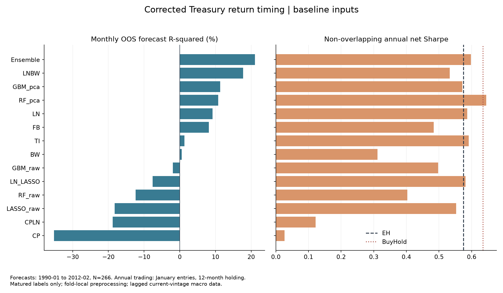
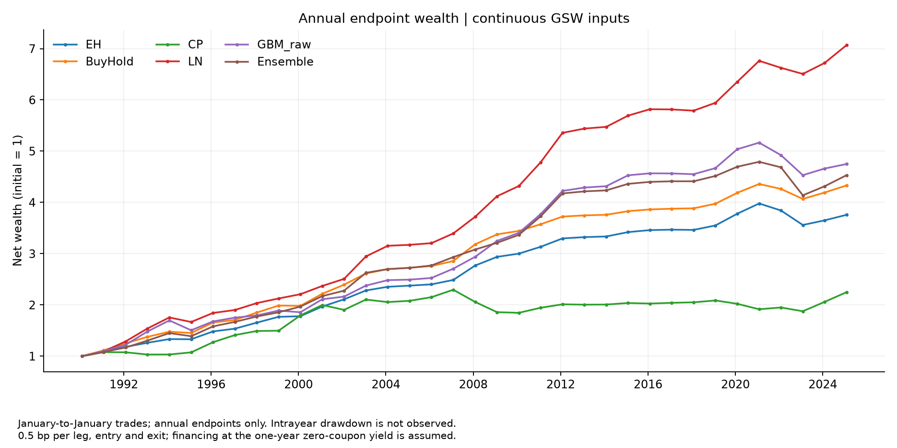
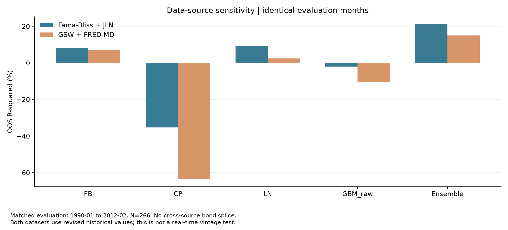
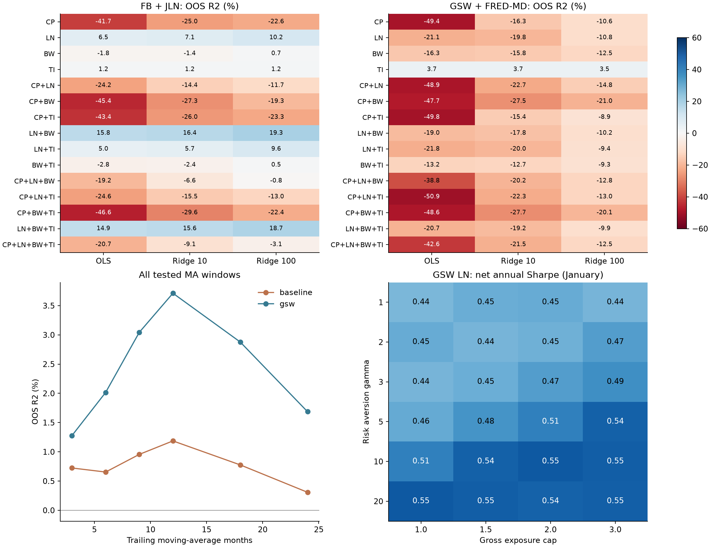
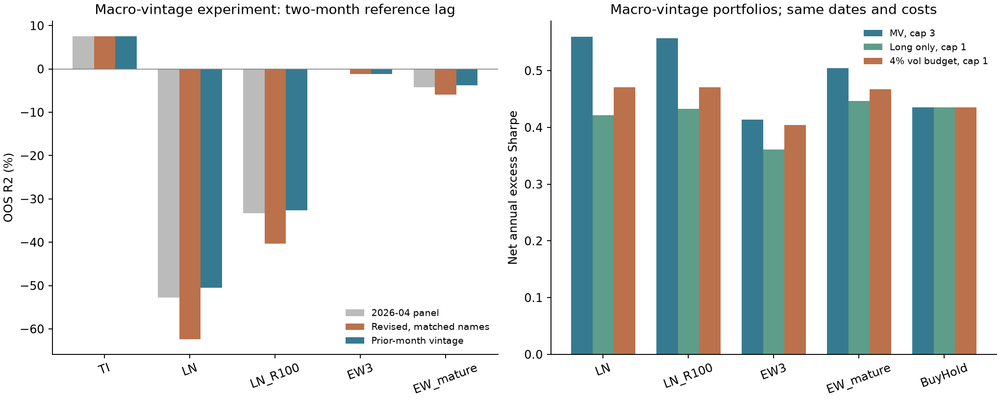
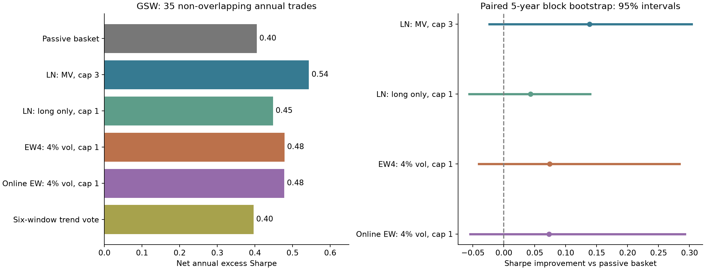
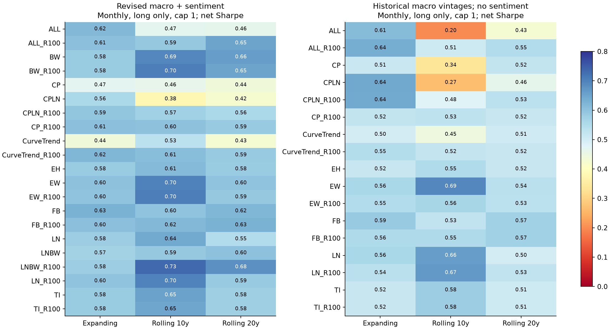
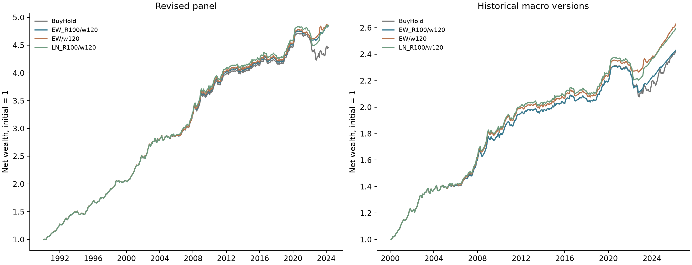

# 美国国债多因子预测与年度择时

一个可复现的固定收益课程研究项目：用收益率曲线、宏观经济、投资者情绪与机器学习，预测美国 2–5 年期零息国债未来一年的平均简单超额收益，并构建受杠杆限制的年度配置策略。

**研究重点是信息时点、模型比较与资产配置评价。** 最新的 [月度配置研究](#trading-designs) 在现有因子上加入滚动估计与预测收缩，得到仅多头、无杠杆的竞争性候选；另保留 [六项研究选择审计](#research-audit)，系统比较组合、均线周期、样本起点、风险约束与宏观历史版本。所有新增方案属于已接触历史样本后的探索，不称为预注册。

基础报告保留 CP、LN、BW 与 GBM_raw 的等权预测作为比较规格；其固定权重是在修正研究时制定。不同目标与交易频率的结果分别报告，不以事后排名替代选择依据。

修正版已处理标签前视、交叉验证泄漏、重叠收益复利、协方差估计和费用计量问题。基础表使用修订版宏观数据，新增实验使用逐月历史宏观版本；两者的范围、结果与限制分别披露。

## 1. 策略与信息时点

- 每月末形成未来 12 个月的收益预测，训练期从 1964 年开始，评价期从 1990 年开始，至少需要 120 个已兑现标签。
- 对预测月份 $t$，训练标签的买入月 $s$ 必须满足 **$s+12<t$**。例如 1990 年 1 月最多使用 1988 年 12 月买入、1989 年 12 月兑现的收益。
- 当月收益率曲线与技术指标使用 $t$ 月信息；宏观和情绪输入统一使用 **$t-2$** 月信息。另检验 1、2、3 个月的发布滞后。
- 月度重叠标签用于预测评价；经济回测固定每年 **1 月**建仓，持有 **12 个月**后全部平仓并重新建立下一年的仓位。两套评价使用不同观测频率，收益不会重复复利。

```text
当期收益率曲线 / 价格趋势 ─┐
滞后两月的宏观原始变量 ───┼→ 已兑现标签训练 → 每月一年期收益预测
滞后两月的情绪水平 ──────┘                     ↓
                             固定 1 月入场 → 持有一年 → 扣费净值与风险指标
```

### 收益目标

设 $P_t^{(n)}$ 为面值 100 的 $n$ 年期零息债券价格，$\ell_t^{(n)}=100\log(P_t^{(n)}/100)$，则连续复利年收益率为 $y_t^{(n)}=-\ell_t^{(n)}/n$。

从 $t$ 持有至 $t+12$ 月的**简单收益**及一年期无风险收益为：

$$
R_t^{(n)}=\exp\left(\frac{\ell_{t+12}^{(n-1)}-\ell_t^{(n)}}{100}\right)-1,\qquad
R_{f,t}=\exp(y_t^{(1)}/100)-1.
$$

主预测目标为：

$$
x_t=\frac{100}{4}\sum_{n=2}^{5}(R_t^{(n)}-R_{f,t}).
$$

代码以 `sx_bar` 存储 $x_t$，单位为百分点；保留 `rx_bar` 对数超额收益供公式对照。终值价格按**日历月份**定位，任一期限缺少必要价格时，整篮子收益不视为完整观测。文献公式对照脚本使用传统对数收益口径，不与本报告的简单收益数值混用。

## 2. 因子与模型

| 模型 | 因子如何计算与使用 |
| --- | --- |
| **EH** | 已兑现的一年期平均简单超额收益的扩展历史均值；EH 只是代码中的基准名称，不将优于它解释为严格拒绝预期假说 |
| **FB** | $f_t^{(n)}=\ell_t^{(n-1)}-\ell_t^{(n)}$，$fs_t^{(n)}=f_t^{(n)}-y_t^{(1)}$；对 2–5 年期远期利差取均值，用 OLS 预测收益 |
| **CP** | 将 $f_t^{(1)}=y_t^{(1)}$ 和 $f_t^{(2)},\ldots,f_t^{(5)}$ 联合输入 OLS；不强制回归系数呈帐篷形 |
| **TI** | 对各期限计算对数价格减去含当月在内的 12 个月移动平均，再跨期限取均值 |
| **LN** | 原始宏观序列按变量性质平稳化；在每个训练窗口筛选缺失率不超过 20% 的变量、以训练均值填补、标准化、PCA 提取 8 个主成分，再进行 OLS；不再硬编码事后选择的六项因子子集 |
| **LN_LASSO** | 同样提取 8 个宏观主成分，再用 LASSO 收缩预测系数 |
| **BW** | Baker–Wurgler `SENT` 水平及平方；按数据说明去掉不适合解释为情绪变化的差分项，也不使用有已知月度正交化跳点的 `SENT_ORTH` |
| **CPLN / LNBW** | 在同一个回归中联合使用远期利率与宏观主成分，或宏观主成分与情绪项 |
| **LASSO_raw / RF_raw / GBM_raw** | 直接使用平稳化的原始宏观变量，比较线性收缩与非线性模型；JLN 面板为 132 列，FRED-MD 文件为 126 列，每个训练窗口会继续筛选 |
| **RF_pca / GBM_pca** | 将训练窗口提取的 8 个宏观主成分输入树模型，检验压缩特征对预测的影响 |
| **Ensemble：基础比较组合** | CP、LN、BW、GBM_raw 四个预测各占 25%；权重不随样本外排名调整，属于回溯研究设定 |

宏观变换在 [`config.py`](bond_rp/config.py) 中逐变量指定，支持水平、差分、对数与对数差分；FRED-MD 使用文件首行的官方变换码。收益率、远期利率和价格趋势取自债券价格，不需要额外外部因子文件。PCA 主成分随训练窗口重新估计，编号不被固定解释为“增长因子”或“通胀因子”，经济解释需要另查当期载荷。

### 时间交叉验证

LASSO 使用三个按时间前推的验证折。每折的训练标签也满足 $s+12<v$，其中 $v$ 为该折验证期起始月；隔离区按实际日历月份判断。缺失率筛选、填补、标准化和 PCA **均在每个训练折内拟合**，然后应用于该折验证数据。

$\alpha$ 网格固定为 0.01–10 的 7 个对数间隔值，在首次预测与每年 1 月重新选择；模型系数仍逐月重估。LASSO 最大迭代次数 100,000，收敛告警会作为错误停止运行。RF 使用 100 棵树、最大深度 3；GBM 使用 100 棵树、深度 2、学习率 0.05、子采样 0.5；树模型随机种子为 42。这些是本项目配置，不宣称与参考论文程序逐项一致。

## 3. 真实持有期的仓位和费用核算

主组合将预测 $\widehat\mu_t=\widehat x_t/100$ 转为总风险敞口：

$$
w_t=\operatorname{clip}\left(\frac{\widehat\mu_t}{\gamma\widehat\sigma_t^2},-3,3\right),\qquad
\gamma=5,\qquad q_{n,t}=w_t/4.
$$

$\widehat\sigma_t^2$ 从决策时点之前已经兑现的历史篮子简单超额收益估计，每期重新计算。实际账户权重为 $q_{n,t}$，总绝对风险敞口 $\sum_n|q_{n,t}|\le3$；剩余现金或借款权重为 $1-\sum_n q_{n,t}$。

**融资假设：** 现金和借款均按买入日的一年期零息收益率计息，不另设借贷利差。该假设用于理论资产配置比较，尚未匹配国债或期货账户的真实融资条件。

每笔持仓都在一年后平仓，按单边成本 $c=0.5/10{,}000$，分别对买入本金和卖出市值收取费用；入场费用占用现金的利息也计入：

$$
C_t=c\sum_n|q_{n,t}|\left[(1+R_{f,t})+(1+R_t^{(n)})\right],
$$

$$
R_{p,t}^{net}=R_{f,t}+\sum_nq_{n,t}(R_t^{(n)}-R_{f,t})-C_t.
$$

所有年度交易**不重叠**；净值为 $V_{t+12}=V_t(1+R_{p,t}^{net})$。CAGR 根据实际年度交易数计算，夏普为年度简单超额收益均值除以标准差，不使用 $\sqrt{12}$。回撤从初始净值 1 开始计算，但只观测年度端点，**不能解释为年内最大回撤**。CER 为年收益均值减去 $\gamma/2$ 倍方差，ΔCER 与同一路径的 EH 比较。

`BuyHold` 为每年买入等权 2–5 年期篮子的被动基准，`Cash` 为一年期零息国债持有至到期。另有对角协方差与 Ledoit–Wolf 收缩的敏感性比较：协方差只用已兑现训练收益，不再使用测试期全样本，所有权重采用一致的 NAV 单位与总敞口限制。该比较将标量预测等量应用于各期限，不将它宣传为逐期限收益预测模型。

## 4. 修正后的结果

以下数据与图片由同一套报告入口生成，计算日期为 **2026-10-22**。每个预测表内部所有模型使用相同月份，年度交易表也使用同一组不重叠交易。旧版未经隔离的预测数字不再用于项目介绍。

### Fama–Bliss + JLN 基准数据

<!-- BEGIN BASELINE_SAMPLE -->
月度预测评价：**1990-01–2012-02，266 个月**；固定 1 月建仓的年度回测：**1990-01–2013-01，23 笔交易**。
<!-- END BASELINE_SAMPLE -->

<!-- BEGIN BASELINE_TABLE -->
| 模型 | 月度样本数 | OOS R² (%) | RMSE (百分点) | 方向命中 (%) |
| --- | --- | --- | --- | --- |
| EH | 266 | 0.00 | 3.47 | 76.32 |
| FB | 266 | 8.12 | 3.32 | 69.17 |
| CP | 266 | -35.21 | 4.03 | 52.63 |
| TI | 266 | 1.33 | 3.44 | 72.93 |
| LN | 266 | 9.22 | 3.30 | 73.31 |
| LN_LASSO | 266 | -7.59 | 3.60 | 77.07 |
| CPLN | 266 | -18.78 | 3.78 | 59.40 |
| BW | 266 | 0.56 | 3.46 | 59.40 |
| LNBW | 266 | 17.74 | 3.14 | 77.82 |
| LASSO_raw | 266 | -18.25 | 3.77 | 76.32 |
| RF_raw | 266 | -12.34 | 3.68 | 59.77 |
| GBM_raw | 266 | -1.92 | 3.50 | 69.92 |
| RF_pca | 266 | 10.77 | 3.28 | 69.55 |
| GBM_pca | 266 | 11.30 | 3.27 | 71.05 |
| Ensemble | 266 | 21.04 | 3.08 | 74.06 |
<!-- END BASELINE_TABLE -->

<!-- BEGIN BASELINE_ANNUAL -->
| 模型 | 年度交易数 | 扣费 CAGR (%) | 年收益波动 (%) | 超额收益夏普 | 年度端点回撤 (%) | ΔCER (bps) |
| --- | --- | --- | --- | --- | --- | --- |
| EH | 23 | 5.23 | 3.43 | 0.58 | 0.00 | 0.00 |
| FB | 23 | 7.04 | 7.12 | 0.48 | -10.44 | 100.29 |
| CP | 23 | 3.64 | 8.41 | 0.03 | -29.14 | -279.31 |
| TI | 23 | 5.62 | 3.67 | 0.59 | -0.56 | 35.11 |
| LN | 23 | 7.29 | 6.10 | 0.59 | -5.11 | 153.23 |
| LN_LASSO | 23 | 5.92 | 3.61 | 0.58 | -2.25 | 65.98 |
| CPLN | 23 | 4.41 | 8.46 | 0.12 | -20.70 | -204.75 |
| BW | 23 | 5.36 | 6.12 | 0.31 | -3.99 | -40.63 |
| LNBW | 23 | 7.26 | 6.73 | 0.53 | -10.63 | 134.53 |
| LASSO_raw | 23 | 6.44 | 4.92 | 0.55 | -3.31 | 94.63 |
| RF_raw | 23 | 6.39 | 6.80 | 0.40 | -12.29 | 45.15 |
| GBM_raw | 23 | 7.13 | 7.77 | 0.50 | -10.51 | 89.92 |
| RF_pca | 23 | 7.58 | 6.01 | 0.64 | -2.43 | 184.62 |
| GBM_pca | 23 | 7.59 | 7.12 | 0.57 | -7.61 | 155.56 |
| Ensemble | 23 | 6.69 | 5.26 | 0.60 | -3.74 | 112.99 |
| BuyHold | 23 | 5.87 | 4.56 | 0.63 | -1.71 | 44.95 |
| Cash | 23 | 3.73 | 2.39 | — | 0.00 | -137.85 |
<!-- END BASELINE_ANNUAL -->



### 连续 GSW + FRED-MD 扩展数据

扩展期从头到尾使用 GSW 曲线，消除了 FB/GSW 拼接断点。宏观面板使用 2026-04 版 FRED-MD；宏观预处理和 PCA 随已兑现训练窗口重新拟合。由于当前情绪文件截止 2023-12，含 BW 的全模型共同评价期也受其约束；不把无情绪模型较长的样本混入同一排行榜。

<!-- BEGIN EXTENSION_SAMPLE -->
月度预测评价：**1990-01–2024-02，410 个月**；固定 1 月建仓的年度回测：**1990-01–2025-01，35 笔交易**。
<!-- END EXTENSION_SAMPLE -->

<!-- BEGIN EXTENSION_TABLE -->
| 模型 | 月度样本数 | OOS R² (%) | RMSE (百分点) | 方向命中 (%) |
| --- | --- | --- | --- | --- |
| EH | 410 | 0.00 | 3.26 | 66.34 |
| FB | 410 | 3.96 | 3.20 | 59.02 |
| CP | 410 | -46.64 | 3.95 | 52.44 |
| TI | 410 | 3.74 | 3.20 | 64.88 |
| LN | 410 | -21.06 | 3.59 | 67.80 |
| LN_LASSO | 410 | -15.26 | 3.50 | 66.59 |
| CPLN | 410 | -47.11 | 3.96 | 58.54 |
| BW | 410 | -15.41 | 3.51 | 56.34 |
| LNBW | 410 | -18.07 | 3.55 | 66.10 |
| LASSO_raw | 410 | -13.16 | 3.47 | 66.34 |
| RF_raw | 410 | -12.69 | 3.46 | 57.80 |
| GBM_raw | 410 | -13.39 | 3.48 | 60.98 |
| RF_pca | 410 | 5.37 | 3.17 | 65.37 |
| GBM_pca | 410 | -3.93 | 3.33 | 64.88 |
| Ensemble | 410 | 8.02 | 3.13 | 63.66 |
<!-- END EXTENSION_TABLE -->

<!-- BEGIN EXTENSION_ANNUAL -->
| 模型 | 年度交易数 | 扣费 CAGR (%) | 年收益波动 (%) | 超额收益夏普 | 年度端点回撤 (%) | ΔCER (bps) |
| --- | --- | --- | --- | --- | --- | --- |
| EH | 35 | 3.86 | 4.12 | 0.29 | -10.54 | 0.00 |
| FB | 35 | 5.02 | 6.85 | 0.34 | -11.03 | 54.66 |
| CP | 35 | 2.34 | 6.78 | -0.08 | -19.59 | -210.48 |
| TI | 35 | 4.30 | 4.14 | 0.40 | -6.61 | 44.42 |
| LN | 35 | 5.75 | 5.76 | 0.54 | -5.02 | 155.54 |
| LN_LASSO | 35 | 4.65 | 5.09 | 0.36 | -10.41 | 61.13 |
| CPLN | 35 | 3.46 | 7.15 | 0.10 | -15.46 | -109.76 |
| BW | 35 | 3.49 | 6.43 | 0.12 | -18.77 | -86.03 |
| LNBW | 35 | 5.23 | 7.32 | 0.36 | -17.79 | 63.46 |
| LASSO_raw | 35 | 4.67 | 5.01 | 0.39 | -10.44 | 64.48 |
| RF_raw | 35 | 4.68 | 5.66 | 0.32 | -9.40 | 51.80 |
| GBM_raw | 35 | 4.55 | 6.51 | 0.28 | -12.28 | 17.89 |
| RF_pca | 35 | 4.51 | 5.05 | 0.35 | -2.79 | 47.34 |
| GBM_pca | 35 | 4.26 | 6.54 | 0.23 | -14.72 | -11.70 |
| Ensemble | 35 | 4.41 | 5.32 | 0.32 | -13.64 | 32.78 |
| BuyHold | 35 | 4.28 | 4.61 | 0.40 | -6.69 | 33.19 |
| Cash | 35 | 3.00 | 2.43 | — | 0.00 | -62.91 |
<!-- END EXTENSION_ANNUAL -->



### 数据源与样本时期的影响

先比较两个数据源的**相同评价月份**，再单独列出 GSW 2013 年后的预测结果，以减少把数据更换和时间延长混为一谈的问题。

<!-- BEGIN MATCHED_TABLE -->
| 数据与时期 | 模型 | 月数 | R² (%) |
| --- | --- | --- | --- |
| FB+JLN：共同期 | EH | 266 | 0.00 |
| FB+JLN：共同期 | CP | 266 | -35.21 |
| FB+JLN：共同期 | LN | 266 | 9.22 |
| FB+JLN：共同期 | Ensemble | 266 | 21.04 |
| GSW+FRED：共同期 | EH | 266 | 0.00 |
| GSW+FRED：共同期 | CP | 266 | -63.44 |
| GSW+FRED：共同期 | LN | 266 | 2.42 |
| GSW+FRED：共同期 | Ensemble | 266 | 15.01 |
| GSW+FRED：2013 年起 | EH | 134 | 0.00 |
| GSW+FRED：2013 年起 | CP | 134 | -2.85 |
| GSW+FRED：2013 年起 | LN | 134 | -78.27 |
| GSW+FRED：2013 年起 | Ensemble | 134 | -10.02 |
<!-- END MATCHED_TABLE -->



预测指标包括相对 EH 的 $R^2_{OOS}$、均方根预测误差和方向命中率。月度一年期标签仍有重叠，误差检验使用 18 阶 Newey–West HAC；嵌套 OLS 规格使用 Clark–West 调整，其余规格报告未调整的损失差检验。多模型 p 值另做 Holm 校正，完整统计保存在本地结果表；README 不以显著性星号代替稳健性判断。

## 5. 结论与稳健性

<!-- BEGIN FINDINGS -->
1. 在连续 GSW 扩展样本上，Ensemble 的预测 R² 在参与比较的预测模型（含历史均值基准）中最高，为 8.02%；这是模型比较结果，不用于事后挑选组合。
2. 固定权重的 Ensemble 规格预测 R² 为 8.02%，每年 1 月建仓的扣费 CAGR 为 4.41%，超额收益夏普为 0.32，基于 35 笔不重叠年度交易。EH 夏普为 0.29，等权持有基准的 CAGR 为 4.28%、夏普为 0.40；组合未在所有风险调整指标上胜过被动持有。
3. 将固定建仓月份从 1 月改为 1–12 月分别回测，该规格的夏普范围为 0.29–0.47。这 12 条路径相互重叠，不能合并成 12 倍独立样本。
4. 组合预测的损失差 HAC 检验 p 值为 0.135，Holm 校正后为 1.000。不将正的 R² 点估计直接解释为统计显著；预测精度、交易表现与不同数据源的稳健性需要分别判断。当前结果只支持对所列历史数据和交易假设的研究结论，不等于真实成交记录或实时信息有效性证明。
5. 单看 2013 年起的较晚样本，该组合预测 R² 为 -10.02%。应单独判断较晚时期的表现，不能从全样本的正 R² 外推跨时期稳健性。
<!-- END FINDINGS -->

报告还保存以下敏感性结果：固定建仓月份 1–12 月各自的完整年度路径（各自首尾月份与交易数可能不同）；单边交易费 0、0.5、2、5、10 bps；标量、对角和收缩协方差配置；线性模型在 1、2、3 个月宏观/情绪发布滞后下的同月份比较。没有根据这些检查反向调整主参数以美化主结果。

<!-- BEGIN SPECIFICATION_AUDIT -->
<a id="research-audit"></a>

### 5.1 六项质疑的补充审计与策略探索（2026-10-22）

**先纠正研究表述：不能由现有结果得出“没有好的投资策略”，也不能把历史赢家当成已经确认的策略。** 本轮扩大规格空间、加入递归选择和宏观历史版本检验，保留所有失败方案。新增结果属于已经看过历史数据后的探索；计算过程的无前视约束不能消除研究者的事后选择。

为控制比较，新增因子审计中的所有规格使用四类因子均可用的共同训练月份；1990 年首期为 280 个已兑现标签。因此这里的 EH、CP、LN 等数字与上方按各模型可用历史拟合的基础报告略有差异，两个实验分别保留，不混用。预测评价仍是月度一年期标签，投资评价仍是扣费、不重叠的年度交易。

**① 为什么 LN+CP、LN+BW？** 经济假设是分别结合曲线中的定价信息、宏观状态和情绪代理，但没有理论保证这两组最优。原先仅测试两组不足以支持选择。现在穷举 CP、LN、BW、TI 的全部 15 个非空子集，并对每组报告 OLS、Ridge α=10、100；惩罚施加在训练窗口标准化后的回归变量上，8 个宏观 PC 每期重新估计。

下表是各规格相对共同 EH 的 OOS R²（%），起点均为 1990-01；FB+JLN 截止 2012-02，GSW+FRED 截止 2024-02。Ridge 网格也是本次研究选择，不称为预注册。


| 因子子集 | FB OLS | FB R10 | FB R100 | GSW OLS | GSW R10 | GSW R100 |
| --- | --- | --- | --- | --- | --- | --- |
| CP | -41.66 | -24.98 | -22.59 | -49.36 | -16.30 | -10.65 |
| LN | 6.50 | 7.06 | 10.22 | -21.13 | -19.78 | -10.77 |
| BW | -1.76 | -1.41 | 0.65 | -16.30 | -15.82 | -12.52 |
| TI | 1.19 | 1.20 | 1.25 | 3.71 | 3.69 | 3.45 |
| CP+LN | -24.16 | -14.41 | -11.68 | -48.91 | -22.70 | -14.77 |
| CP+BW | -45.43 | -27.26 | -19.32 | -47.67 | -27.45 | -20.97 |
| CP+TI | -43.44 | -26.00 | -23.28 | -49.76 | -15.35 | -8.86 |
| LN+BW | 15.83 | 16.44 | 19.33 | -18.98 | -17.80 | -10.21 |
| LN+TI | 5.01 | 5.75 | 9.61 | -21.79 | -20.05 | -9.40 |
| BW+TI | -2.84 | -2.36 | 0.50 | -13.24 | -12.73 | -9.32 |
| CP+LN+BW | -19.24 | -6.64 | -0.85 | -38.84 | -20.18 | -12.79 |
| CP+LN+TI | -24.57 | -15.49 | -13.04 | -50.86 | -22.29 | -13.00 |
| CP+BW+TI | -46.63 | -29.61 | -22.36 | -48.64 | -27.70 | -20.15 |
| LN+BW+TI | 14.92 | 15.58 | 18.65 | -20.70 | -19.18 | -9.93 |
| CP+LN+BW+TI | -20.69 | -9.06 | -3.14 | -42.59 | -21.47 | -12.47 |

短样本中 LN+BW 及其收缩版本较强，延长到 GSW 样本后这种优势消失；加入更多因子也没有稳定改善。因而不再将 LN+CP 或 LN+BW 作为有充分证据支持的唯一选择。

另外比较四个单因子预测等权的 EW4，以及两个只能使用已兑现历史误差的算法：`EW_mature` 在最近 120 个买入月份中，按已兑现误差的 MSE 倒数分配预测权重；`Select_mature` 选其中历史 MSE 最小的规格。候选涵盖 EH、45 个子集/惩罚规格、六个均线模型与多窗口模型，共 53 个。至少累计 60 个已兑现误差后才启动；此前使用 EH。每个误差也满足 s+12<t，权重、选中模型和信息截止日均留档。它们是实际可递归执行的选择规则，不能用事后最好的模型替代其真实表现。

**② 为什么只用 12 期均线？** 原先没有证明 12 期优于其他周期。现在完整比较 3、6、9、12、18、24 期，另将六个指标联合输入 Ridge(100)，并让上述历史选择器有机会选择各周期。指标始终是各期限对数价格减去含当期在内的过去 k 月均值，再跨期限平均；没有用未来价格。


| 技术窗口 | FB OOS R² (%) | GSW OOS R² (%) |
| --- | --- | --- |
| MA3 | 0.72 | 1.28 |
| MA6 | 0.65 | 2.02 |
| MA9 | 0.96 | 3.04 |
| MA12 | 1.19 | 3.71 |
| MA18 | 0.78 | 2.88 |
| MA24 | 0.31 | 1.69 |
| 六窗口 Ridge(100) | -0.79 | 1.91 |

12 期在这组 GSW 历史结果中相对较好，但仍是事后观察，不能称为唯一正确周期；正 R² 的技术规格在扩大比较后的 Holm 校正下没有达到 5% 显著性。

**③ 换 1985、1995、2000 年是否成立？** 对无调参状态的逐月扩展 OLS/Ridge，给定同一预测月份，改变评价起点不会改变训练规则或拟合；它们可直接使用 1985 年起逐期生成的因果预测。两个递归选择器则在每个起点重新开始累计误差，不沿用更早测试期的选择记录。训练起点始终为 1964 年，未将“更换测试起点”误写成改变训练历史。

下列值为 OOS R²（%）；每张表内部的不同起点使用相同结束月，故改变的是评价时期及其历史均值误差分母。它们是嵌套、相关的历史窗口。


FB+JLN（结束 2012-02）：

| 模型 | 1985 起 | 1990 起 | 1995 起 | 2000 起 |
| --- | --- | --- | --- | --- |
| CP | -12.58 | -41.66 | -94.26 | -122.62 |
| LN | -1.52 | 6.50 | -9.64 | -13.43 |
| CP+LN | -5.54 | -24.16 | -74.29 | -97.64 |
| LN+BW | 6.32 | 15.83 | 19.72 | 16.92 |
| TI | 1.02 | 1.19 | 1.72 | 5.91 |
| EW4 | 12.60 | 12.02 | 10.02 | 8.36 |
| EW_mature | 9.00 | 5.26 | 11.37 | -5.65 |
| Select_mature | 1.04 | -11.81 | 12.49 | -8.80 |

GSW+FRED（结束 2024-02）：

| 模型 | 1985 起 | 1990 起 | 1995 起 | 2000 起 |
| --- | --- | --- | --- | --- |
| CP | -32.66 | -49.36 | -56.64 | -64.80 |
| LN | -20.36 | -21.13 | -44.43 | -52.30 |
| CP+LN | -35.48 | -48.91 | -71.61 | -82.65 |
| LN+BW | -18.33 | -18.98 | -33.05 | -42.36 |
| TI | 2.94 | 3.71 | 5.10 | 7.92 |
| EW4 | 4.99 | 4.99 | 5.12 | 2.44 |
| EW_mature | 3.32 | 0.48 | 1.05 | -6.87 |
| Select_mature | -13.06 | -23.36 | -12.65 | -28.10 |

结论随时期变化：不能说原组合在所有起点都成立。TI 的点估计相对稳定，而高维联合 OLS 和按历史误差选单一模型并未自动解决不稳定性。

**④ 为什么 γ=5、杠杆上限 3？** γ 是均值—方差效用中的风险厌恶偏好，上限是投资约束，二者都不是收益预测模型估计出的最佳值。原先没有证据证明 5 和 3 特别合适；现保留它们作为与基础报告对照的规格，另完整检验 γ∈{1,2,3,5,10,20}、cap∈{1,1.5,2,3} 的 24 个组合，不按夏普挑出“最优参数”。不同 γ 下的 CER 对应不同投资者，不能跨 γ 排名后选赢家。

GSW、1990 年起、固定 1 月入场的敏感性范围如下；被动篮子夏普为 0.40。范围仅覆盖所列网格，尚不意味着每个时期或建仓月份都优于被动。


| 模型 | 夏普最小 | 夏普最大 | CAGR 最小 (%) | CAGR 最大 (%) |
| --- | --- | --- | --- | --- |
| EH | 0.30 | 0.40 | 3.25 | 6.14 |
| LN | 0.44 | 0.55 | 3.79 | 6.59 |
| EW4 | 0.32 | 0.52 | 3.31 | 6.51 |
| EW_mature | 0.29 | 0.53 | 3.31 | 6.33 |
| Select_mature | 0.29 | 0.35 | 3.58 | 5.53 |

同时增加更容易解释的投资约束：`long_only` 将仓位限制在 [0,1]，剩余为一年期国债，不借款也不做空；`vol_target` 只用预测正负决定是否持有，再按“风险预算÷已兑现历史篮子波动”配置，上限为 1。2%、4%、6%、8% 的波动预算全部保存；4% 是展示用的圆整数风险预算，不能称为校准出的最优值。这里估计的是风险资产的超额收益波动，最终账户收益波动不一定等于预算。



**⑤ 是否处理实时版本和发布滞后？** 基础报告仅做了 1/2/3 个月参考期滞后，没有消除修订偏差。本轮新增读取[圣路易斯联储官方历史 FRED-MD](https://www.stlouisfed.org/research/economists/mccracken/fred-databases) 两个 ZIP：1999-08–2014-12、2015-01–2025-12。对月份 t，只使用 t−1 月的历史文件，读取该版本自己的变量与变换码，并重估其完整已知历史的填补、标准化、PCA 和回归。当前变量使用 t−lag 参考月；尾部零散缺失用训练均值处理，整个当期宏观行都不存在时拒绝生成宏观预测。

历史版本标签是月份，未取得逐系列的精确下载/发布日期日志，所以额外延迟一个版本月，保留保守的月度时点约定。[ALFRED 关于 observation date 与 real-time period 的说明](https://fred.stlouisfed.org/docs/api/fred/realtime_period.html)解释了为何参考月份与当时可见版本必须分开。

三个比较对象为：最新版完整面板、最新版中与当期历史文件同名的列、历史版本自身面板。后两者仍可能存在定义/变换码差别；因此差异包含修订、变量构成和可得性的共同影响，不能全部归因于数值修订。历史版本实验不使用 BW，因此不受 2023-12 情绪截止限制，使用全部已兑现债券标签。


宏观历史版本的共同评价期为 **2000-01–2025-05，305 个月**。下表为 OOS R²（%）：

| 参考期滞后 | 模型 | 新版完整 | 新版同名列 | 历史版本 |
| --- | --- | --- | --- | --- |
| 1 | LN | -66.60 | -78.32 | — |
| 1 | LN_R100 | -43.24 | -51.78 | — |
| 1 | EW3 | -0.51 | -1.88 | — |
| 1 | EW_mature | -8.28 | -10.66 | — |
| 2 | LN | -52.71 | -62.37 | -50.50 |
| 2 | LN_R100 | -33.35 | -40.37 | -32.67 |
| 2 | EW3 | -0.04 | -1.21 | -1.18 |
| 2 | EW_mature | -4.25 | -5.94 | -3.83 |
| 3 | LN | -47.36 | -50.91 | -49.29 |
| 3 | LN_R100 | -29.98 | -32.75 | -31.93 |
| 3 | EW3 | -0.19 | -0.69 | -1.12 |
| 3 | EW_mature | -2.58 | -2.90 | -3.13 |

在上述保守版本约定下，lag=1 时所有 t−1 参考月的宏观行均尚未存在，因此表中的“—”是不可估计，不能解释为零 R²。lag=2/3 使用实际已有数值，未用新版数据回填历史文件的缺失尾部。

**仍未完全修复的边界：** 1990 年起的全样本没有相应的完整月度宏观版本；JLN 与 BW 仍是后验版本，GSW 也使用当前下载的拟合曲线，尚未做债券曲线估计的历史版本重建。因此这里只能称为“宏观历史版本检验”，不能将整个交易系统称为严格 point-in-time。精确发布日期、情绪版本和可交易价格仍需另行补齐。



**⑥ 为什么 OOS R² 可能高于 IS R²？** 两个常见量的分母不同：

$$R^2_{IS}=1-\frac{SSE_{fit,train}}{\sum_{train}(x-\bar x_{train})^2},\qquad
R^2_{OOS,EH}=1-\frac{SSE_{recursive,test}}{\sum_{test}(x-\widehat x_{EH,t})^2}.$$

OLS 的训练拟合最优性质只针对相同样本、相同设计矩阵和同一固定系数问题，不对不同历史时期和不同基准的 R² 给出大小关系。现在同时计算初始训练拟合 R²、递归预测相对 EH 的 R²，以及把递归预测误差放到测试期样本均值分母后的 R²。最后一种均值使用了整个测试期，是诊断基准，不能交易。另保存对测试期事后重新拟合 OLS 的 R²，明确不作为样本外业绩。


| 数据 | 模型 | 初始 IS R² (%) | OOS/EH R² (%) | OOS/测试均值 R² (%) |
| --- | --- | --- | --- | --- |
| FB | LN | 9.08 | 6.50 | -16.37 |
| FB | LN+BW | 28.67 | 15.83 | -4.76 |
| FB | TI | 1.71 | 1.19 | -22.98 |
| GSW | LN | 9.74 | -21.13 | -31.03 |
| GSW | LN+BW | 29.46 | -18.98 | -28.70 |
| GSW | TI | 1.81 | 3.71 | -4.16 |

以 GSW/TI 为例：预测 MSE=10.176，EH 的 MSE=10.569，测试期样本均值的 MSE=9.770。所以相对 EH 是 +3.71%，换成同一测试期均值则为 -4.16%。这里高于初始 IS 的现象主要反映不同分母和时期，不能作为泛化超强的证据。旧版前视造成的异常也已通过标签隔离和训练期内 PCA 修正。

**进一步探索：有哪些值得保留的策略？** 将预测误差、经济效用和风险调整表现分开判断。LN 的幅度预测误差较大，并不排除其符号、截断后的仓位在部分年度具有价值；反过来，低预测 MSE 也不保证年度交易获利。这里报告实际产生的扣费仓位收益，不用预测 R² 替代投资回测。

下表为 GSW、1990-01 买入至 2025-01 卖出、35 笔年度交易；费用与基础报告相同。EW4 是 CP/LN/BW/TI 预测等权，不同于前面的含 GBM 的 Ensemble；`TrendVote` 以六种均线为正的比例直接作为篮子仓位，不拟合未来收益。


| 配置规则 | 净 CAGR (%) | 超额夏普 | 年度端点回撤 (%) |
| --- | --- | --- | --- |
| 被动篮子 | 4.28 | 0.40 | -6.69 |
| LN，γ5/cap3 | 5.79 | 0.54 | -5.87 |
| LN，仅多头/cap1 | 4.18 | 0.45 | -4.84 |
| EW4，4%预算/cap1 | 4.28 | 0.48 | -6.69 |
| 历史误差加权，4%/cap1 | 4.28 | 0.48 | -6.69 |
| 历史误差选模，γ5/cap3 | 4.64 | 0.31 | -11.28 |
| 六均线投票/cap1 | 3.85 | 0.40 | -1.06 |

为了避免只展示 1990 年这个起点，还检查了候选的年度投资结果。GSW 固定 1 月入场的夏普如下（共同结束于 2025-01）：

| 起始买入年 | LN γ5/cap3 | LN 仅多头/cap1 | 被动篮子 |
| --- | --- | --- | --- |
| 1985 | 0.33 | 0.40 | 0.43 |
| 1990 | 0.54 | 0.45 | 0.40 |
| 1995 | 0.57 | 0.45 | 0.37 |
| 2000 | 0.63 | 0.47 | 0.42 |

**1985 年起的窗口中，两个 LN 规则均未超过被动夏普**，因此不能宣称起点稳健。1990 年起仅多头 LN 的 12 个建仓月夏普范围为 0.42–0.63，其中 10 个月高于各自同月的被动基准；这些路径相关，不能当成 12 次独立确认。

LN 的 1 月入场均值—方差策略是有竞争力的历史候选；仅多头版本降低了借贷和卖空假设。风险预算 EW4/历史误差加权也值得研究，但收益改善主要出现在较早时期，并非稳定的新 alpha。分时期（固定 1 月入场）结果如下：


| 规则 | 买入年份 | 年度数 | 净 CAGR (%) | 超额夏普 |
| --- | --- | --- | --- | --- |
| BuyHold/long_only | 1990–2012 | 23 | 5.91 | 0.63 |
| LN/long_only | 1990–2012 | 23 | 5.60 | 0.64 |
| BuyHold/long_only | 2013+ | 12 | 1.22 | -0.13 |
| LN/long_only | 2013+ | 12 | 1.52 | 0.01 |
| EW4/vol_target | 1990–2012 | 23 | 5.86 | 0.77 |
| EW_mature/vol_target | 1990–2012 | 23 | 5.96 | 0.82 |
| EW4/vol_target | 2013+ | 12 | 1.33 | -0.07 |
| EW_mature/vol_target | 2013+ | 12 | 1.12 | -0.19 |

夏普优势的不确定性也必须保留。对同一年份的策略与被动收益做 5 年循环区块、5,000 次配对 bootstrap，得到以下 95% 区间（尚未校正策略搜索）：

| 规则 | 夏普差 | 95% 下界 | 95% 上界 |
| --- | --- | --- | --- |
| LN/scalar | 0.14 | -0.02 | 0.30 |
| LN/long_only | 0.04 | -0.06 | 0.14 |
| EW4/vol_target | 0.07 | -0.04 | 0.28 |
| EW_mature/vol_target | 0.07 | -0.05 | 0.29 |

所有这些区间都跨越零，当前证据支持“存在值得继续验证的候选”，不足以声称已经确认跑赢被动。多模型月度检验另保存 Holm p 值；它不能覆盖所有研究者选择、风险参数和策略试验。

在宏观历史版本实验的 **2000-01–2026-01、26 笔年度交易**中，主要候选如下（评价期与上一表不同，不能直接横比 CAGR）：

| 规则 | 净 CAGR (%) | 超额夏普 | 年度端点回撤 (%) |
| --- | --- | --- | --- |
| BuyHold/scalar | 3.29 | 0.44 | -6.69 |
| LN/scalar | 4.87 | 0.56 | -7.71 |
| LN_R100/scalar | 4.70 | 0.56 | -8.07 |
| LN/long_only | 3.14 | 0.42 | -6.69 |
| EW_mature/vol_target | 3.26 | 0.47 | -6.69 |

历史版本候选也保存了 24 组 γ/cap、12 个固定入场月、0–10 bps 成本与配对 bootstrap。上述限制与置信区间仍适用。全部新增逐期预测、选择权重、覆盖率、交易和敏感性矩阵保存在本地 `output/research_audit/`，README 与图片由同一批 CSV 生成；不上传原始数据。


<!-- END SPECIFICATION_AUDIT -->

<!-- BEGIN TRADING_DESIGNS -->
<a id="trading-designs"></a>

### 5.2 从因子预测到可交易策略：滚动估计与月度配置

**继续探索后的判断：原年度实现限制了策略的适应速度，不能据此否定现有因子的价值。** 维持已兑现标签与宏观可得性约束后，改用月度目标、滚动估计和预测收缩，得到风险收益表现更好的候选。本节是新增的策略设计研究，参数及规则均披露，不把经过探索的历史样本重新称为盲测。

先保留原来的年度目标，测试扩展、10 年和 20 年滚动窗口；单靠滚动估计并未稳定超过原 LN 年度方案。因此另建立**一月期预测、一月持有、每月调仓**的策略。年目标的训练标签仍需等待 12 个月兑现；月目标则只需等待一月兑现，统一要求 s+h<t，没有把未兑现的年收益提前加入训练。

**使用的仍是现有因子：** FB/CP 曲线、LN 的 8 个训练宏观 PC、BW 水平及平方、TI 价格趋势。比较扩展/120/240 月窗口；OLS/Ridge(100)；各组联合回归与等权预测；仅多头、双向均值—方差、波动预算、对角风险配置和初始久期中性五类交易设计。预测分别输出 2/3/4/5 年期收益。完整面板为 63 个基础预测规格，宏观历史版本面板为 51 个；另各加 6 个跨窗口组合/历史均值规格，不将最好的规格悄悄替换为预先指定模型。

展示用的四因子组合把 CP/LN/BW/TI 预测等权平均，再按同一训练窗口历史均值收缩：

$$\widetilde\mu_t=\bar\mu_{train,t}+0.5(\widehat\mu_t-\bar\mu_{train,t}),\qquad
w_t=\operatorname{clip}\left(\frac{\operatorname{mean}_n\widetilde\mu_{n,t}}{5\widehat\sigma_{monthly,t}^2},0,1\right).$$

主展示用 120 月训练窗口、最近 60 个已兑现月收益估计风险，每期等权持有各期限，总仓位在 0–100%，余款持有短期国库券。收缩系数 0/0.25/0.5/1、风险窗口 60/120 月都保留比较；不宣称 0.5 或 120 月已经被证明最优。仅多头方案不使用借款或卖空。

**月收益如何计算。** 使用原 GSW 文件中的 BETA0–3、TAU1–2 重建 Svensson 曲线，并与官方 1–5 年期收益率核对至公布精度。买入 n 年期债券，一个月后按剩余 n−1/12 年重新定价：

$$R_{t,t+1}^{(n)}=\exp\{[-(n-1/12)y_{t+1}(n-1/12)+ny_t(n)]/100\}-1.$$

此处 y 为百分数。该公式计入债券期限缩短，不把相同恒定期限的价格差当成实际持有收益。[GSW 官方方法](https://www.federalreserve.gov/pubs/feds/2006/200628/index.html)支持由曲线计算不同到期日的零息价格，同时也说明极短端拟合有局限。

因此现金基准改用 [Kenneth French 官方 RF](https://mba.tuck.dartmouth.edu/pages/faculty/ken.french/Data_Library/f-f_factors.html) 的月度国库券收益，按实际持有的下一月对齐；未引入其股票因子。RF 是已实现现金收益基准，未来现金收益不进入预测或仓位规则。另比较 GSW 一年期收益率折算及短端外推口径。每月按全部本金买入、全部卖出市值扣除费用，并计入入场费用占用现金的利息；双向杠杆方案另计超过净值部分的 50 bps 年化借款利差。卖空融券及真实成交条件仍是模型化假设。

**与被动策略的同月份比较。** 下表为修订版宏观与情绪面板，1990-01 买入至 2024-03 卖出，共 410 个不重叠月收益；单边费用 0.5 bps。夏普统一由月度简单超额收益年化，回撤现在覆盖月末路径，不能与上一节仅观察年度端点的回撤直接横比。被动篮子也每月恢复 2–5 年恒定期限，并使用相同成本。


| 规则 | 净 CAGR (%) | 超额夏普 | 月末回撤 (%) | 平均风险仓位 (%) |
| --- | --- | --- | --- | --- |
| BuyHold | 4.47 | 0.58 | -10.28 | 100.00 |
| EH/w120 | 4.51 | 0.61 | -10.24 | 96.49 |
| EW_R100/w120 | 4.73 | 0.70 | -4.04 | 94.56 |
| EW/w120 | 4.73 | 0.70 | -4.04 | 94.44 |
| LN_R100/w120 | 4.74 | 0.70 | -7.14 | 94.15 |
| LNBW_R100/w120 | 4.82 | 0.73 | -4.04 | 92.95 |
| TrendVote | 4.11 | 0.63 | -3.75 | 53.29 |

`EW_R100/w120` 为四个 Ridge 单因子模型预测等权、10 年滚动估计；`EW/w120` 为对应 OLS 版本。`LNBW_R100/w120` 是联合回归候选，其排名来自本轮事后观察，不能拿它替代完整网格的表现。

为检查月度夏普年化口径的影响，再把相同交易逐个合成为连续、不重叠的 12 月账户收益，现金收益也同期复利；丢弃末尾不足一年的观测。34 个完整年度区块的夏普如下，不使用 √12：

| 规则 | 完整年度数 | 年度区块夏普 |
| --- | --- | --- |
| BuyHold | 34 | 0.47 |
| EW_R100/w120 | 34 | 0.56 |
| EW/w120 | 34 | 0.56 |
| LN_R100/w120 | 34 | 0.56 |

月度表的年化夏普是常用描述统计；有自相关时，它不等于真实一年持有期夏普。年度区块检查和下方区块 bootstrap 提供另外两种观察方式。

**避免再次按历史排名选择 10 年窗口。** 还将 OLS/Ridge × 扩展/10 年/20 年的六个 EW 专家组合，报告固定等权 `EW/mix`、按已兑现预测 MSE 倒数加权的 `EW/online` 和按历史最小 MSE 选择的 `EW/select`。后两者只使用最近 60 个买入月份中已兑现的一月预测误差，至少 36 个误差后启动，此前等权；所有截止日、权重和选择均留档。组合仍收缩到相同权重的各窗口历史均值，交易约束保持一致。

| 面板 | 规则 | 净 CAGR (%) | 超额夏普 | 月末回撤 (%) |
| --- | --- | --- | --- | --- |
| 新版四因子 | BuyHold | 4.47 | 0.58 | -10.28 |
| 新版四因子 | EW/mix | 4.48 | 0.59 | -10.04 |
| 新版四因子 | EW/online | 4.48 | 0.59 | -10.04 |
| 新版四因子 | EW/select | 4.67 | 0.67 | -5.91 |
| 历史宏观 | BuyHold | 3.46 | 0.52 | -10.28 |
| 历史宏观 | EW/mix | 3.47 | 0.53 | -9.71 |
| 历史宏观 | EW/online | 3.47 | 0.53 | -9.70 |
| 历史宏观 | EW/select | 3.45 | 0.54 | -10.25 |

递归权重可使用评价起点前已生成、当时能够形成的历史预测作为内部验证，不按展示窗口清空合法历史；历史宏观版本受档案起始月限制，有更长的等权启动阶段。自适应不保证胜过每个固定专家，其实际结果也保留。



**候选能否经受更严格的执行检查？** 对四因子 Ridge 等权版本，仅改变一项条件，使用同一结束月份：

| 条件 | 策略 CAGR (%) | 策略夏普 | 被动 CAGR (%) | 被动夏普 |
| --- | --- | --- | --- | --- |
| 1985 年起 | 5.19 | 0.66 | 5.24 | 0.61 |
| 1990 年起 | 4.73 | 0.70 | 4.47 | 0.58 |
| 2000 年起 | 3.65 | 0.71 | 3.29 | 0.53 |
| 2013 年起 | 1.60 | 0.24 | 0.92 | -0.07 |
| 单边成本 2 bps | 4.37 | 0.59 | 4.10 | 0.47 |
| 单边成本 5 bps | 3.66 | 0.36 | 3.35 | 0.24 |
| 单边成本 10 bps | 2.49 | -0.02 | 2.12 | -0.13 |
| 延迟一月执行 | 4.65 | 0.67 | 4.47 | 0.58 |
| 风险估计使用 120 月 | 4.70 | 0.69 | 4.47 | 0.58 |

延迟一月执行使用上个月已形成的预测和趋势信号，不增加样本末端的一月收益。2–5 bps 下优势点估计仍在；10 bps 下策略超额夏普转负，成本不可忽略。较晚时期的绝对收益能力也较弱，不能从全样本约 0.70 的夏普外推今后的水平。

| 规则 | 买入年份 | 净 CAGR (%) | 超额夏普 | 月末回撤 (%) |
| --- | --- | --- | --- | --- |
| BuyHold | 1990–2012 | 6.24 | 0.85 | -4.04 |
| EW_R100/w120 | 1990–2012 | 6.28 | 0.86 | -4.04 |
| BuyHold | 2013+ | 0.92 | -0.07 | -10.28 |
| EW_R100/w120 | 2013+ | 1.60 | 0.24 | -3.60 |

**宏观历史版本复核。** 该部分只使用 CP/LN/TI；未取得 BW 历史版本，故不将四因子新版组合包装成严格实时策略。EW 在这里表示三个单因子预测等权，和上表的四因子组合分别报告。样本为 2000-01–2026-02，共 313 个已兑现月收益，沿用同一交易、收缩与风险规则。

| 规则 | 净 CAGR (%) | 超额夏普 | 月末回撤 (%) |
| --- | --- | --- | --- |
| BuyHold | 3.46 | 0.52 | -10.28 |
| EH/w120 | 3.44 | 0.55 | -10.24 |
| EW/w120 | 3.77 | 0.69 | -3.82 |
| EW_R100/w120 | 3.46 | 0.56 | -8.67 |
| LN_R100/w120 | 3.72 | 0.67 | -7.19 |

历史版本中 OLS 等权与 Ridge 等权表现不同，不能说收缩模型处处占优。这里继续保留完整网格及旧年度方案；GSW 曲线与 RF 仍是当前下载版本，历史宏观文件也只提供月度时点，整套系统仍非严格历史逐日可成交记录。



**统计和搜索的不确定性。** 对月度策略/被动同月份收益做配对循环区块 bootstrap，分别用 12/36 月区块、5,000 次重复。以下是夏普差的 95% 区间，尚未覆盖研究者的全部选择：

| 面板 | 规则 | 区块月数 | 夏普差 | 95% 下界 | 95% 上界 |
| --- | --- | --- | --- | --- | --- |
| 新版四因子 | EW_R100/w120 | 12 | 0.12 | 0.00 | 0.28 |
| 新版四因子 | EW_R100/w120 | 36 | 0.12 | 0.00 | 0.30 |
| 新版四因子 | EW/w120 | 12 | 0.12 | -0.01 | 0.30 |
| 新版四因子 | EW/w120 | 36 | 0.12 | -0.01 | 0.29 |
| 历史宏观 | EW/w120 | 12 | 0.18 | 0.01 | 0.37 |
| 历史宏观 | EW/w120 | 36 | 0.18 | 0.01 | 0.37 |
| 历史宏观 | LN_R100/w120 | 12 | 0.15 | 0.00 | 0.32 |
| 历史宏观 | LN_R100/w120 | 36 | 0.15 | 0.00 | 0.30 |

另保存预测损失的 HAC/全规格 Holm 校正，以及各交易设计相对被动超额收益回归的 HAC α 与多重比较校正。这些诊断不能把同一段反复研究过的历史变成独立确认。当前更有根据的结论是：**现有因子可以构建有竞争力的配置规则，收益目标、估计窗口和交易频率会显著影响其经济价值；仍需对未来新增数据作独立验证。**

例如四因子 Ridge 候选相对被动的线性超额收益回归，年化 HAC α 点估计为 0.44%、单边 p=0.044；涵盖全部模型/交易设计的 Holm p=1.000。因此个别未校正区间略高于零也不构成完成模型搜索后的显著性证明。

新增逐期预测、四期限仓位、月度现金流、全部五类交易设计、失败模型、敏感性与统计诊断保存在本地 `output/trading_designs/`。原始数据继续留在本地，仓库只发布代码、README、依赖和展示图。
<!-- END TRADING_DESIGNS -->

## 6. 已修复的问题与仍然存在的边界

| 已修复 | 现在如何处理 |
| --- | --- |
| 前一年买入但尚未兑现的收益进入训练 | 每次拟合与每个验证折都检查标签兑现月份 |
| 普通 K 折和全样本预处理泄漏 | 前推验证、按日历隔离一年、折内填补/缩放/PCA |
| 固定的事后因子子集 | LN 使用完整 8 个训练主成分，LASSO 通过历史时间验证收缩 |
| 重叠一年期收益被当成月收益复利 | 主经济评价采用不重叠年度持仓和简单收益 |
| 测试期协方差、非标准缩放和权重单位混乱 | 仅使用已兑现训练收益；标准 Ledoit–Wolf；按 NAV 权重限制总敞口 |
| 费用只看信号权重变化 | 年度持仓逐笔计算进出本金/市值费用与现金占用 |
| 初始亏损未计入回撤 | 净值序列显式包含初始资金 1 |
| BW 差分与正交化跳点 | 使用滞后 SENT 水平及平方 |
| FB/GSW 直接拼接 | 基准和连续 GSW 独立评价，另按共同月份比较 |
| 普通 CW 标准误处理重叠标签 | HAC，并保留多模型校正后的诊断结果 |

仍然存在的正常研究限制：

- **基础报告使用修订版；新增宏观历史版本实验仍有边界。** 两个月滞后不能消除修订偏差；新增实验按历史宏观版本重估，但尚未取得全样本宏观、情绪和债券估计曲线的全部历史版本及精确发布日志，不能将整套系统称为严格实时回测。
- **不是未看过的封存测试集。** 方法修复发生在已查看旧版历史结果之后；递归检验隔离了每次模型拟合的信息，但无法抹去研究者的历史样本接触。独立确认需要后续新增数据或预先封存样本。
- **交易是理论组合。** 使用拟合零息价格和月末成交假设，尚未实现合约映射、真实报价与成交、融资利差、保证金、卖空限制及冲击成本。0.5 bps 为费用假设。
- **独立样本有限。** 不把月度观测数当作独立年度收益数。年度端点回撤未覆盖年内风险，新增月末回撤也未覆盖月内路径；多个建仓月份及相邻历史窗口的结果彼此相关。
- **模型和数据源风险。** 固定树模型参数没有覆盖所有模型选择不确定性；更新宏观面板和收益率估计方法会改变历史结果。预测能力和交易表现均可能随市场环境变化。

这些边界与代码错误分开披露，方便复查和面试讨论。

## 7. 数据来源与准备

仓库只发布代码、README、依赖声明与结果图片；原始数据、文献、笔记、虚拟环境、uv 锁文件和本地忽略规则均不上传。以下公开页面已于 **2026-10-21** 核对。数据源的最新版本可能与本项目保存的历史文件不同。

| 本地文件 | 使用方式 / 必要格式 | 来源与可核验范围 |
| --- | --- | --- |
| `Fama_Bliss_price.txt` | 主分析与文献复现；本地价格覆盖 1953-01–2013-12，1–5 年期；空白分隔，无表头，每行依次为 `YYYYMMDD p1 p2 p3 p4 p5`，价格按面值 100；`%` 开头为注释 | 对应 [CRSP US Treasury / Fama–Bliss Discount Bonds](https://www.crsp.org/research__trashed/crsp-us-treasury-database/) 与 [官方字段指南](https://www.crsp.org/wp-content/uploads/guides/CRSP_US_Treasury_Database_Guide_for_SAS_ASCII_EXCEL_R.pdf)。本地文件是已有课程输入，未找到能证明其确切下载版本的记录；CRSP 数据通常需机构授权，不能承诺匿名下载同一文件 |
| `macro_raw_data.xlsx` | 主分析；读取 `macrodata` 工作表，要求 `year`、`month` 以及 `config.TRANSFORM` 中的系列名称；实际使用 132 个序列 | 工作簿 `description` 明确标注 Jurado–Ludvigson–Ng “Measuring Uncertainty”，1960:01–2011:12，132 个宏观变量。可从 [Ludvigson 数据与附录页](https://www.sydneyludvigson.com/data-and-appendixes)查找对应大型数据集。此面板用于 LN 思路的重新估计，不是 2009 年原论文同版本数据；官网条目所标起始月与本地表有差异，未核验文件逐字节一致 |
| `SENTIMENT.xlsx` | 主分析；`DATA` 工作表包含 `yearmo`（YYYYMM）、`SENT`；修正版读取 `SENT` 水平并计算平方，不再使用差分项 | [Baker–Wurgler 作者数据页](https://pages.stern.nyu.edu/~jwurgler/main.htm)及[官方 Excel 链接](https://pages.stern.nyu.edu/~jwurgler/data/SENTIMENT.xlsx)；本地有效情绪数据截止 2023-12，不以官网当前最新截止日期替代 |
| `GSW_yields.csv` | 扩展部分全期使用 GSW，不与 FB 拼接；保留官方说明行及第 10 行表头，读取 `Date`、`SVENY01`–`SVENY05`，取每月最后观测，按 $\ell^{(n)}=-ny^{(n)}$ 转换 | [美联储名义收益率曲线说明](https://www.federalreserve.gov/data/nominal-yield-curve.htm)与[官方 CSV](https://www.federalreserve.gov/data/yield-curve-tables/feds200628.csv)，即 Gürkaynak–Sack–Wright 估计曲线；是模型拟合零息收益率 |
| `2026-04-MD.csv` | 扩展分析；`sasdate` 为日期列，第一条数据行保留变换码 | [圣路易斯联储 FRED-MD 页面](https://www.stlouisfed.org/research/economists/mccracken/fred-databases)与[2026-04 官方文件](https://www.stlouisfed.org/-/media/project/frbstl/stlouisfed/research/fred-md/monthly/2026-04-md.csv)；保持该版本以便比较 |
| `fred_md_vintages_1999_2014.zip` | 宏观历史版本实验；直接读取 ZIP 内按月份命名的 CSV，无需解压 | [官方历史版本 1999-08–2014-12](https://www.stlouisfed.org/-/media/project/frbstl/stlouisfed/research/fred-md/historical_fred-md.zip)，2026-10-22 下载 |
| `fred_md_vintages_2015_2025.zip` | 同上；每份文件使用自身变换码与可用面板 | [官方历史版本 2015-01–2025-12](https://www.stlouisfed.org/-/media/project/frbstl/stlouisfed/research/fred-md/historical-vintages-of-fred-md-2015-01-to-2025-12.zip)，2026-10-22 下载 |
| `F-F_Research_Data_Factors_CSV.zip` | 仅新增月度策略使用；只读取月度 `RF`，按下一月持有期对齐，不使用股票因子 | [Kenneth French 官方文件](https://mba.tuck.dartmouth.edu/pages/faculty/ken.french/ftp/F-F_Research_Data_Factors_CSV.zip)及[字段说明](https://mba.tuck.dartmouth.edu/pages/faculty/ken.french/Data_Library/f-f_factors.html)，2026-10-22 下载，文件版本 2026-08；2024-05 前 RF 来自 Ibbotson，之后来自 ICE BofA 一月国库券指数 |
| `RFS2009.xls`（可选） | 仅用于 `code/replicate_papers.py` 末尾的历史数据对照；缺失时跳过对照，不参与主预测因子构造 | [Ludvigson 数据页](https://www.sydneyludvigson.com/data-and-appendixes)中 2009 RFS 与 Factor Analysis 数据入口；保留原工作表结构 |

默认将文件放入项目根目录下的 `GroupProjectData/`，也可用环境变量 `BOND_RP_DATA_DIR` 指定自己的数据目录。基准报告和文献公式计算只需前三个文件；完整分析还需 GSW 与 FRED-MD；文献脚本可选使用 `RFS2009.xls` 做额外校验。


## 8. 安装、复现与测试

Python 3.11 或以上。原始文件放在 `GroupProjectData/`，或通过 `BOND_RP_DATA_DIR` 指定目录。依赖声明保存在 `pyproject.toml`；无需使用 uv 才能运行。

```bash
python3 -m venv .venv
source .venv/bin/activate
python -m pip install -e '.[report]'

# 数据时点、未来数据扰动、费用恒等式与风险指标的回归测试
python -m unittest discover -s tests -v

# 重建全部修正后结果、图表和 README
python scripts/run_analysis.py --update-readme

# 等价的显式入口
python scripts/export_readme_results.py --with-ml --with-extensions --update-readme

# 重建六项研究选择审计（两个数据源；全部组合和风险参数）
OPENBLAS_NUM_THREADS=1 OMP_NUM_THREADS=1 python scripts/audit_research_choices.py

# 下载官方历史宏观版本并检验；已下载时复用本地文件
OPENBLAS_NUM_THREADS=1 OMP_NUM_THREADS=1 python scripts/audit_macro_vintages.py --download

# 从新增实验 CSV 生成三张图并更新 README 审计部分
python scripts/export_research_audit.py --update-readme

# 滚动估计、一月期收益预测与月度配置；--download 补齐官方 RF 文件
OPENBLAS_NUM_THREADS=1 OMP_NUM_THREADS=1 python scripts/explore_trading_designs.py --download
python scripts/export_trading_results.py --update-readme

# 独立的基础文献样本内公式对照（不属于样本外业绩）
python code/replicate_papers.py
```

`uv run --extra report scripts/run_analysis.py --update-readme` 也可使用。省略 `--with-ml` 和 `--with-extensions` 的导出入口可运行较快的基准模型比较；此时不要加 `--update-readme`。

本地 `output/corrected/` 保存逐期预测、每次拟合的训练截止日、LASSO 参数、年度持仓/收益、模型统计和稳健性表。缓存键包含算法文件、配置、数据文件和库版本的 SHA-256 指纹；变更后自动失效，也可用 `--refresh` 强制重算。图片保存到 `assets/`。数据与中间结果不上传。

<!-- BEGIN ENVIRONMENT -->
| 依赖 | 版本 |
| --- | --- |
| numpy | 2.4.6 |
| pandas | 3.0.3 |
| scikit-learn | 1.8.0 |
| statsmodels | 0.14.6 |
| matplotlib | 3.11.2 |
<!-- END ENVIRONMENT -->

## 9. 项目结构

```text
bond_rp/
  config.py                 参数、时间约定和宏观变换码
  data.py                   精确日历收益、宏观原始变量与情绪输入
  models.py                 已兑现标签训练、折内 PCA 与隔离时间验证
  strategy.py               不重叠年度交易、融资、费用和协方差配置
  metrics.py                HAC 检验与年度收益指标
  tables.py                 相同样本的比较和稳健性结果
  robustness.py             全因子子集、多周期、递归选模与区块 bootstrap
  vintages.py               月度 FRED-MD 历史版本及自身变换码
  trading.py                Svensson 逐月定价、滚动预测及月度现金流
scripts/
  run_analysis.py            修正后的完整研究入口
  export_readme_results.py   带缓存和审计记录的报告生成
  audit_research_choices.py  因子、均线、起点及风险参数的完整审计
  audit_macro_vintages.py    宏观版本、滞后、覆盖率与策略验证
  export_research_audit.py   六项问题的表格、解释与三张图
  explore_trading_designs.py 年度/一月目标、滚动窗口与五类交易规则
  export_trading_results.py  月度策略展示、HAC α 和区块统计
code/
  replicate_papers.py        文献样本内公式对照
  strategy_analysis.py       转入统一入口的兼容命令
tests/
  test_research_protocol.py  无需原始数据的回归测试
  test_specification_audit.py 新增选择器与版本可得性回归测试
  test_trading_designs.py    债券期限缩短、月度时点与现金流恒等式
assets/                     八张展示图
pyproject.toml
README.md
```

方法参考 Fama–Bliss、Cochrane–Piazzesi、Ludvigson–Ng、Goh 等、Baker–Wurgler / Laborda–Olmo 和 Bianchi–Büchner–Tamoni 的研究。采用论文启发的模型，不将当前更新数据与简化配置包装成完整原文复现。时间验证与预处理参考 [scikit-learn 的防泄漏说明](https://scikit-learn.org/stable/common_pitfalls.html#data-leakage)与[时间切分文档](https://scikit-learn.org/stable/modules/generated/sklearn.model_selection.TimeSeriesSplit.html)，误差推断参考 [statsmodels 的 HAC 实现](https://www.statsmodels.org/stable/generated/statsmodels.stats.sandwich_covariance.cov_hac.html)。Bianchi 等另有[关于预测信息可得性的勘误](https://doi.org/10.1093/rfs/hhaa098)。

## 10. 项目实现总结

<!-- BEGIN RESUME -->
搭建美国国债多因子收益预测与月度资产配置框架，结合曲线、宏观 PCA、情绪与技术指标；实现标签兑现隔离、滚动估计、预测收缩、宏观历史版本检验和含成本的债券逐月定价回测。

探索性历史回测中，四因子等权预测、10 年滚动训练、仅多头无杠杆组合在 1990-01–2024-03 410 个非重叠月收益上，扣费 CAGR 4.73%、月度年化超额夏普 0.70；同期被动约为 4.47%/0.58。收益基于拟合零息曲线及所列成本假设，非实盘记录；历史搜索与独立验证边界详见策略研究部分。
<!-- END RESUME -->
