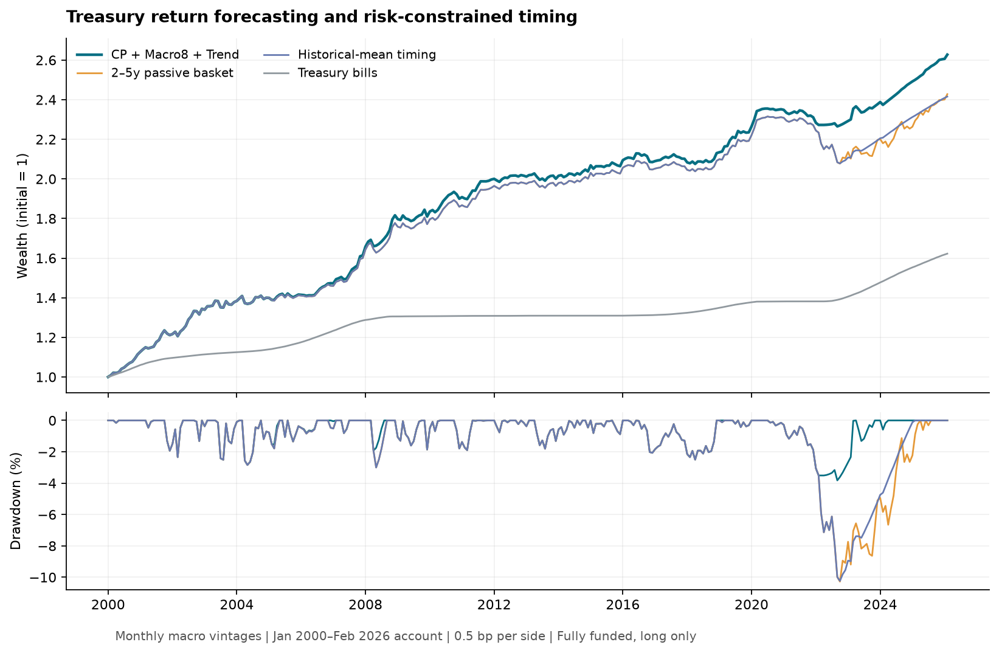
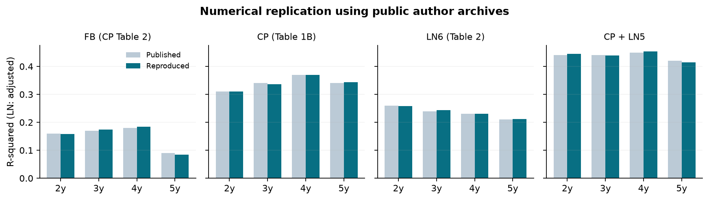
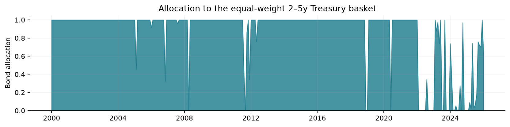

# 美国国债风险溢价预测与风险约束择时

基于 Fama–Bliss、Cochrane–Piazzesi 和 Ludvigson–Ng 的债券收益预测框架，构建 **CP＋宏观主成分＋价格趋势** 等权预测组合，在 2–5 年期零息国债篮子与短期国库券之间进行月度配置。

本项目完成课程要求的 EH、FB、CP、LN 因子、样本内与样本外分析、多预测期限和经济价值评价。主策略使用历史宏观版本、滚动估计、现金约束和交易费用，代码同时提供原论文数值核验。研究结论是：**组合信号在这段历史上改善了债券配置的风险收益表现，价值主要体现在回撤控制；均值可预测性与收益增益的统计证据仍有限。**

## 结果

<!-- RESULTS -->
建仓月份为 **2000-01 至 2026-01**，最后卖出月份为 **2026-02**，共 313 个连续月度账户。下表为历史宏观版本主实验；债券买卖双边各扣 0.5 bp，所有策略使用相同现金账户和交易规则。

| 策略 | 扣费 CAGR | 超额夏普 | 年化波动 | 最大回撤 |
| --- | --- | --- | --- | --- |
| 最终组合策略 | 3.77% | 0.69 | 2.79% | -3.82% |
| 等权持有 2–5 年债券 | 3.46% | 0.52 | 3.15% | -10.28% |
| 历史均值择时 | 3.44% | 0.55 | 2.92% | -10.24% |
| 短期国库券账户 | 1.87% | — | 0.57% | 0.00% |

组合策略期末净值为初始资金的 **2.63 倍**。相对持有债券，CAGR 提高 **0.31 个百分点**，最大回撤绝对值降低 **62.8%**。夏普用扣费收益减同月国库券收益计算；CAGR 是总收益，二者口径不同。



| 建仓时期 | 策略 | CAGR | 超额夏普 | 最大回撤 |
| --- | --- | --- | --- | --- |
| 2000-2012 | 组合策略 | 5.52% | 1.02 | -2.84% |
| 2000-2012 | 等权持有 | 5.38% | 0.96 | -3.00% |
| 2013-2019 | 组合策略 | 1.70% | 0.49 | -2.50% |
| 2013-2019 | 等权持有 | 1.69% | 0.48 | -2.50% |
| 2020-2026 | 组合策略 | 2.47% | -0.14 | -3.82% |
| 2020-2026 | 等权持有 | 1.48% | -0.35 | -10.28% |

采用 26 个完整、不重叠的年度账户，γ=5 的年度均值—方差确定性等价收益（CER）相对持有基准提高 **37.3 bp/年**，条件区块自助法 95% 区间为 **[-3.0, 101.5] bp**。置信区间包含零时，不声称经济增益已显著。

50% 收缩后的组合篮子预测 R²_OOS 为：1 个月 **-0.11%**，3 个月 **-2.72%**，12 个月 **-6.41%**；三个持有期是独立预测评价，不能把年度重叠标签当作月度策略收益。策略的经济效果不等同于稳定提高均值预测精度。

实现与算法一致性检查 **45/45 通过**；逐项核对的论文印刷数值中 **203/217** 在公布精度内一致，其余差异保留并标明。完整数值见 [论文对照表](results/paper_comparison.csv)、[逐单元核验](results/published_cells.csv)和[算法检查](results/paper_checks.csv)。


<!-- /RESULTS -->

## 策略如何构造

### 债券与收益

风险资产为每月月末买入的 2、3、4、5 年期零息国债，四个期限等权；下月卖出时，剩余期限分别为原期限减去 1/12 年。整段策略样本使用美联储 Gürkaynak–Sack–Wright（GSW）曲线，不拼接 Fama–Bliss 与 GSW 数据。利用官方 Nelson–Siegel / Svensson 参数计算买卖价格：

$$
P_t(n)=\exp[-n y_t(n)],\qquad
R^n_{t,t+1}=\frac{P_{t+1}(n-1/12)}{P_t(n)}-1.
$$

收益率在公式中使用小数，文件中的百分数在读取时统一转换。现金收益使用 Kenneth French 月度文件的 **RF 一项**，按实际收益月份对齐；未来 RF 只进入已实现标签和账本，不进入当月信号。预测目标为四个期限简单超额收益的平均值。3、12 个月评价同样对原债券按剩余期限重定价，扣除对应区间复合国库券收益。

### 三类预测信息

| 信息 | 计算与估计 | 经济解释 |
| --- | --- | --- |
| CP | 对数价格 $p_t(n)=\log P_t(n)$；$f_t(1)=y_t(1)$，$f_t(n)=p_t(n-1)-p_t(n)$。用常数项和五个远期利率回归平均未来超额收益，再以拟合指数预测各期限收益 | 收益率曲线的组合形状反映时变风险补偿 |
| Macro8 | 根据每份 FRED-MD 的变换码计算差分或对数差分；训练窗内剔除缺失超过 20% 的序列，均值填补、标准化、提取前八个主成分，再线性预测收益 | 总体经济和金融状况提供曲线之外的信息 |
| Trend12 | 对 2–5 年债券分别计算 $p_t(n)-\frac1{12}\sum_{j=0}^{11}p_{t-j}(n)$，再取四期限平均，用带截距 OLS 预测收益 | 捕捉价格趋势与缓慢调整；是本项目的技术指标扩展 |

FRED-MD 变换码 1–7 分别对应原值、一阶差分、二阶差分、对数、对数一阶差分、对数二阶差分、增长率的一阶差分；代码对后三种变化量乘以 100。宏观 PCA 先在训练窗标准化变换后的序列，再对前八个 PC 的训练分数各自标准化；当前月使用同一组均值、尺度和载荷。

CP 的实现沿用原论文两阶段估计，第二阶段没有额外截距。宏观共同指数第二阶段包含截距。对等权篮子的平均预测，两阶段指数估计与直接多输出 OLS 的平均预测在数值上等价，代码对此进行断言检查。

**Macro8 是 LN 思路的线性扩展，不是原论文 LN6。** 课程规定的 LN6 使用 $F_1,F_1^3,F_2,F_3,F_4,F_8$，保留为单因子预测与论文核验基准。最终策略采用八个线性 PC，以降低高阶项在极端宏观冲击中的外推风险。Trend12 受技术分析文献启发，但不宣称复刻 Goh 等人的完整技术指标体系。

三类预测等权平均，并向相同训练窗的 EH 历史均值收缩 50%：

$$
\widehat\mu_t=\tfrac12\widehat\mu_{EH,t}
+\tfrac12\left(\widehat\mu_{CP,t}+\widehat\mu_{Macro8,t}+\widehat\mu_{Trend12,t}\right)/3.
$$

等权组合降低对某个因子或估计权重的依赖。[单因子与组合消融表](results/performance.csv)同时展示 FB、CP、LN6、Macro8、Trend12、三种两两组合，以及三类信息的组合；研究不以某个单独模型的最高历史夏普作为证明。

### 滚动估计与信息可得性

每个预测月重新估计模型，使用最近 **120 个已成熟标签**。建仓月为 $s$、持有期为 $h$ 的标签仅在 $s+h<t$ 时进入月份 $t$ 的训练集，明确留出一个月的保守间隔。窗口按日历月计算，缺失月份不会被当作相邻月份。

主实验每月读取 **前一个月标记的历史 FRED-MD 文件**，宏观参考月另滞后两个月；所有缺失筛选、填补、缩放、PCA 和监督回归均只在该次训练窗拟合。作者发布的全样本 CP/LN 因子仅用于原论文的描述性核验，禁止进入策略预测。

历史月度文件名不包含逐日发布时间，且部分早期历史版本本身可能经过事后整理。因此本项目称为**历史月度宏观版本实验**，不宣称已认证所有时点的真实交易可得性。GSW 曲线和 RF 也使用下载时的历史文件；这是宏观版本控制，并非所有输入都使用完整实时数据库。

### 投资权重与现金账本

过去 60 个已成熟月度篮子超额收益估计方差 $\widehat\sigma_t^2$，配置权重为

$$
w_t=\operatorname{clip}\left(\frac{\widehat\mu_t}{\gamma\widehat\sigma_t^2},0,1\right),\quad \gamma=5.
$$

分母是**方差**。策略不做空、不借钱；四个债券各配置 $w_t/4$，其余持有国库券。γ=5 表示中等风险厌恶，是研究设定而非唯一最优参数；上限 1 对应可完全融资的现金配置。

单边费用 $c=0.5\mathrm{bp}$。入场前预留手续费，使 $q_t(1+c)\le1$，其中 $q_t$ 为实际债券总仓位。每月完整买入并于下月完整卖出，按两次成交金额收费：

$$
1+R^{net}_{t,t+1}
=[1-q_t-cq_t](1+R^{RF}_{t,t+1})
+\sum_{n=2}^5\frac{q_t}{4}(1+R^n_{t,t+1})(1-c).
$$

这会对每月替换债券收取双边成本，而不是只按仓位变化收费。被动基准使用相同期限篮子、现金收益和收费规则。账本逐月保存四期限仓位、手续费、入场后现金、决策日期与风险估计截止日期。



## 论文复现与实现验证

论文核验采用公开的作者数据，与交易策略的数据管线分开；共享价格转换、日历对齐、宏观变换和两阶段指数估计函数。

| 检验 | 数据与目标 | 能支持的结论 |
| --- | --- | --- |
| CP（2005）Table 1 | 作者 `cp.zip` 的原始价格与 `fbregslatest.m`；1964-01 至 2002-12 建仓，468 条年度标签 | 六个 CP 系数复现到论文公布的两位小数；四期限 R² 约 0.31、0.34、0.37、0.34 |
| FB 回归 | 与 CP Table 2 相同作者价格；各期限远期利差独立回归 | R² 接近 0.16、0.17、0.18、0.09；5 年期为 0.08489，与印刷值差约 0.00511，保留差异 |
| LN（2009）Table 2 | 作者 `RFS2009.xls` 的八个 PC、LN5/LN6 和收益；严格区分当期因子与随后一年收益 | LN6 调整 R² 约 0.258、0.243、0.231、0.211；CP＋LN5 约 0.444、0.440、0.453、0.415 |
| LN 指数重构 | 从作者提供的 PC 按论文指定项重新估计指数 | LN5/LN6 与发布指数的 RMSE 约 $4\times10^{-5}$ 个百分点 |
| 原始宏观 PCA | 作者 Handbook MATLAB 包的原始面板、变换码与 `Fhat_T` | 八个 PC 在符号对齐后与作者结果的最大误差约 $4.4\times10^{-13}$ |

Handbook 包是更新后的 **131 列宏观面板**，与 RFS 原始 132 序列版本不同；不能把二者称为同一原始数据的完整复刻。FB（1987）的原始数据版本不公开在本项目输入中，代码另列其原样本比较，但不把更新价格上的数值差异判作精确通过。通过的数值容差全部保存在 CSV 中，未复现的差异不会被隐藏。

数值核验说明主要构造与估计步骤正确，不能保证现代样本仍有同样的预测 R² 或投资收益。作者全样本因子的高解释力也不是可直接交易的样本外结果。

## 稳健性与统计评价

所有敏感性行完整导出，主设定不会自动切换到表中表现最好的参数。

| 问题 | 提供的检验与结果文件 |
| --- | --- |
| 为什么组合这三类信息？ | 覆盖曲线、宏观与趋势，等权避免再估计组合权重；各单信号、全部两两组合和三信号组合使用同一账本，并用 2013 年以前已结算账户冻结一次模型选择：[消融结果](results/performance.csv)、[因子选择验证](results/factor_validation.csv) |
| 为什么 MA12？ | MA12 是年度价格趋势的固定定义；完整对照 3、6、9、12、18、24 个月，并纳入联合参数网格：[参数敏感性](results/sensitivity.csv)、[参数网格](results/parameter_grid.csv) |
| 换样本外起点是否成立？ | 1985、1990、1995、2000 起点使用相同滚动规则；早期缺少同等宏观历史版本，故明确使用修订数据：[起点检验](results/revised_origins.csv) |
| γ 与杠杆上限是否事后挑选？ | 主设定 γ=5、上限 1；324 组联合网格、2013 年冻结选择、逐年滚动选择及家族 max-t 修正均单独报告：[参数网格](results/parameter_grid.csv)、[因果选择结果](results/selection_performance.csv)、[家族检验](results/parameter_family_tests.csv) |
| 宏观数据是否按可得时点处理？ | 对每月历史版本、最新参考月和 lag 1/2/3 的可用序列数逐月审计，并在相同日历比较更早与更宽松信息集：[宏观时点](results/macro_information.csv)、[假设对照](results/assumption_performance.csv) |
| 成本与同收盘交易是否影响结论？ | 双边各 0/0.5/2/5 bp、信号延迟一个月；延迟检验保持相同起止月份：[敏感性](results/sensitivity.csv) |
| 是否真正改善预测？ | 1/3/12 月篮子及各期限 R²_OOS、HAC 损失差；同一评价样本另分解历史均值 SSE、中心化 TSS 和事后校准上限：[实际收缩预测](results/forecast_scores.csv)、[R² 分解](results/r2_accounting.csv) |
| 投资价值是否显著？ | 26 个不重叠年度账户计算 CER；3 年区块重采样给出差值区间；对披露的模型族提供共同区块 max-t 检验：[年度效用](results/annual_utility.csv)、[CER 区间](results/cer_intervals.csv)、[主动收益检验](results/active_return_tests.csv) |

样本内 R² 使用同样本的常数均值作分母；样本外 R² 使用每期训练窗的历史均值预测误差作分母。它们的样本、基准和波动状态不同，**OOS R² 高于 IS R² 不自动说明错误，也不能据此声称模型更稳定**。[样本内表](results/in_sample.csv)与样本外表分别报告；常数和单一 OLS 篮子模型另给调整 R²，[系数表](results/in_sample_coefficients.csv)报告 HAC 标准误与双侧 p 值。CP 为第一阶段篮子回归，宏观推断条件于估计得到的 PC，不将其误称为完整两阶段 GMM 标准误。两类 R² 分开解释，不把二者当作同一统计量排名。

自助法条件于已经生成的预测路径，不会在每次抽样中重新估计全部 PCA 和模型，也不能覆盖未记录的研究尝试。全期及后段样本均属于回溯研究，已经被查看过，**不称为一次性未触碰测试集**。120 月训练窗、MA12、50% 收缩和 γ=5 是最终固定研究规格，不声称通过独立验证证明这些参数最优。

## 结论与局限

- 在所用历史数据与费用假设下，三类信息的组合产生正的扣费收益，收益与回撤指标优于同期限被动持有及历史均值择时；这是一个有经济解释且可重跑的课程策略。
- 主要价值来自减少部分不利时期的债券暴露，无法据此推出普遍、稳定的方向预测能力。2020 年以后的超额夏普仍为负；更高 γ 或不同训练窗也不会在所有指标上同时改善。
- 统计区间包含零，且存在回溯选模风险。完整的独立前瞻检验仍需冻结代码、数据发布时间规则和交易规则后积累新样本。
- GSW 是拟合的零息曲线，不是可直接按模型价格成交的具体证券；没有逐券买卖价差、税费和真实执行数据。成本敏感性和一个月延迟仅部分刻画这些问题。
- 月度宏观历史版本比单一修订面板更接近历史信息集，但无法保证逐日实时性；曲线和现金序列的历史修订也未全部消除。
- 均值—方差准则忽略偏度和尾部风险。现金约束能限制借贷风险，不能保证未来不会发生大于历史回测的亏损。

## 数据来源与复现

数据、文献、课堂资料与笔记仅保留在本地，不上传到仓库。所有必要数据均提供公开下载入口，不要求购买 CRSP。`scripts/fetch_data.py` 保留已有文件；校验和见 [数据与代码清单](results/data_manifest.json)。

| 本地文件 | 官方或作者来源 | 用途 |
| --- | --- | --- |
| `CP2005_replication.zip` | [Piazzesi 作者主页](https://web.stanford.edu/~piazzesi/)的 [CP 数据及 MATLAB 包](https://web.stanford.edu/~piazzesi/cp.zip) | 原论文价格、样本与回归核验 |
| `RFS2009.xls` | [Ludvigson 作者数据页](https://www.sydneyludvigson.com/data-and-appendixes)、[原始文件](https://www.sydneyludvigson.com/s/RFS2009.xls) | LN（2009）数值核验 |
| `LN_handbook_replication.zip` | [作者公开 MATLAB 包](https://www.sydneyludvigson.com/s/DataReplicationFiles.zip) | 宏观变换与 PCA 核验 |
| `GSW_yields.csv` | [美联储曲线说明](https://www.federalreserve.gov/data/nominal-yield-curve.htm)、[CSV](https://www.federalreserve.gov/data/yield-curve-tables/feds200628.csv) | 现代策略曲线与收益 |
| `fred_md_vintages_1999_2014.zip`、`fred_md_vintages_2015_2025.zip` | [圣路易斯联储 FRED-MD 历史版本](https://www.stlouisfed.org/research/economists/mccracken/fred-databases) | 主实验历史宏观文件 |
| `2026-04-MD.csv` | [固定月份的官方文件](https://www.stlouisfed.org/-/media/project/frbstl/stlouisfed/research/fred-md/monthly/2026-04-md.csv) | 修订面板及早期起点敏感性 |
| `F-F_Research_Data_Factors_CSV.zip` | [Kenneth French 数据库](https://mba.tuck.dartmouth.edu/pages/faculty/ken.french/data_library.html)、[月度文件](https://mba.tuck.dartmouth.edu/pages/faculty/ken.french/ftp/F-F_Research_Data_Factors_CSV.zip) | 仅 RF；国库券现金账户 |

使用 Python 3.11 或更高版本；科学计算库与绘图库已锁定为生成发布结果时的版本：

```bash
uv sync --extra report
uv run python scripts/fetch_data.py
uv run python scripts/fetch_data.py --verify
uv run python scripts/replicate_literature.py
uv run python -m unittest discover -s tests -v
uv run python scripts/run_research.py
uv run python scripts/check_results.py
```

`--verify` 要求本地原始文件与发布结果记录的 SHA-256 一致。实时更新的下载地址可能改写历史数据；若校验和不同，仍可运行并得到独立记录的新结果，但不能声称逐位复现本文快照。首次运行建议保留下载的原始文件；可以用 `BOND_RP_DATA_DIR` 指向自选数据目录。

完整预测、信息截止审计和逐月账本写入被忽略的 `output/final/`；仓库 `results/` 仅保存研究汇总表、校验结果和清单。缓存同时检查原始数据、预测代码、参数和核心库版本，输入改变后会重新计算。图和 README 数值部分从最终结果自动生成。

```text
bond_rp/
  data.py, market.py        数据变换、收益率曲线与到期日对齐
  models.py, factors.py     训练窗预处理、共享 CP/LN 指数估计
  forecasting.py           历史版本递归预测与多期限标签
  portfolio.py             完全融资的月度现金账本
  evaluation.py, inference.py, validation.py  预测、经济价值、选择与稳健性检验
  replication.py           原论文数值核验
  reporting.py             结果表与研究图
scripts/                   下载、论文核验、完整重跑、独立账本审计
results/, assets/          汇总结果、来源清单与图
```

主要文献：Fama & Bliss（1987）, *AER* 77, 680–692；Cochrane & Piazzesi（2005）, *AER* 95, 138–160；Ludvigson & Ng（2009）, *RFS* 22, 5027–5067；Goh, Jiang, Tu & Zhou（2013）, *Forecasting government bond risk premia using technical indicators*；Gürkaynak, Sack & Wright（2007）, *JME* 54, 2291–2304。
