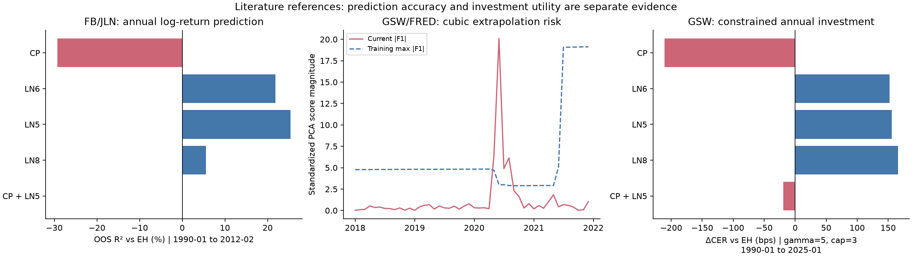
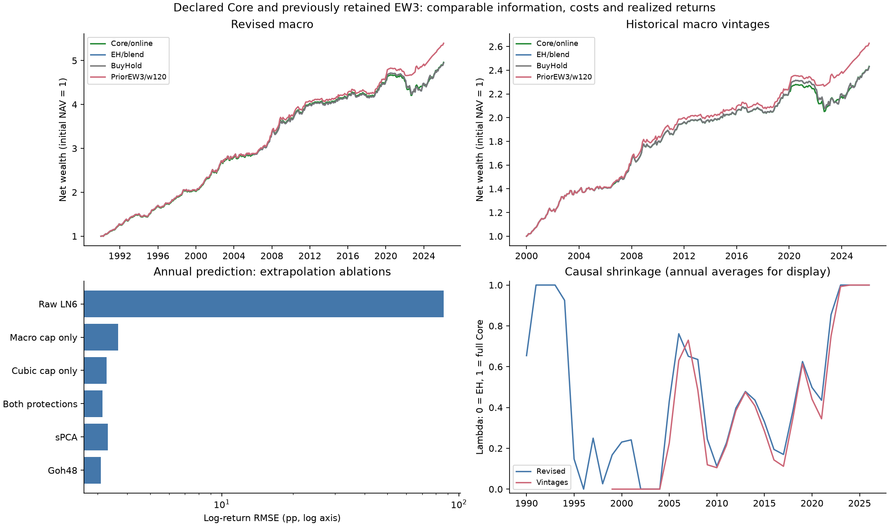
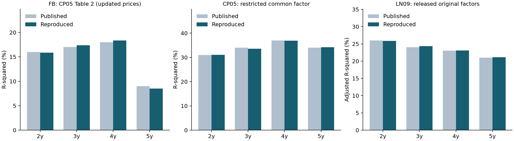
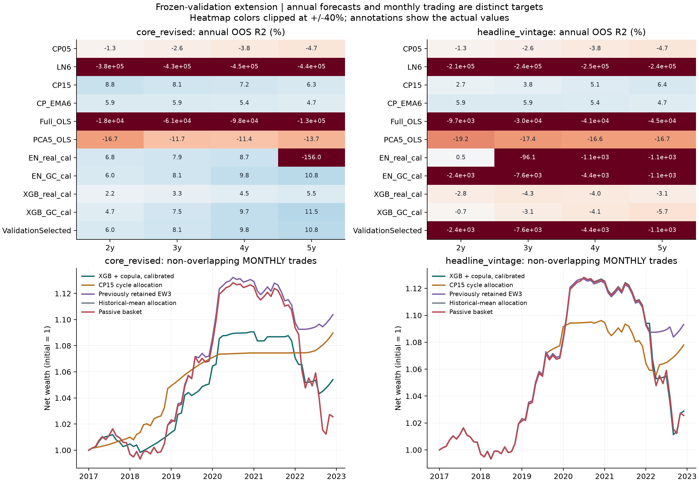
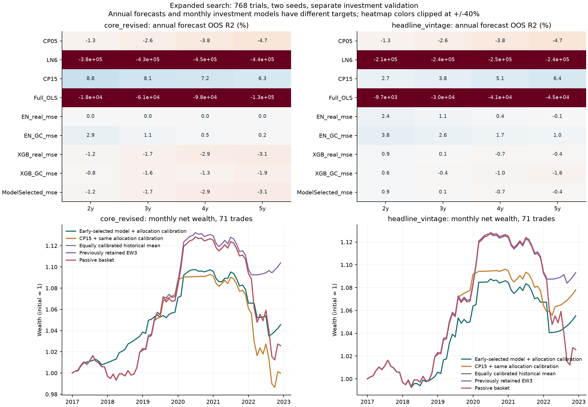
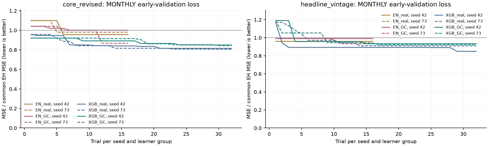
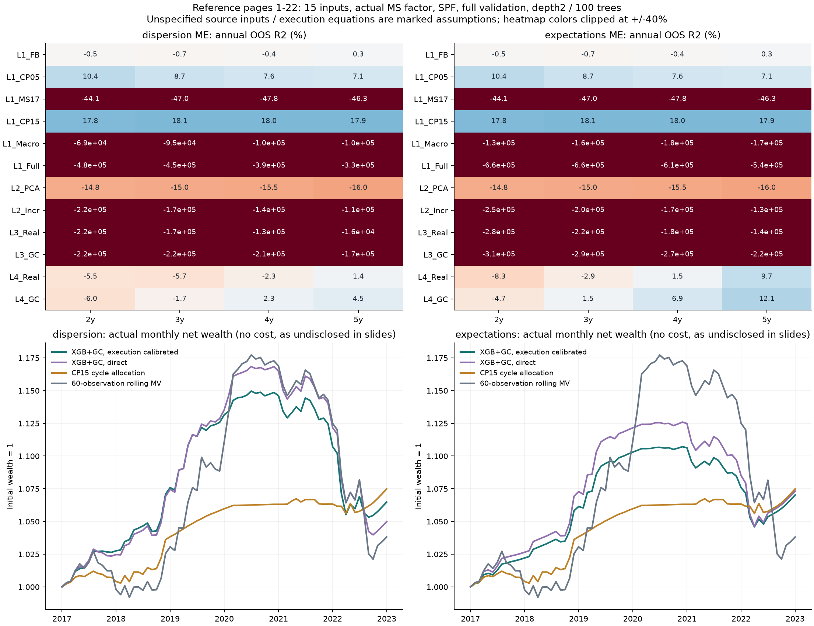

# 美国国债超额收益预测与动态资产配置

一个可复现的固定收益课程研究项目：以美国 2–5 年期零息国债为对象，研究远期利差、远期利率组合与宏观因子能否在历史均值基准之外预测超额收益，并检验预测能否转化为扣费后的投资效用。

**先验证文献，再扩展模型。** [原论文数值校验](#literature-replication) 对照作者数据、实际 PDF 原表和独立回归，验证 FB、CP、LN 及 CP15 的构造；CP15 的 GSW 数据适配、历史远期利率、ElasticNet、XGBoost、Gaussian Copula 和验证期调参见 [新增实验](#validated-extension)与[完成后的扩参研究](#completed-tuning)。原作者全样本因子仅用于描述复现，样本外全部重新构造。

**新增 PDF 对应基线。** [§5.8](#peer-reference) 按前 22 页恢复完整验证段、15 个输入、MS 递归因子、SPF、深度 2/100 树 XGBoost，以及按期限配置的滚动 MV 基准。按[读本原文核查](#factor-origins)修正 ME 为名义 GDP 后，PPT 分歧代理与 Eriksen 预期定义的零费校准 CAGR 为 1.05%/1.14%；对方高夏普尚未数值复现。原 82 个候选清单和执行公式未披露，采用的假设逐页标明，不能称为同代码、同数据的原样复现。

**上一轮独立扩参结果。** 四组独立实验共运行 768 个候选，分开早段模型选择与晚段投资校准；41 项文献数值检查、75 项当轮回归测试，以及 17,325 条预测和 14,445 笔交易的独立审计通过。历史版本面板在 2017-02–2022-12 的新选中月度策略，校准后扣费 CAGR 0.91%、超额夏普 −0.09；同期 EW3 为 1.52%/0.22，被动为 0.43%/−0.24。该轮扩大调参未超过既有 EW3，完整失败对照、参数边界与效用区间见 §5.7；保留下面的 EW3 历史候选。

**研究主线按正式课程要求与原文定义。** [文献基准核对](#coursework-check) 单列 EH、逐期限 FB、两阶段 CP、含三次项的 LN6，以及 LN 原文的 LN5/CP 联合规格，分别报告样本内、一年期样本外和经济价值。[六项研究选择审计](#research-audit) 回答组合、均线周期、起点、风险参数、数据版本及 R² 可比性；[月度配置研究](#trading-designs) 是一月预测期的策略扩展。最新的 [文献驱动改进与策略复核](#refinement-study) 实现 Goh48、sPCA、外推保护、递归收缩和成本感知配置，并与先前的 EW3 候选公平比较。所有新增方案属于已接触历史样本后的探索，不称为预注册。

**前轮发现。** CP15 在 2017 年冻结设定后的主评价中，一年期篮子 OOS R² 为 7.63%（修订核心通胀）及 5.15%（历史总通胀版本）；原始 HAC 和联合检验仍未确认稳定预测优势。小预算 XGBoost＋Copula 在修订核心通胀面板约为 9.43%，历史总通胀版本约为 -4.15%；这里同时改变通胀定义与信息版本，差距不能单独归因为修订影响。同口径修订/历史版本另列，完整比较见 §5.6。

**目前保留的投资候选：EW3，10 年滚动、预测收缩、仅多头。** 将远期利率 CP、宏观 LN8、价格 MA12 的平均收益预测等权，再以 50% 权重向同窗口历史均值收缩；按 γ=5 的均值—方差规则配置等权 2–5 年期篮子，敞口限制在 [0,1]。风险只用已兑现的过去 60 月收益，余款为现金，并预留入场费用。LN8/价格 MA12 属于扩展，文献原规格另列；这里没有声称 10 年、MA12 或 50% 收缩是唯一最优选择。

| 数据与买入期 | 规则 | 非重叠月数 | 扣费 CAGR (%) | 年化超额夏普 | 月末回撤 (%) |
| --- | --- | --- | --- | --- | --- |
| 修订宏观，1990-01–2026-01 | EW3/120 月 | 433 | 4.78 | 0.70 | -4.04 |
| 同期间 | 被动篮子 | 433 | 4.53 | 0.57 | -10.28 |
| 历史宏观版本，2000-01–2026-01 | EW3/120 月 | 313 | 3.77 | 0.69 | -3.82 |
| 同期间 | 被动篮子 | 313 | 3.46 | 0.52 | -10.28 |

最后一笔均在 2026-02 卖出；每笔买卖单边假设 0.5 bps。不同面板各自与同期间被动比较；同期间、同学习器起步的修订/历史版本对照在 §5.4。新 Core 的外推保护改善数值稳定性，但没有超过该先前候选。EW3 的历史版本年度 ΔCER/EH 约 37.3 bps，未校正搜索的 95% 区间为 [-3.0, 101.5] bps，校正后 α 也未获确认，因此保留为历史策略候选，不称为已证实的稳定 alpha。

幅度预测的证据比交易表现弱：历史版本 EW3 相对同为 120 月窗口 EH 的 OOS R² 约为 **-0.11%**。因此本项目保留的是实际配置和风险控制的历史经济价值，尚未证明该组合稳定改善条件均值预测；预测 MSE、仓位截断后的收益和统计显著性分别评价。

| 研究部分 | 作用 | 结果的适用范围 |
| --- | --- | --- |
| 文献基准核对（§5.3） | 完成 FB/CP/LN 必做模型，核对原文并补齐 IS/OOS、版本和效用检验 | 在本地更新数据上重估文献规格，不宣称原样复现论文所有表格 |
| 基础年度报告（§1–5）与六项审计（§5.1） | 保留修复前视后的 LN8、简化情绪、趋势和机器学习比较 | 属于扩展模型；不能将其中 LN8、BW、TI 的结果称为原论文规格 |
| 一月期策略（§5.2） | 滚动估计、收缩、仅多头月度交易 | 是另一预测期的探索，较高夏普不能替代一年期的 EH 检验 |
| 文献驱动改进（§5.4） | Goh48、sPCA、LN6 外推保护；固定 Core 主检验与既有 EW3 候选复核 | 原规格、消融、成本、冷启动、历史版本与联合检验同时保留，不以复杂度或新排名替换已有结论 |
| 原论文数值校验（§5.5） | 作者指数重建、原表数值、MATLAB PCA 与生产流程独立校验；修正 CP 第二阶段截距 | FB1987 数据版本差异如实保留；CP/LN 原表与 CP15 数据适配分别披露 |
| 验证期选择与非线性扩展（§5.6） | CP15、平滑远期利率、EN/XGBoost、Copula 增强；2017 年冻结超参数与收缩 | 原始与校准预测、真实与合成训练、修订与历史版本、主期与后续期全部保留 |
| 完成扩参与独立投资校准（§5.7） | 两种子、三表示、三窗口、768 个候选；独立晚段 81 点信号校准 | 同时校准 EH，版本对照继承参数；新增方法未超过既有 EW3，搜索和收益局限完整保留 |
| 新增 PDF 对应基线（§5.8） | 前22页来源映射、10＋5输入、原文MS、两种SPF定义、完整验证段与逐期限配置 | 明确区分已披露设定与重建假设；实际月度净值、预测误差和PPT年化口径分别报告 |
| 读本因子追溯（§5.9） | 18项因子/方法出处、Eriksen原表24项统计、修正NGDP输入并控制旧参数比较 | 原始规格、代理与尚缺数据分列；纠正定义不保证测试收益提高 |

基础报告保留 CP、LN、BW 与 GBM_raw 的等权预测作为比较规格；其固定权重是在修正研究时制定。不同目标与交易频率的结果分别报告，不以事后排名替代选择依据。

修正版已处理标签前视、交叉验证泄漏、重叠收益复利、协方差估计和费用计量问题。基础表使用修订版宏观数据，新增实验使用逐月历史宏观版本；两者的范围、结果与限制分别披露。

## 1. 年度基础研究的信息时点

本节至 §5 的基础比较使用下列年度规则。月度策略使用一月收益及相应标签隔离，详见 §5.2；文献规格及其 PCA 信息集按 §5.3 单列。

- 每月末形成未来 12 个月的收益预测，训练期从 1964 年开始，评价期从 1990 年开始，至少需要 120 个已兑现标签。
- 对预测月份 $t$，训练标签的买入月 $s$ 必须满足 **$s+12<t$**。例如 1990 年 1 月最多使用 1988 年 12 月买入、1989 年 12 月兑现的收益。
- 当月收益率曲线与技术指标使用 $t$ 月信息；宏观和情绪输入统一使用 **$t-2$** 月信息。另检验 1、2、3 个月的发布滞后。
- 月度重叠标签用于预测评价；经济回测固定每年 **1 月**建仓，持有 **12 个月**后全部平仓并重新建立下一年的仓位。两套评价使用不同观测频率，收益不会重复复利。

```text
当期收益率曲线 / 价格趋势 ─┐
滞后两月的宏观原始变量 ───┼→ 已兑现标签训练 → 每月一年期收益预测
滞后两月的情绪水平 ──────┘                     ↓
                             固定 1 月入场 → 持有一年 → 扣费净值与风险指标
```

### 收益目标

设 $P_t^{(n)}$ 为面值 100 的 $n$ 年期零息债券价格，$\ell_t^{(n)}=100\log(P_t^{(n)}/100)$，则连续复利年收益率为 $y_t^{(n)}=-\ell_t^{(n)}/n$。

从 $t$ 持有至 $t+12$ 月的**简单收益**及一年期无风险收益为：

$$
R_t^{(n)}=\exp\left(\frac{\ell_{t+12}^{(n-1)}-\ell_t^{(n)}}{100}\right)-1,\qquad
R_{f,t}=\exp(y_t^{(1)}/100)-1.
$$

年度基础比较的简单收益目标为：

$$
x_t=\frac{100}{4}\sum_{n=2}^{5}(R_t^{(n)}-R_{f,t}).
$$

代码以 `sx_bar` 存储 $x_t$，单位为百分点；`rx_bar` 为对数超额收益。终值价格按**日历月份**定位，任一期限缺少必要价格时，整篮子收益不视为完整观测。§5.3 同时重新拟合对数与简单收益规格：前者用于文献预测比较，后者用于真实财富复利，不混用两者数值。

## 2. 基础扩展模型的因子

下表解释已保留的基础报告名称；课程要求的逐期限 FB、两阶段 CP、LN6/LN5 另在 §5.3 定义。

| 模型 | 因子如何计算与使用 |
| --- | --- |
| **EH** | 已兑现的一年期平均简单超额收益的扩展历史均值；EH 只是代码中的基准名称，不将优于它解释为严格拒绝预期假说 |
| **FB** | $f_t^{(n)}=\ell_t^{(n-1)}-\ell_t^{(n)}$，$fs_t^{(n)}=f_t^{(n)}-y_t^{(1)}$；对 2–5 年期远期利差取均值，用 OLS 预测收益 |
| **CP** | 将 $f_t^{(1)}=y_t^{(1)}$ 和 $f_t^{(2)},\ldots,f_t^{(5)}$ 联合输入 OLS；不强制回归系数呈帐篷形 |
| **TI** | 对各期限计算对数价格减去含当月在内的 12 个月移动平均，再跨期限取均值 |
| **LN（LN8 扩展）** | 原始宏观序列按变量性质平稳化；在每个训练窗口筛选缺失率不超过 20% 的变量、以训练均值填补、标准化、PCA 提取 8 个主成分，再进行 OLS；与课程/文献给定的 LN6 规格分别报告 |
| **LN_LASSO** | 同样提取 8 个宏观主成分，再用 LASSO 收缩预测系数 |
| **BW（简化代理）** | Baker–Wurgler `SENT` 水平及平方；与 Laborda–Olmo 的正交化情绪、平方、差分及两阶段指数有区别。原文包含差分，当前不使用差分及 `SENT_ORTH` 是简化选择，不能称为原文错误修复 |
| **CPLN / LNBW** | 在同一个回归中联合使用远期利率与宏观主成分，或宏观主成分与情绪项 |
| **LASSO_raw / RF_raw / GBM_raw** | 直接使用平稳化的原始宏观变量，比较线性收缩与非线性模型；JLN 面板为 132 列，FRED-MD 文件为 126 列，每个训练窗口会继续筛选 |
| **RF_pca / GBM_pca** | 将训练窗口提取的 8 个宏观主成分输入树模型，检验压缩特征对预测的影响 |
| **Ensemble：基础比较组合** | CP、LN、BW、GBM_raw 四个预测各占 25%；权重不随样本外排名调整，属于回溯研究设定 |

宏观变换在 [`config.py`](bond_rp/config.py) 中逐变量指定，支持水平、差分、对数与对数差分；FRED-MD 使用文件首行的官方变换码。收益率、远期利率和价格趋势取自债券价格，不需要额外外部因子文件。PCA 主成分随训练窗口重新估计，编号不被固定解释为“增长因子”或“通胀因子”，经济解释需要另查当期载荷。

### 时间交叉验证

LASSO 使用三个按时间前推的验证折。每折的训练标签也满足 $s+12<v$，其中 $v$ 为该折验证期起始月；隔离区按实际日历月份判断。缺失率筛选、填补、标准化和 PCA **均在每个训练折内拟合**，然后应用于该折验证数据。

$\alpha$ 网格固定为 0.01–10 的 7 个对数间隔值，在首次预测与每年 1 月重新选择；模型系数仍逐月重估。LASSO 最大迭代次数 100,000，收敛告警会作为错误停止运行。RF 使用 100 棵树、最大深度 3；GBM 使用 100 棵树、深度 2、学习率 0.05、子采样 0.5；树模型随机种子为 42。这些是本项目配置，不宣称与参考论文程序逐项一致。

## 3. 真实持有期的仓位和费用核算

基础年度配置将预测 $\widehat\mu_t=\widehat x_t/100$ 转为总风险敞口：

$$
w_t=\operatorname{clip}\left(\frac{\widehat\mu_t}{\gamma\widehat\sigma_t^2},-3,3\right),\qquad
\gamma=5,\qquad q_{n,t}=w_t/4.
$$

$\widehat\sigma_t^2$ 从决策时点之前已经兑现的历史篮子简单超额收益估计，每期重新计算。实际账户权重为 $q_{n,t}$，总绝对风险敞口 $\sum_n|q_{n,t}|\le3$；剩余现金或借款权重为 $1-\sum_n q_{n,t}$。

**融资假设：** 现金和借款均按买入日的一年期零息收益率计息，不另设借贷利差。该假设用于理论资产配置比较，尚未匹配国债或期货账户的真实融资条件。

每笔持仓都在一年后平仓，按单边成本 $c=0.5/10{,}000$，分别对买入本金和卖出市值收取费用；入场费用占用现金的利息也计入：

$$
C_t=c\sum_n|q_{n,t}|\left[(1+R_{f,t})+(1+R_t^{(n)})\right],
$$

$$
R_{p,t}^{net}=R_{f,t}+\sum_nq_{n,t}(R_t^{(n)}-R_{f,t})-C_t.
$$

所有年度交易**不重叠**；净值为 $V_{t+12}=V_t(1+R_{p,t}^{net})$。CAGR 根据实际年度交易数计算，夏普为年度简单超额收益均值除以标准差，不使用 $\sqrt{12}$。回撤从初始净值 1 开始计算，但只观测年度端点，**不能解释为年内最大回撤**。CER 为年收益均值减去 $\gamma/2$ 倍方差，ΔCER 与同一路径的 EH 比较。

`BuyHold` 为每年买入等权 2–5 年期篮子的被动基准，`Cash` 为一年期零息国债持有至到期。另有对角协方差与 Ledoit–Wolf 收缩的敏感性比较：协方差只用已兑现训练收益，不再使用测试期全样本，所有权重采用一致的 NAV 单位与总敞口限制。该比较将标量预测等量应用于各期限，不将它宣传为逐期限收益预测模型。

## 4. 修正后的结果

以下数据与图片由同一套报告入口生成，计算日期为 **2026-10-22**。每个预测表内部所有模型使用相同月份，年度交易表也使用同一组不重叠交易。旧版未经隔离的预测数字不再用于项目介绍。

### Fama–Bliss + JLN 基准数据

<!-- BEGIN BASELINE_SAMPLE -->
月度预测评价：**1990-01–2012-02，266 个月**；固定 1 月建仓的年度回测：**1990-01–2013-01，23 笔交易**。
<!-- END BASELINE_SAMPLE -->

<!-- BEGIN BASELINE_TABLE -->
| 模型 | 月度样本数 | OOS R² (%) | RMSE (百分点) | 方向命中 (%) |
| --- | --- | --- | --- | --- |
| EH | 266 | 0.00 | 3.47 | 76.32 |
| FB | 266 | 8.12 | 3.32 | 69.17 |
| CP | 266 | -35.21 | 4.03 | 52.63 |
| TI | 266 | 1.33 | 3.44 | 72.93 |
| LN | 266 | 9.22 | 3.30 | 73.31 |
| LN_LASSO | 266 | -7.59 | 3.60 | 77.07 |
| CPLN | 266 | -18.78 | 3.78 | 59.40 |
| BW | 266 | 0.56 | 3.46 | 59.40 |
| LNBW | 266 | 17.74 | 3.14 | 77.82 |
| LASSO_raw | 266 | -18.25 | 3.77 | 76.32 |
| RF_raw | 266 | -12.34 | 3.68 | 59.77 |
| GBM_raw | 266 | -1.92 | 3.50 | 69.92 |
| RF_pca | 266 | 10.77 | 3.28 | 69.55 |
| GBM_pca | 266 | 11.30 | 3.27 | 71.05 |
| Ensemble | 266 | 21.04 | 3.08 | 74.06 |
<!-- END BASELINE_TABLE -->

<!-- BEGIN BASELINE_ANNUAL -->
| 模型 | 年度交易数 | 扣费 CAGR (%) | 年收益波动 (%) | 超额收益夏普 | 年度端点回撤 (%) | ΔCER (bps) |
| --- | --- | --- | --- | --- | --- | --- |
| EH | 23 | 5.23 | 3.43 | 0.58 | 0.00 | 0.00 |
| FB | 23 | 7.04 | 7.12 | 0.48 | -10.44 | 100.29 |
| CP | 23 | 3.64 | 8.41 | 0.03 | -29.14 | -279.31 |
| TI | 23 | 5.62 | 3.67 | 0.59 | -0.56 | 35.11 |
| LN | 23 | 7.29 | 6.10 | 0.59 | -5.11 | 153.23 |
| LN_LASSO | 23 | 5.92 | 3.61 | 0.58 | -2.25 | 65.98 |
| CPLN | 23 | 4.41 | 8.46 | 0.12 | -20.70 | -204.75 |
| BW | 23 | 5.36 | 6.12 | 0.31 | -3.99 | -40.63 |
| LNBW | 23 | 7.26 | 6.73 | 0.53 | -10.63 | 134.53 |
| LASSO_raw | 23 | 6.44 | 4.92 | 0.55 | -3.31 | 94.63 |
| RF_raw | 23 | 6.39 | 6.80 | 0.40 | -12.29 | 45.15 |
| GBM_raw | 23 | 7.13 | 7.77 | 0.50 | -10.51 | 89.92 |
| RF_pca | 23 | 7.58 | 6.01 | 0.64 | -2.43 | 184.62 |
| GBM_pca | 23 | 7.59 | 7.12 | 0.57 | -7.61 | 155.56 |
| Ensemble | 23 | 6.69 | 5.26 | 0.60 | -3.74 | 112.99 |
| BuyHold | 23 | 5.87 | 4.56 | 0.63 | -1.71 | 44.95 |
| Cash | 23 | 3.73 | 2.39 | — | 0.00 | -137.85 |
<!-- END BASELINE_ANNUAL -->


### 连续 GSW + FRED-MD 扩展数据

扩展期从头到尾使用 GSW 曲线，消除了 FB/GSW 拼接断点。宏观面板使用 2026-04 版 FRED-MD；宏观预处理和 PCA 随已兑现训练窗口重新拟合。由于当前情绪文件截止 2023-12，含 BW 的全模型共同评价期也受其约束；不把无情绪模型较长的样本混入同一排行榜。

<!-- BEGIN EXTENSION_SAMPLE -->
月度预测评价：**1990-01–2024-02，410 个月**；固定 1 月建仓的年度回测：**1990-01–2025-01，35 笔交易**。
<!-- END EXTENSION_SAMPLE -->

<!-- BEGIN EXTENSION_TABLE -->
| 模型 | 月度样本数 | OOS R² (%) | RMSE (百分点) | 方向命中 (%) |
| --- | --- | --- | --- | --- |
| EH | 410 | 0.00 | 3.26 | 66.34 |
| FB | 410 | 3.96 | 3.20 | 59.02 |
| CP | 410 | -46.64 | 3.95 | 52.44 |
| TI | 410 | 3.74 | 3.20 | 64.88 |
| LN | 410 | -21.06 | 3.59 | 67.80 |
| LN_LASSO | 410 | -15.26 | 3.50 | 66.59 |
| CPLN | 410 | -47.11 | 3.96 | 58.54 |
| BW | 410 | -15.41 | 3.51 | 56.34 |
| LNBW | 410 | -18.07 | 3.55 | 66.10 |
| LASSO_raw | 410 | -13.16 | 3.47 | 66.34 |
| RF_raw | 410 | -12.69 | 3.46 | 57.80 |
| GBM_raw | 410 | -13.39 | 3.48 | 60.98 |
| RF_pca | 410 | 5.37 | 3.17 | 65.37 |
| GBM_pca | 410 | -3.93 | 3.33 | 64.88 |
| Ensemble | 410 | 8.02 | 3.13 | 63.66 |
<!-- END EXTENSION_TABLE -->

<!-- BEGIN EXTENSION_ANNUAL -->
| 模型 | 年度交易数 | 扣费 CAGR (%) | 年收益波动 (%) | 超额收益夏普 | 年度端点回撤 (%) | ΔCER (bps) |
| --- | --- | --- | --- | --- | --- | --- |
| EH | 35 | 3.86 | 4.12 | 0.29 | -10.54 | 0.00 |
| FB | 35 | 5.02 | 6.85 | 0.34 | -11.03 | 54.66 |
| CP | 35 | 2.34 | 6.78 | -0.08 | -19.59 | -210.48 |
| TI | 35 | 4.30 | 4.14 | 0.40 | -6.61 | 44.42 |
| LN | 35 | 5.75 | 5.76 | 0.54 | -5.02 | 155.54 |
| LN_LASSO | 35 | 4.65 | 5.09 | 0.36 | -10.41 | 61.13 |
| CPLN | 35 | 3.46 | 7.15 | 0.10 | -15.46 | -109.76 |
| BW | 35 | 3.49 | 6.43 | 0.12 | -18.77 | -86.03 |
| LNBW | 35 | 5.23 | 7.32 | 0.36 | -17.79 | 63.46 |
| LASSO_raw | 35 | 4.67 | 5.01 | 0.39 | -10.44 | 64.48 |
| RF_raw | 35 | 4.68 | 5.66 | 0.32 | -9.40 | 51.80 |
| GBM_raw | 35 | 4.55 | 6.51 | 0.28 | -12.28 | 17.89 |
| RF_pca | 35 | 4.51 | 5.05 | 0.35 | -2.79 | 47.34 |
| GBM_pca | 35 | 4.26 | 6.54 | 0.23 | -14.72 | -11.70 |
| Ensemble | 35 | 4.41 | 5.32 | 0.32 | -13.64 | 32.78 |
| BuyHold | 35 | 4.28 | 4.61 | 0.40 | -6.69 | 33.19 |
| Cash | 35 | 3.00 | 2.43 | — | 0.00 | -62.91 |
<!-- END EXTENSION_ANNUAL -->


### 数据源与样本时期的影响

先比较两个数据源的**相同评价月份**，再单独列出 GSW 2013 年后的预测结果，以减少把数据更换和时间延长混为一谈的问题。

<!-- BEGIN MATCHED_TABLE -->
| 数据与时期 | 模型 | 月数 | R² (%) |
| --- | --- | --- | --- |
| FB+JLN：共同期 | EH | 266 | 0.00 |
| FB+JLN：共同期 | CP | 266 | -35.21 |
| FB+JLN：共同期 | LN | 266 | 9.22 |
| FB+JLN：共同期 | Ensemble | 266 | 21.04 |
| GSW+FRED：共同期 | EH | 266 | 0.00 |
| GSW+FRED：共同期 | CP | 266 | -63.44 |
| GSW+FRED：共同期 | LN | 266 | 2.42 |
| GSW+FRED：共同期 | Ensemble | 266 | 15.01 |
| GSW+FRED：2013 年起 | EH | 134 | 0.00 |
| GSW+FRED：2013 年起 | CP | 134 | -2.85 |
| GSW+FRED：2013 年起 | LN | 134 | -78.27 |
| GSW+FRED：2013 年起 | Ensemble | 134 | -10.02 |
<!-- END MATCHED_TABLE -->


预测指标包括相对 EH 的 $R^2_{OOS}$、均方根预测误差和方向命中率。月度一年期标签仍有重叠，误差检验使用 18 阶 Newey–West HAC；确认使用同一训练历史且嵌套的 OLS 才使用 Clark–West 调整。基础报告的 BW/LNBW 与 EH 的可用历史不同，使用原始损失差；共同训练审计显式指定其嵌套集合。多模型 p 值另做 Holm 校正，完整统计保存在本地结果表；README 不以显著性星号代替稳健性判断。

## 5. 结论与稳健性

<!-- BEGIN FINDINGS -->
1. 在连续 GSW 扩展样本上，Ensemble 的预测 R² 在参与比较的预测模型（含历史均值基准）中最高，为 8.02%；这是模型比较结果，不用于事后挑选组合。
2. 固定权重的 Ensemble 规格预测 R² 为 8.02%，每年 1 月建仓的扣费 CAGR 为 4.41%，超额收益夏普为 0.32，基于 35 笔不重叠年度交易。EH 夏普为 0.29，等权持有基准的 CAGR 为 4.28%、夏普为 0.40；组合未在所有风险调整指标上胜过被动持有。
3. 将固定建仓月份从 1 月改为 1–12 月分别回测，该规格的夏普范围为 0.29–0.47。这 12 条路径相互重叠，不能合并成 12 倍独立样本。
4. 组合预测的损失差 HAC 检验 p 值为 0.135，Holm 校正后为 1.000。不将正的 R² 点估计直接解释为统计显著；预测精度、交易表现与不同数据源的稳健性需要分别判断。当前结果只支持对所列历史数据和交易假设的研究结论，不等于真实成交记录或实时信息有效性证明。
5. 单看 2013 年起的较晚样本，该组合预测 R² 为 -10.02%。应单独判断较晚时期的表现，不能从全样本的正 R² 外推跨时期稳健性。
<!-- END FINDINGS -->

报告还保存以下敏感性结果：固定建仓月份 1–12 月各自的完整年度路径（各自首尾月份与交易数可能不同）；单边交易费 0、0.5、2、5、10 bps；标量、对角和收缩协方差配置；线性模型在 1、2、3 个月宏观/情绪发布滞后下的同月份比较。没有根据这些检查反向调整主参数以美化主结果。

<!-- BEGIN SPECIFICATION_AUDIT -->
<a id="research-audit"></a>

### 5.1 六项质疑的补充审计与策略探索（2026-10-22）

**先纠正研究表述：不能由现有结果得出“没有好的投资策略”，也不能把历史赢家当成已经确认的策略。** 本轮扩大规格空间、加入递归选择和宏观历史版本检验，保留所有失败方案。新增结果属于已经看过历史数据后的探索；计算过程的无前视约束不能消除研究者的事后选择。

为控制比较，新增因子审计中的所有规格使用四类因子均可用的共同训练月份；1990 年首期为 280 个已兑现标签。因此这里的 EH、CP、LN 等数字与上方按各模型可用历史拟合的基础报告略有差异，两个实验分别保留，不混用。预测评价仍是月度一年期标签，投资评价仍是扣费、不重叠的年度交易。

**① 为什么 LN+CP、LN+BW？** 经济假设是分别结合曲线中的定价信息、宏观状态和情绪代理，但没有理论保证这两组最优。原先仅测试两组不足以支持选择。现在穷举 CP、LN、BW、TI 的全部 15 个非空子集，并对每组报告 OLS、Ridge α=10、100；惩罚施加在训练窗口标准化后的回归变量上，8 个宏观 PC 每期重新估计。

下表是各规格相对共同 EH 的 OOS R²（%），起点均为 1990-01；FB+JLN 截止 2012-02，GSW+FRED 截止 2024-02。Ridge 网格也是本次研究选择，不称为预注册。


| 因子子集 | FB OLS | FB R10 | FB R100 | GSW OLS | GSW R10 | GSW R100 |
| --- | --- | --- | --- | --- | --- | --- |
| CP | -41.66 | -24.98 | -22.59 | -49.36 | -16.30 | -10.65 |
| LN | 6.50 | 7.06 | 10.22 | -21.13 | -19.78 | -10.77 |
| BW | -1.76 | -1.41 | 0.65 | -16.30 | -15.82 | -12.52 |
| TI | 1.19 | 1.20 | 1.25 | 3.71 | 3.69 | 3.45 |
| CP+LN | -24.16 | -14.41 | -11.68 | -48.91 | -22.70 | -14.77 |
| CP+BW | -45.43 | -27.26 | -19.32 | -47.67 | -27.45 | -20.97 |
| CP+TI | -43.44 | -26.00 | -23.28 | -49.76 | -15.35 | -8.86 |
| LN+BW | 15.83 | 16.44 | 19.33 | -18.98 | -17.80 | -10.21 |
| LN+TI | 5.01 | 5.75 | 9.61 | -21.79 | -20.05 | -9.40 |
| BW+TI | -2.84 | -2.36 | 0.50 | -13.24 | -12.73 | -9.32 |
| CP+LN+BW | -19.24 | -6.64 | -0.85 | -38.84 | -20.18 | -12.79 |
| CP+LN+TI | -24.57 | -15.49 | -13.04 | -50.86 | -22.29 | -13.00 |
| CP+BW+TI | -46.63 | -29.61 | -22.36 | -48.64 | -27.70 | -20.15 |
| LN+BW+TI | 14.92 | 15.58 | 18.65 | -20.70 | -19.18 | -9.93 |
| CP+LN+BW+TI | -20.69 | -9.06 | -3.14 | -42.59 | -21.47 | -12.47 |

短样本中 LN+BW 及其收缩版本较强，延长到 GSW 样本后这种优势消失；加入更多因子也没有稳定改善。因而不再将 LN+CP 或 LN+BW 作为有充分证据支持的唯一选择。

另外比较四个单因子预测等权的 EW4，以及两个只能使用已兑现历史误差的算法：`EW_mature` 在最近 120 个买入月份中，按已兑现误差的 MSE 倒数分配预测权重；`Select_mature` 选其中历史 MSE 最小的规格。候选涵盖 EH、45 个子集/惩罚规格、六个均线模型与多窗口模型，共 53 个。至少累计 60 个已兑现误差后才启动；此前使用 EH。每个误差也满足 s+12<t，权重、选中模型和信息截止日均留档。它们是实际可递归执行的选择规则，不能用事后最好的模型替代其真实表现。

**② 为什么只用 12 期均线？** 原先没有证明 12 期优于其他周期。现在完整比较 3、6、9、12、18、24 期，另将六个指标联合输入 Ridge(100)，并让上述历史选择器有机会选择各周期。指标始终是各期限对数价格减去含当期在内的过去 k 月均值，再跨期限平均；没有用未来价格。


| 技术窗口 | FB OOS R² (%) | GSW OOS R² (%) |
| --- | --- | --- |
| MA3 | 0.72 | 1.28 |
| MA6 | 0.65 | 2.02 |
| MA9 | 0.96 | 3.04 |
| MA12 | 1.19 | 3.71 |
| MA18 | 0.78 | 2.88 |
| MA24 | 0.31 | 1.69 |
| 六窗口 Ridge(100) | -0.79 | 1.91 |

12 期在这组 GSW 历史结果中相对较好，但仍是事后观察，不能称为唯一正确周期；正 R² 的技术规格在扩大比较后的 Holm 校正下没有达到 5% 显著性。

**③ 换 1985、1995、2000 年是否成立？** 对无调参状态的逐月扩展 OLS/Ridge，给定同一预测月份，改变评价起点不会改变训练规则或拟合；它们可直接使用 1985 年起逐期生成的因果预测。两个递归选择器则在每个起点重新开始累计误差，不沿用更早测试期的选择记录。训练起点始终为 1964 年，未将“更换测试起点”误写成改变训练历史。

下列值为 OOS R²（%）；每张表内部的不同起点使用相同结束月，故改变的是评价时期及其历史均值误差分母。它们是嵌套、相关的历史窗口。


FB+JLN（结束 2012-02）：

| 模型 | 1985 起 | 1990 起 | 1995 起 | 2000 起 |
| --- | --- | --- | --- | --- |
| CP | -12.58 | -41.66 | -94.26 | -122.62 |
| LN | -1.52 | 6.50 | -9.64 | -13.43 |
| CP+LN | -5.54 | -24.16 | -74.29 | -97.64 |
| LN+BW | 6.32 | 15.83 | 19.72 | 16.92 |
| TI | 1.02 | 1.19 | 1.72 | 5.91 |
| EW4 | 12.60 | 12.02 | 10.02 | 8.36 |
| EW_mature | 9.00 | 5.26 | 11.37 | -5.65 |
| Select_mature | 1.04 | -11.81 | 12.49 | -8.80 |

GSW+FRED（结束 2024-02）：

| 模型 | 1985 起 | 1990 起 | 1995 起 | 2000 起 |
| --- | --- | --- | --- | --- |
| CP | -32.66 | -49.36 | -56.64 | -64.80 |
| LN | -20.36 | -21.13 | -44.43 | -52.30 |
| CP+LN | -35.48 | -48.91 | -71.61 | -82.65 |
| LN+BW | -18.33 | -18.98 | -33.05 | -42.36 |
| TI | 2.94 | 3.71 | 5.10 | 7.92 |
| EW4 | 4.99 | 4.99 | 5.12 | 2.44 |
| EW_mature | 3.32 | 0.48 | 1.05 | -6.87 |
| Select_mature | -13.06 | -23.36 | -12.65 | -28.10 |

结论随时期变化：不能说原组合在所有起点都成立。TI 的点估计相对稳定，而高维联合 OLS 和按历史误差选单一模型并未自动解决不稳定性。

**④ 为什么 γ=5、杠杆上限 3？** γ 是均值—方差效用中的风险厌恶偏好，上限是投资约束，二者都不是收益预测模型估计出的最佳值。原先没有证据证明 5 和 3 特别合适；现保留它们作为与基础报告对照的规格，另完整检验 γ∈{1,2,3,5,10,20}、cap∈{1,1.5,2,3} 的 24 个组合，不按夏普挑出“最优参数”。不同 γ 下的 CER 对应不同投资者，不能跨 γ 排名后选赢家。

GSW、1990 年起、固定 1 月入场的敏感性范围如下；被动篮子夏普为 0.40。范围仅覆盖所列网格，尚不意味着每个时期或建仓月份都优于被动。


| 模型 | 夏普最小 | 夏普最大 | CAGR 最小 (%) | CAGR 最大 (%) |
| --- | --- | --- | --- | --- |
| EH | 0.30 | 0.40 | 3.25 | 6.14 |
| LN | 0.44 | 0.55 | 3.79 | 6.59 |
| EW4 | 0.32 | 0.52 | 3.31 | 6.51 |
| EW_mature | 0.29 | 0.53 | 3.31 | 6.33 |
| Select_mature | 0.29 | 0.35 | 3.58 | 5.53 |

同时增加更容易解释的投资约束：`long_only` 将仓位限制在 [0,1]，剩余为一年期国债，不借款也不做空；`vol_target` 只用预测正负决定是否持有，再按“风险预算÷已兑现历史篮子波动”配置，上限为 1。2%、4%、6%、8% 的波动预算全部保存；4% 是展示用的圆整数风险预算，不能称为校准出的最优值。这里估计的是风险资产的超额收益波动，最终账户收益波动不一定等于预算。


**⑤ 是否处理实时版本和发布滞后？** 基础报告仅做了 1/2/3 个月参考期滞后，没有消除修订偏差。本轮新增读取[圣路易斯联储官方历史 FRED-MD](https://www.stlouisfed.org/research/economists/mccracken/fred-databases) 两个 ZIP：1999-08–2014-12、2015-01–2025-12。对月份 t，只使用 t−1 月的历史文件，读取该版本自己的变量与变换码，并重估其完整已知历史的填补、标准化、PCA 和回归。当前变量使用 t−lag 参考月；尾部零散缺失用训练均值处理，整个当期宏观行都不存在时拒绝生成宏观预测。

历史版本标签是月份，未取得逐系列的精确下载/发布日期日志，所以额外延迟一个版本月，保留保守的月度时点约定。[ALFRED 关于 observation date 与 real-time period 的说明](https://fred.stlouisfed.org/docs/api/fred/realtime_period.html)解释了为何参考月份与当时可见版本必须分开。

三个比较对象为：最新版完整面板、最新版中与当期历史文件同名的列、历史版本自身面板。后两者仍可能存在定义/变换码差别；因此差异包含修订、变量构成和可得性的共同影响，不能全部归因于数值修订。历史版本实验不使用 BW，因此不受 2023-12 情绪截止限制，使用全部已兑现债券标签。


宏观历史版本的共同评价期为 **2000-01–2025-05，305 个月**。下表为 OOS R²（%）：

| 参考期滞后 | 模型 | 新版完整 | 新版同名列 | 历史版本 |
| --- | --- | --- | --- | --- |
| 1 | LN | -66.60 | -78.32 | — |
| 1 | LN_R100 | -43.24 | -51.78 | — |
| 1 | EW3 | -0.51 | -1.88 | — |
| 1 | EW_mature | -8.28 | -10.66 | — |
| 2 | LN | -52.71 | -62.37 | -50.50 |
| 2 | LN_R100 | -33.35 | -40.37 | -32.67 |
| 2 | EW3 | -0.04 | -1.21 | -1.18 |
| 2 | EW_mature | -4.25 | -5.94 | -3.83 |
| 3 | LN | -47.36 | -50.91 | -49.29 |
| 3 | LN_R100 | -29.98 | -32.75 | -31.93 |
| 3 | EW3 | -0.19 | -0.69 | -1.12 |
| 3 | EW_mature | -2.58 | -2.90 | -3.13 |

在上述保守版本约定下，lag=1 时所有 t−1 参考月的宏观行均尚未存在，因此表中的“—”是不可估计，不能解释为零 R²。lag=2/3 使用实际已有数值，未用新版数据回填历史文件的缺失尾部。

**仍未完全修复的边界：** 1990 年起的全样本没有相应的完整月度宏观版本；JLN 与 BW 仍是后验版本，GSW 也使用当前下载的拟合曲线，尚未做债券曲线估计的历史版本重建。因此这里只能称为“宏观历史版本检验”，不能将整个交易系统称为严格 point-in-time。精确发布日期、情绪版本和可交易价格仍需另行补齐。


**⑥ 为什么 OOS R² 可能高于 IS R²？** 两个常见量的分母不同：

$$R^2_{IS}=1-\frac{SSE_{fit,train}}{\sum_{train}(x-\bar x_{train})^2},\qquad
R^2_{OOS,EH}=1-\frac{SSE_{recursive,test}}{\sum_{test}(x-\widehat x_{EH,t})^2}.$$

OLS 的训练拟合最优性质只针对相同样本、相同设计矩阵和同一固定系数问题，不对不同历史时期和不同基准的 R² 给出大小关系。现在同时计算初始训练拟合 R²、递归预测相对 EH 的 R²，以及把递归预测误差放到测试期样本均值分母后的 R²。最后一种均值使用了整个测试期，是诊断基准，不能交易。另保存对测试期事后重新拟合 OLS 的 R²，明确不作为样本外业绩。


| 数据 | 模型 | 初始 IS R² (%) | OOS/EH R² (%) | OOS/测试均值 R² (%) |
| --- | --- | --- | --- | --- |
| FB | LN | 9.08 | 6.50 | -16.37 |
| FB | LN+BW | 28.67 | 15.83 | -4.76 |
| FB | TI | 1.71 | 1.19 | -22.98 |
| GSW | LN | 9.74 | -21.13 | -31.03 |
| GSW | LN+BW | 29.46 | -18.98 | -28.70 |
| GSW | TI | 1.81 | 3.71 | -4.16 |

以 GSW/TI 为例：预测 MSE=10.176，EH 的 MSE=10.569，测试期样本均值的 MSE=9.770。所以相对 EH 是 +3.71%，换成同一测试期均值则为 -4.16%。这里高于初始 IS 的现象主要反映不同分母和时期，不能作为泛化超强的证据。旧版前视造成的异常也已通过标签隔离和训练期内 PCA 修正。

**进一步探索：有哪些值得保留的策略？** 将预测误差、经济效用和风险调整表现分开判断。LN 的幅度预测误差较大，并不排除其符号、截断后的仓位在部分年度具有价值；反过来，低预测 MSE 也不保证年度交易获利。这里报告实际产生的扣费仓位收益，不用预测 R² 替代投资回测。

下表为 GSW、1990-01 买入至 2025-01 卖出、35 笔年度交易；费用与基础报告相同。EW4 是 CP/LN/BW/TI 预测等权，不同于前面的含 GBM 的 Ensemble；`TrendVote` 以六种均线为正的比例直接作为篮子仓位，不拟合未来收益。


| 配置规则 | 净 CAGR (%) | 超额夏普 | 年度端点回撤 (%) |
| --- | --- | --- | --- |
| 被动篮子 | 4.28 | 0.40 | -6.69 |
| LN，γ5/cap3 | 5.79 | 0.54 | -5.87 |
| LN，仅多头/cap1 | 4.18 | 0.45 | -4.84 |
| EW4，4%预算/cap1 | 4.28 | 0.48 | -6.69 |
| 历史误差加权，4%/cap1 | 4.28 | 0.48 | -6.69 |
| 历史误差选模，γ5/cap3 | 4.64 | 0.31 | -11.28 |
| 六均线投票/cap1 | 3.85 | 0.40 | -1.06 |

为了避免只展示 1990 年这个起点，还检查了候选的年度投资结果。GSW 固定 1 月入场的夏普如下（共同结束于 2025-01）：

| 起始买入年 | LN γ5/cap3 | LN 仅多头/cap1 | 被动篮子 |
| --- | --- | --- | --- |
| 1985 | 0.33 | 0.40 | 0.43 |
| 1990 | 0.54 | 0.45 | 0.40 |
| 1995 | 0.57 | 0.45 | 0.37 |
| 2000 | 0.63 | 0.47 | 0.42 |

**1985 年起的窗口中，两个 LN 规则均未超过被动夏普**，因此不能宣称起点稳健。1990 年起仅多头 LN 的 12 个建仓月夏普范围为 0.42–0.63，其中 10 个月高于各自同月的被动基准；这些路径相关，不能当成 12 次独立确认。

LN 的 1 月入场均值—方差策略是有竞争力的历史候选；仅多头版本降低了借贷和卖空假设。风险预算 EW4/历史误差加权也值得研究，但收益改善主要出现在较早时期，并非稳定的新 alpha。分时期（固定 1 月入场）结果如下：


| 规则 | 买入年份 | 年度数 | 净 CAGR (%) | 超额夏普 |
| --- | --- | --- | --- | --- |
| BuyHold/long_only | 1990–2012 | 23 | 5.91 | 0.63 |
| LN/long_only | 1990–2012 | 23 | 5.60 | 0.64 |
| BuyHold/long_only | 2013+ | 12 | 1.22 | -0.13 |
| LN/long_only | 2013+ | 12 | 1.52 | 0.01 |
| EW4/vol_target | 1990–2012 | 23 | 5.86 | 0.77 |
| EW_mature/vol_target | 1990–2012 | 23 | 5.96 | 0.82 |
| EW4/vol_target | 2013+ | 12 | 1.33 | -0.07 |
| EW_mature/vol_target | 2013+ | 12 | 1.12 | -0.19 |

夏普优势的不确定性也必须保留。对同一年份的策略与被动收益做 5 年循环区块、5,000 次配对 bootstrap，得到以下 95% 区间（尚未校正策略搜索）：

| 规则 | 夏普差 | 95% 下界 | 95% 上界 |
| --- | --- | --- | --- |
| LN/scalar | 0.14 | -0.02 | 0.30 |
| LN/long_only | 0.04 | -0.06 | 0.14 |
| EW4/vol_target | 0.07 | -0.04 | 0.28 |
| EW_mature/vol_target | 0.07 | -0.05 | 0.29 |

所有这些区间都跨越零，当前证据支持“存在值得继续验证的候选”，不足以声称已经确认跑赢被动。多模型月度检验另保存 Holm p 值；它不能覆盖所有研究者选择、风险参数和策略试验。

在宏观历史版本实验的 **2000-01–2026-01、26 笔年度交易**中，主要候选如下（评价期与上一表不同，不能直接横比 CAGR）：

| 规则 | 净 CAGR (%) | 超额夏普 | 年度端点回撤 (%) |
| --- | --- | --- | --- |
| BuyHold/scalar | 3.29 | 0.44 | -6.69 |
| LN/scalar | 4.87 | 0.56 | -7.71 |
| LN_R100/scalar | 4.70 | 0.56 | -8.07 |
| LN/long_only | 3.14 | 0.42 | -6.69 |
| EW_mature/vol_target | 3.26 | 0.47 | -6.69 |

历史版本候选也保存了 24 组 γ/cap、12 个固定入场月、0–10 bps 成本与配对 bootstrap。上述限制与置信区间仍适用。全部新增逐期预测、选择权重、覆盖率、交易和敏感性矩阵保存在本地 `output/research_audit/`，README 与图片由同一批 CSV 生成；不上传原始数据。


<!-- END SPECIFICATION_AUDIT -->

<!-- BEGIN TRADING_DESIGNS -->
<a id="trading-designs"></a>

### 5.2 从因子预测到可交易策略：滚动估计与月度配置

**继续探索后的判断：原年度实现限制了策略的适应速度，不能据此否定现有因子的价值。** 维持已兑现标签与宏观可得性约束后，改用月度目标、滚动估计和预测收缩，得到风险收益表现更好的候选。本节是新增的策略设计研究，参数及规则均披露，不把经过探索的历史样本重新称为盲测。

先保留原来的年度目标，测试扩展、10 年和 20 年滚动窗口；单靠滚动估计并未稳定超过原 LN 年度方案。因此另建立**一月期预测、一月持有、每月调仓**的策略。年目标的训练标签仍需等待 12 个月兑现；月目标则只需等待一月兑现，统一要求 s+h<t，没有把未兑现的年收益提前加入训练。

**使用的仍是现有因子：** FB/CP 曲线、LN 的 8 个训练宏观 PC、BW 水平及平方、TI 价格趋势。比较扩展/120/240 月窗口；OLS/Ridge(100)；各组联合回归与等权预测；仅多头、双向均值—方差、波动预算、对角风险配置和初始久期中性五类交易设计。预测分别输出 2/3/4/5 年期收益。完整面板为 63 个基础预测规格，宏观历史版本面板为 51 个；另各加 6 个跨窗口组合/历史均值规格，不将最好的规格悄悄替换为预先指定模型。

展示用的四因子组合把 CP/LN/BW/TI 预测等权平均，再按同一训练窗口历史均值收缩：

$$\widetilde\mu_t=\bar\mu_{train,t}+0.5(\widehat\mu_t-\bar\mu_{train,t}),\qquad
w_t=\operatorname{clip}\left(\frac{\operatorname{mean}_n\widetilde\mu_{n,t}}{5\widehat\sigma_{monthly,t}^2},0,1\right).$$

主展示用 120 月训练窗口、最近 60 个已兑现月收益估计风险，每期等权持有各期限，总仓位在 0–100%，余款持有短期国库券。收缩系数 0/0.25/0.5/1、风险窗口 60/120 月都保留比较；不宣称 0.5 或 120 月已经被证明最优。仅多头方案不使用借款或卖空。

**月收益如何计算。** 使用原 GSW 文件中的 BETA0–3、TAU1–2 重建 Svensson 曲线，并与官方 1–5 年期收益率核对至公布精度。买入 n 年期债券，一个月后按剩余 n−1/12 年重新定价：

$$R_{t,t+1}^{(n)}=\exp\{[-(n-1/12)y_{t+1}(n-1/12)+ny_t(n)]/100\}-1.$$

此处 y 为百分数。该公式计入债券期限缩短，不把相同恒定期限的价格差当成实际持有收益。[GSW 官方方法](https://www.federalreserve.gov/pubs/feds/2006/200628/index.html)支持由曲线计算不同到期日的零息价格，同时也说明极短端拟合有局限。

因此现金基准改用 [Kenneth French 官方 RF](https://mba.tuck.dartmouth.edu/pages/faculty/ken.french/Data_Library/f-f_factors.html) 的月度国库券收益，按实际持有的下一月对齐；未引入其股票因子。RF 是已实现现金收益基准，未来现金收益不进入预测或仓位规则。另比较 GSW 一年期收益率折算及短端外推口径。每月按全部本金买入、全部卖出市值扣除费用，并计入入场费用占用现金的利息；双向杠杆方案另计超过净值部分的 50 bps 年化借款利差。卖空融券及真实成交条件仍是模型化假设。

**与被动策略的同月份比较。** 下表为修订版宏观与情绪面板，1990-01 买入至 2024-03 卖出，共 410 个不重叠月收益；单边费用 0.5 bps。夏普统一由月度简单超额收益年化，回撤现在覆盖月末路径，不能与上一节仅观察年度端点的回撤直接横比。被动篮子也每月恢复 2–5 年恒定期限，并使用相同成本。


| 规则 | 净 CAGR (%) | 超额夏普 | 月末回撤 (%) | 平均风险仓位 (%) |
| --- | --- | --- | --- | --- |
| BuyHold | 4.47 | 0.58 | -10.28 | 100.00 |
| EH/w120 | 4.51 | 0.61 | -10.24 | 96.49 |
| EW_R100/w120 | 4.73 | 0.70 | -4.04 | 94.56 |
| EW/w120 | 4.73 | 0.70 | -4.04 | 94.44 |
| LN_R100/w120 | 4.74 | 0.70 | -7.14 | 94.15 |
| LNBW_R100/w120 | 4.82 | 0.73 | -4.04 | 92.95 |
| TrendVote | 4.11 | 0.63 | -3.75 | 53.29 |

`EW_R100/w120` 为四个 Ridge 单因子模型预测等权、10 年滚动估计；`EW/w120` 为对应 OLS 版本。`LNBW_R100/w120` 是联合回归候选，其排名来自本轮事后观察，不能拿它替代完整网格的表现。

为检查月度夏普年化口径的影响，再把相同交易逐个合成为连续、不重叠的 12 月账户收益，现金收益也同期复利；丢弃末尾不足一年的观测。34 个完整年度区块的夏普如下，不使用 √12：

| 规则 | 完整年度数 | 年度区块夏普 |
| --- | --- | --- |
| BuyHold | 34 | 0.47 |
| EW_R100/w120 | 34 | 0.56 |
| EW/w120 | 34 | 0.56 |
| LN_R100/w120 | 34 | 0.56 |

月度表的年化夏普是常用描述统计；有自相关时，它不等于真实一年持有期夏普。年度区块检查和下方区块 bootstrap 提供另外两种观察方式。

**避免再次按历史排名选择 10 年窗口。** 还将 OLS/Ridge × 扩展/10 年/20 年的六个 EW 专家组合，报告固定等权 `EW/mix`、按已兑现预测 MSE 倒数加权的 `EW/online` 和按历史最小 MSE 选择的 `EW/select`。后两者只使用最近 60 个买入月份中已兑现的一月预测误差，至少 36 个误差后启动，此前等权；所有截止日、权重和选择均留档。组合仍收缩到相同权重的各窗口历史均值，交易约束保持一致。

| 面板 | 规则 | 净 CAGR (%) | 超额夏普 | 月末回撤 (%) |
| --- | --- | --- | --- | --- |
| 新版四因子 | BuyHold | 4.47 | 0.58 | -10.28 |
| 新版四因子 | EW/mix | 4.48 | 0.59 | -10.04 |
| 新版四因子 | EW/online | 4.48 | 0.59 | -10.04 |
| 新版四因子 | EW/select | 4.67 | 0.67 | -5.91 |
| 历史宏观 | BuyHold | 3.46 | 0.52 | -10.28 |
| 历史宏观 | EW/mix | 3.47 | 0.53 | -9.71 |
| 历史宏观 | EW/online | 3.47 | 0.53 | -9.70 |
| 历史宏观 | EW/select | 3.45 | 0.54 | -10.25 |

递归权重可使用评价起点前已生成、当时能够形成的历史预测作为内部验证，不按展示窗口清空合法历史；历史宏观版本受档案起始月限制，有更长的等权启动阶段。自适应不保证胜过每个固定专家，其实际结果也保留。


**候选能否经受更严格的执行检查？** 对四因子 Ridge 等权版本，仅改变一项条件，使用同一结束月份：

| 条件 | 策略 CAGR (%) | 策略夏普 | 被动 CAGR (%) | 被动夏普 |
| --- | --- | --- | --- | --- |
| 1985 年起 | 5.19 | 0.66 | 5.24 | 0.61 |
| 1990 年起 | 4.73 | 0.70 | 4.47 | 0.58 |
| 2000 年起 | 3.65 | 0.71 | 3.29 | 0.53 |
| 2013 年起 | 1.60 | 0.24 | 0.92 | -0.07 |
| 单边成本 2 bps | 4.37 | 0.59 | 4.10 | 0.47 |
| 单边成本 5 bps | 3.66 | 0.36 | 3.35 | 0.24 |
| 单边成本 10 bps | 2.49 | -0.02 | 2.12 | -0.13 |
| 延迟一月执行 | 4.65 | 0.67 | 4.47 | 0.58 |
| 风险估计使用 120 月 | 4.70 | 0.69 | 4.47 | 0.58 |

延迟一月执行使用上个月已形成的预测和趋势信号，不增加样本末端的一月收益。2–5 bps 下优势点估计仍在；10 bps 下策略超额夏普转负，成本不可忽略。较晚时期的绝对收益能力也较弱，不能从全样本约 0.70 的夏普外推今后的水平。

| 规则 | 买入年份 | 净 CAGR (%) | 超额夏普 | 月末回撤 (%) |
| --- | --- | --- | --- | --- |
| BuyHold | 1990–2012 | 6.24 | 0.85 | -4.04 |
| EW_R100/w120 | 1990–2012 | 6.28 | 0.86 | -4.04 |
| BuyHold | 2013+ | 0.92 | -0.07 | -10.28 |
| EW_R100/w120 | 2013+ | 1.60 | 0.24 | -3.60 |

**宏观历史版本复核。** 该部分只使用 CP/LN/TI；未取得 BW 历史版本，故不将四因子新版组合包装成严格实时策略。EW 在这里表示三个单因子预测等权，和上表的四因子组合分别报告。样本为 2000-01–2026-02，共 313 个已兑现月收益，沿用同一交易、收缩与风险规则。

| 规则 | 净 CAGR (%) | 超额夏普 | 月末回撤 (%) |
| --- | --- | --- | --- |
| BuyHold | 3.46 | 0.52 | -10.28 |
| EH/w120 | 3.44 | 0.55 | -10.24 |
| EW/w120 | 3.77 | 0.69 | -3.82 |
| EW_R100/w120 | 3.46 | 0.56 | -8.67 |
| LN_R100/w120 | 3.72 | 0.67 | -7.19 |

历史版本中 OLS 等权与 Ridge 等权表现不同，不能说收缩模型处处占优。这里继续保留完整网格及旧年度方案；GSW 曲线与 RF 仍是当前下载版本，历史宏观文件也只提供月度时点，整套系统仍非严格历史逐日可成交记录。


**统计和搜索的不确定性。** 对月度策略/被动同月份收益做配对循环区块 bootstrap，分别用 12/36 月区块、5,000 次重复。以下是夏普差的 95% 区间，尚未覆盖研究者的全部选择：

| 面板 | 规则 | 区块月数 | 夏普差 | 95% 下界 | 95% 上界 |
| --- | --- | --- | --- | --- | --- |
| 新版四因子 | EW_R100/w120 | 12 | 0.12 | 0.00 | 0.28 |
| 新版四因子 | EW_R100/w120 | 36 | 0.12 | 0.00 | 0.30 |
| 新版四因子 | EW/w120 | 12 | 0.12 | -0.01 | 0.30 |
| 新版四因子 | EW/w120 | 36 | 0.12 | -0.01 | 0.29 |
| 历史宏观 | EW/w120 | 12 | 0.18 | 0.01 | 0.37 |
| 历史宏观 | EW/w120 | 36 | 0.18 | 0.01 | 0.37 |
| 历史宏观 | LN_R100/w120 | 12 | 0.15 | 0.00 | 0.32 |
| 历史宏观 | LN_R100/w120 | 36 | 0.15 | 0.00 | 0.30 |

另保存预测损失的 HAC/全规格 Holm 校正，以及各交易设计相对被动超额收益回归的 HAC α 与多重比较校正。这些诊断不能把同一段反复研究过的历史变成独立确认。当前更有根据的结论是：**现有因子可以构建有竞争力的配置规则，收益目标、估计窗口和交易频率会显著影响其经济价值；仍需对未来新增数据作独立验证。**

例如四因子 Ridge 候选相对被动的线性超额收益回归，年化 HAC α 点估计为 0.44%、单边 p=0.044；涵盖全部模型/交易设计的 Holm p=1.000。因此个别未校正区间略高于零也不构成完成模型搜索后的显著性证明。

新增逐期预测、四期限仓位、月度现金流、全部五类交易设计、失败模型、敏感性与统计诊断保存在本地 `output/trading_designs/`。原始数据继续留在本地，仓库只发布代码、README、依赖和展示图。
<!-- END TRADING_DESIGNS -->

<!-- BEGIN COURSEWORK_CHECK -->
<a id="coursework-check"></a>

### 5.3 按课程研究要求补齐文献基准和证据链

本节依据本地 `docs/作业要求.md`、`docs/往届建议.md`，并核对 `GroupProjectReading` 的原文公式。正式作业要求优先于往届的概括性建议；课程材料和论文 PDF 均留在本地，不上传。

**研究主线：** 在 EH 常数预期溢价基准上，比较 FB、CP、LN 对国债一年期超额收益的解释及预测能力；再判断统计改进能否转化为投资效用。月度策略是另一个预测期的扩展，不能用其较高夏普代替一年期预测检验。

**已补回的必做规格。** `FB_n` 对每个期限分别使用本期限远期利差；`CP_2stage` 先由五个远期利率预测平均超额收益，形成单一 CP 指数，再回归各期限收益；`LN6_2stage` 使用 F1、F1³、F2、F3、F4、F8 构建宏观指数，再作第二阶段。LN 原论文在其样本中用 BIC 得到这个集合，课程明确给出此规格；在本项目中将它固定为外部文献基准是合理的，但不意味着它必然适合更新后的宏观面板。此前直接称其为本项目的“事后子集”并替换为 LN8，处理不当，现已恢复。

**原文与扩展的对应关系。** 直接核对本地 `GroupProjectReading` 的核心文献、Goh、Laborda–Olmo 以及实时数据论文，按文中的公式区分：

| 依据 | 原文研究设计与经济解释 | 本项目落实及批判性边界 |
| --- | --- | --- |
| Fama–Bliss (1987)，远期利差回归 | 本期限远期利差预测超额收益；利差兼含预期短端利率与风险补偿 | 必做 `FB_n` 已按期限实现；基础报告的平均利差 `FB` 是篮子简化，二者分别保留。预测关系不能自动识别风险补偿的因果机制 |
| [CP (2005)](https://web.stanford.edu/~piazzesi/cp.pdf)，式 (3)–(4)、表 1 | 用平均收益提取共同回报预测指数，再估计期限暴露 | 已补齐两阶段；帐篷形是实证结果，不能强加。拟合曲线、测量误差和历史时期变化都会影响系数 |
| [LN (2009)](https://www.nber.org/papers/w11703)，pp.5038–5039、5049–5051 | 单独使用六项；与 CP 联合时剔除 F2，使用 F1、F1³、F3、F4、F8 五项；宏观状态可能包含曲线未涵盖的信息 | 新增 `LN5_2stage`、`CP_LN5_2stage`，以及表 3 思路的五项加 CP 直接回归 `CP_LN5_direct`。联合六项和 LN8 均明确为扩展，不冒充原文规格。原文还检验递归 BIC 和完整因子重估 bootstrap，本项目未完整复现这两部分 |
| [Goh 等 (2013)](https://ssrn.com/abstract=1914227)，§II.A、式 (1)–(2) | 2–5 年期远期利差的短/长均线交叉，s∈{3,6,9}、l∈{18,24,30,36}，共 48 个信号，另有成交量指标；机制包括信息处理速度与需求调整 | 当前价格偏离均线 TI 和六周期审计属于自行定义的趋势扩展，**不是 Goh 原文指标复现**；12 期没有文献赋予的唯一性，尚未复现原文 48 信号和成交量因子 |
| [Laborda–Olmo (2014)](https://eprints.soton.ac.uk/357416/1/LabordaOlmoJFMfinalversion.pdf)，p.211、式 (12)–(15) | 先将平均收益投影到正交化情绪、其平方及差分，得到债券情绪预测指数，再与 CP/LN 联合 | 当前 `BW` 是 SENT 水平及平方的简化代理，缺少原文正交化、差分和共同指数限制；不能声称删掉差分是在纠正原论文。原始 SENT 与 SENT_ORTH 的选择及历史版本是研究限制 |
| [Ghysels–Horan–Moench](https://www.newyorkfed.org/medialibrary/media/research/staff_reports/sr581.pdf)，§1；[Huang 等 (2020)](https://ssrn.com/abstract=3107612)，§1–2 | 前者指出发布滞后、修订会放大可预测性；后者发现更有效的目标导向方法可能从实时数据提取信息 | 本地前者 PDF 实为 2014 年修订的 Staff Report 581，不能只按文件名当作最终版本。已有历史 FRED-MD 实验，但严格逐系列实时档案未齐；实时 OLS 较弱不意味着所有因子和方法无效，也不构成新方法必胜的保证 |

PCA、第一阶段指数系数和第二阶段期限暴露均在每个预测时点重新估计。监督回归共享同一批满足 **s+12<t** 的已兑现标签；本节无监督 PCA 可以使用当时已公开的宏观观测，即使其对应收益尚未兑现：输入已滞后两月，PCA 最晚参考月为 t−2。这样不会把收益标签提前，也不必额外舍弃一年宏观信息。扩展窗口 PCA 使用 1964 年以来可得观测，滚动 PCA 使用最近 240 月；回归的滚动窗口仍按已兑现标签计算。基础报告及前述策略扩展采用更保守的“成熟标签训练行内 PCA”，与本节实现不同，结果不混用。

主比较为扩展窗口，并补充 240 月滚动窗口。对数收益用于文献公式检验，简单收益另行重新拟合用于投资回测，不对预测的对数收益直接取指数冒充预期简单收益。数据面板、两月发布约定和样本截止日与原文不同，属于文献规格在现有数据上的重估，不是逐表精确复现。

**因子为何可能有效。** [CP 的研究](https://web.stanford.edu/~piazzesi/cp.pdf)强调远期曲线中随时间变化的风险补偿，组合系数形状是经验结果，不能人为强制成帐篷。[LN 的研究](https://www.nber.org/papers/w11703)检验曲线未完全涵盖的宏观状态、实际活动和通胀信息。FB 是更直接的远期利差基准。情绪与趋势则是需求变化、风险承担和调整速度的代理假设，不能把相关性当作因果机制，也不能把股票情绪直接称为已经识别的债券情绪。

**样本内和样本外分开。** 样本内固定为 1964-01–2003-12，使用该区间已知历史文件事后拟合，属于描述分析；样本外从 1990-01 开始，每次训练均满足 s+12<t。两个研究区间有重叠，样本内估计从不被样本外程序复用，故重叠不构成拟合泄漏，但不能称为两份独立证据。下面展示一年期对数篮子收益，IS 调整 R² 取指数构造阶段的平均收益回归；CP/LN 的二阶段篮子预测与一阶段预测数值一致。


| 面板 | 规格 | IS 调整 R² (%) | OOS R² (%) | 原始损失 p | CW-HAC p | bootstrap-t p | bootstrap Holm p |
| --- | --- | --- | --- | --- | --- | --- | --- |
| FB+JLN | CP_2stage | 34.14 | -29.28 | 0.871 | 0.402 | 0.421 | 1.000 |
| FB+JLN | LN6_2stage | 17.19 | 21.83 | 0.108 | 0.005 | 0.011 | 0.352 |
| FB+JLN | LN5_2stage | 12.18 | 25.37 | 0.027 | 0.003 | 0.009 | 0.306 |
| FB+JLN | LN8_2stage | 13.95 | 5.55 | 0.389 | 0.006 | 0.009 | 0.315 |
| FB+JLN | CP_LN_raw | 39.95 | -1.66 | 0.528 | 0.060 | 0.074 | 1.000 |
| GSW+FRED | CP_2stage | 23.41 | -40.23 | 0.977 | 0.621 | 0.618 | 1.000 |
| GSW+FRED | LN6_2stage | 19.28 | -320254.44 | 0.847 | 0.110 | 0.048 | 1.000 |
| GSW+FRED | LN5_2stage | 15.52 | -299316.47 | 0.847 | 0.113 | 0.057 | 1.000 |
| GSW+FRED | LN8_2stage | 15.45 | -18.36 | 0.764 | 0.006 | 0.008 | 0.280 |
| GSW+FRED | CP_LN_raw | 34.83 | -358699.26 | 0.847 | 0.135 | 0.075 | 1.000 |

**异常值按原规格保留并定位。** GSW/FRED 的 LN6 在 2020-06 预测为 -3586.33 个对数收益百分点，实际为 -0.50；该月占该规格全期平方预测误差的 99.85%。当期标准化 F1=-20.09，成熟标签训练样本范围为 [-3.01, 1.70]，三次项对疫情冲击产生极端外推。没有为抬高 R² 删除这一时点，也没有将 LN8 偷换为原文 LN6。它说明该多项式规格在更新数据上的幅度预测不稳，不能仅凭年度截断仓位表现较好就认可预测模型。完整最差月份与训练因子范围已留档。

**六个问题也覆盖恢复后的文献基准。** 下表补充必做规格和 LN5 联合规格的起点检验，均为一年期对数篮子收益、扩展估计、相同面板结束月；异常外推造成的极端负值保留。前面的 15 组合、六周期均线与历史版本审计仍是 LN8/简化情绪/TI 扩展的结果，不能混称原文规格。

| 面板 | 规格 | 1985 起 R² (%) | 1990 起 | 1995 起 | 2000 起 |
| --- | --- | --- | --- | --- | --- |
| FB+JLN | FB_n | 13.23 | 10.85 | 4.74 | 2.51 |
| FB+JLN | CP_2stage | -6.81 | -29.28 | -73.04 | -95.18 |
| FB+JLN | LN6_2stage | 16.61 | 21.83 | 11.68 | 21.78 |
| FB+JLN | LN5_2stage | 17.02 | 25.37 | 20.01 | 32.33 |
| FB+JLN | CP_LN5_2stage | 13.17 | 0.10 | -31.07 | -40.12 |
| GSW+FRED | FB_n | 7.26 | 5.08 | 0.07 | -1.63 |
| GSW+FRED | CP_2stage | -27.83 | -40.23 | -45.91 | -53.05 |
| GSW+FRED | LN6_2stage | -249254.90 | -320254.44 | -453672.24 | -513148.64 |
| GSW+FRED | LN5_2stage | -232960.62 | -299316.47 | -424012.60 | -479600.51 |
| GSW+FRED | CP_LN5_2stage | -143551.17 | -184444.80 | -261278.78 | -295533.62 |

对第⑥问再用这些原文规格复查：下表的 IS 是 1990 年第一次预测实际可用训练标签的拟合值，与上方 1964–2003 描述样本不同。测试期样本均值用到未来信息，仅用于诊断分母，不是可交易基准。不同期、不同分母的 R² 没有必须 IS≥OOS 的关系。

| 面板 | 规格 | 初始 IS R² (%) | OOS / EH R² (%) | OOS / 测试均值 R² (%) |
| --- | --- | --- | --- | --- |
| FB+JLN | FB_n | 14.17 | 10.85 | -15.94 |
| FB+JLN | LN6_2stage | 11.67 | 21.83 | -1.66 |
| FB+JLN | LN5_2stage | 8.95 | 25.37 | 2.94 |
| GSW+FRED | FB_n | 11.25 | 5.08 | -4.24 |
| GSW+FRED | LN6_2stage | 13.00 | -320254.44 | -351705.90 |
| GSW+FRED | LN5_2stage | 10.21 | -299316.47 | -328712.29 |

第④问的 24 组 γ/cap 网格也已对本节全部规格重新计算，保存在 `risk_sensitivity.csv`；不按新结果挑风险偏好。第①问同时保存 LN5/CP 联合相对 **CP 自身** 的增量损失比较，而不只与较弱常数基准比较。同理，前述月度候选中的 LN 是 LN8 扩展；其结果不能移植给 LN6 或原文 BW。

**第⑤问补充：原文 LN5/LN6 的宏观历史版本检验。** 使用已有官方 ZIP，对每个预测月采用 t−1 版本和 t−2 参考月，按该版本的历史面板重新构造 PCA 和两阶段指数；不以新版值填补旧版本。为与本节修订版对应，评价共同期为 2000-01–2024-02，290 个月，扩展窗口、一年期对数篮子收益。训练宏观面板的历史修订、构成和变换差异共同影响结果，不能把两列差值全部归为单一修订效应。

| 规格 | 同期间修订版 R² (%) | 历史版本 R² (%) | 历史原始损失 p | 历史 HAC Holm p | 历史 bootstrap Holm p |
| --- | --- | --- | --- | --- | --- |
| FB_n | -1.63 | -1.63 | 0.547 | 1.000 | 1.000 |
| CP_2stage | -53.05 | -53.05 | 0.965 | 1.000 | 1.000 |
| LN6_2stage | -513148.64 | -314837.33 | 0.849 | 1.000 | 1.000 |
| LN5_2stage | -479600.51 | -294354.57 | 0.849 | 1.000 | 1.000 |
| LN8_2stage | -46.09 | -49.12 | 0.904 | 1.000 | 0.477 |
| CP_LN5_2stage | -295533.62 | -165792.62 | 0.849 | 1.000 | 1.000 |

这次原文规格也进行了版本敏感性检查，但不能将历史版本实验自动称为‘通过’。特别保留负 R²、极端预测和校正后 p 值；t−1 月版本约定不能替代逐系列精确发布日志，收益率曲线仍是当前下载版，情绪未取得完整历史档案。

样本内第一阶段系数的 HAC t 值、逐期限两阶段 R²、两种收益口径和两种训练窗口的完整结果均留档。第一阶段共同因子是估计得到的，二阶段 t 值不能作为与因子构造独立的显著性证据；本报告没有用目标拟合出的单因子再制造一组“独立显著”结论。

**CW 与 bootstrap-t 的适用范围。** 对能确认与同训练样本 EH 嵌套的平均收益 OLS 规格，报告 [Clark–West 调整](https://www.kansascityfed.org/documents/5368/pdf-RWP05-05.pdf)：

$$d_t=(x_t-\widehat x_{EH,t})^2-(x_t-\widehat x_{M,t})^2+(\widehat x_{EH,t}-\widehat x_{M,t})^2.$$

其余比较使用未调整损失差，所有规格另保存原始损失差 p 值。CW p 值不改变原始 OOS R²，调整后显著也不等于原始 MSE 更低。bootstrap-t 对 d 去均值后按 12/24 月循环区块重抽，每次重新估计 18 阶 Bartlett HAC 标准误，形成学生化统计量；默认重复 1,999 次、种子 42，实际次数记录在结果表，并保存 Holm 校正。HAC 的 Holm 集合含每面板全部非 EH 的收益口径×窗口×期限检验；bootstrap Holm 集合含全部非 EH 篮子检验，不能覆盖整份研究所有历史尝试。它与之前对夏普差的百分位 bootstrap 是不同检验。这里重抽已产生的损失序列，**没有**重新估计整个历史 PCA/预测流水线，不能宣称覆盖全部潜因子和研究者搜索误差；含 PCA 的 CW 渐近近似、极端值及有限样本也要求谨慎。

**宏观经济解释不靠给 PC 编号贴标签。** 以下载荷来自 GSW/FRED 的同一 1964–2003 描述样本，每行列出标准化宏观面板中绝对载荷最大的变量；因子符号可整体翻转。OOS 仍逐期重新提取，不能用这张事后载荷表替代当期信息。


| 主成分 | 解释宏观变异 (%) | 绝对载荷最大的五列（括号为载荷） |
| --- | --- | --- |
| F1 | 16.02 | IPMANSICS (+0.196); INDPRO (+0.195); USGOOD (+0.191); CUMFNS (+0.189); PAYEMS (+0.185) |
| F2 | 7.10 | BAAFFM (+0.261); AAAFFM (+0.259); T10YFFM (+0.250); T5YFFM (+0.244); BAA (-0.211) |
| F3 | 5.81 | CUSR0000SAC (+0.313); DNDGRG3M086SBEA (+0.309); CUSR0000SA0L2 (+0.303); CPIAUCSL (+0.302); CUSR0000SA0L5 (+0.296) |
| F4 | 5.09 | HOUST (+0.211); PERMIT (+0.186); HOUSTNE (+0.186); GS5 (-0.185); PERMITNE (+0.183) |
| F5 | 4.62 | PERMIT (+0.219); PERMITW (+0.213); HOUSTW (+0.202); HOUST (+0.198); GS1 (+0.196) |
| F6 | 3.44 | TOTRESNS (+0.259); NONBORRES (+0.252); M1SL (+0.230); RETAILx (-0.207); ISRATIOx (+0.195) |
| F7 | 3.16 | TOTRESNS (+0.320); NONBORRES (+0.312); BOGMBASE (+0.241); M1SL (+0.240); DSERRG3M086SBEA (-0.201) |
| F8 | 2.61 | S&P 500 (+0.401); S&P div yield (-0.363); S&P PE ratio (+0.362); VIXCLSx (-0.217); DPCERA3M086SBEA (+0.204) |

**经济意义需要相对基准。** 正的总收益本身可能仅来自国库券利息或国债久期溢价；因此保留同交易规则 EH、被动篮子和现金，并比较收益、风险及 ΔCER。正式作业允许风险厌恶的均值—方差配置，γ=5 属于此类，并非风险中性。若把 σ 定义为标准差，效用一阶条件使用 μ/(γσ²)；γ=0 的风险中性问题不能直接套入这个公式，必须另加投资约束。

一年期简单收益重新预测、γ=5/cap3、固定 1 月入场的经济检验如下；费用/融资假设与基础年度回测相同。这是理论配置比较，不能把该杠杆规则直接视为实盘可成交账户。

| 面板 | 规格 | 年度数 | 净 CAGR (%) | 超额夏普 | ΔCER 对 EH (bps) |
| --- | --- | --- | --- | --- | --- |
| FB+JLN | EH | 23 | 5.23 | 0.58 | 0.00 |
| FB+JLN | FB_n | 23 | 7.07 | 0.50 | 108.32 |
| FB+JLN | CP_2stage | 23 | 3.64 | 0.03 | -279.31 |
| FB+JLN | LN6_2stage | 23 | 7.73 | 0.58 | 173.68 |
| FB+JLN | LN5_2stage | 23 | 7.91 | 0.64 | 204.53 |
| FB+JLN | CP_LN5_2stage | 23 | 5.12 | 0.23 | -94.35 |
| FB+JLN | BuyHold | 23 | 5.87 | 0.63 | 44.95 |
| GSW+FRED | EH | 35 | 3.86 | 0.29 | 0.00 |
| GSW+FRED | FB_n | 35 | 5.04 | 0.35 | 58.12 |
| GSW+FRED | CP_2stage | 35 | 2.34 | -0.08 | -210.48 |
| GSW+FRED | LN6_2stage | 35 | 5.90 | 0.50 | 152.18 |
| GSW+FRED | LN5_2stage | 35 | 5.89 | 0.51 | 156.00 |
| GSW+FRED | CP_LN5_2stage | 35 | 4.15 | 0.21 | -19.15 |
| GSW+FRED | BuyHold | 35 | 4.28 | 0.40 | 33.19 |



图中短样本预测、GSW 因子外推与年度效用使用各自标注的样本。年度仅固定一月入场并限制仓位，不能用其正 ΔCER 掩盖全期月度预测中的极端误差。

对新增月度策略，再将实际月度账户收益复利为完整的不重叠年度区块，以相同 γ=5 计算年度 CER。下表明确区分相对同窗口 EH 与相对被动的效用改善，不把 CAGR 差或夏普差直接称为业绩费：

| 面板 | 规则 | 完整年度数 | ΔCER 对 EH (bps) | ΔCER 对被动 (bps) |
| --- | --- | --- | --- | --- |
| monthly_revised | EW_R100/w120 | 34 | 29.53 | 28.80 |
| monthly_revised | EW/w120 | 34 | 30.92 | 30.19 |
| monthly_revised | LN_R100/w120 | 34 | 27.96 | 27.23 |
| monthly_revised | EW/select | 34 | 23.73 | 23.00 |
| monthly_vintage | EW_R100/w120 | 26 | 3.92 | 3.81 |
| monthly_vintage | EW/w120 | 26 | 37.38 | 37.26 |
| monthly_vintage | LN_R100/w120 | 26 | 29.69 | 29.57 |
| monthly_vintage | EW/select | 26 | -2.28 | -2.40 |

月度策略也须防止基准选择造成误读：`EW_R100/w120` 收缩后预测相对扩展 EH 的 R²=1.498%，但同为 120 月窗口的 EH 已有 1.337%；换成同窗口 EH，增量 R² 仅 0.164%。因此夏普和 CER 点估计改善不等于宏观/情绪因子产生了已确认的额外预测能力。

**不同预测期的样本内证据。** 对已有一月期扩展补齐相同输入定义的 IS：GSW/FRED、简化情绪和 TI，描述样本为 1965-09–2003-12，460 个月。下面 IS 为未收缩拟合 R²，OOS 为扩展窗口的 1990-01–2024-02 预测，相对逐期 EH；列出原始预测与 50% 向 EH 收缩后的预测，避免混淆。此处 LN 表示八主成分扩展；不同预测期的 R² 分母及收益目标不同，不按绝对大小跨期排名。

| 一月期规格 | IS R² (%) | OOS 原始 R² (%) | OOS 收缩后 R² (%) |
| --- | --- | --- | --- |
| LN/exp | 5.44 | -9.15 | 0.29 |
| CP/exp | 4.71 | -3.76 | -0.18 |
| BW/exp | 0.67 | -0.47 | -0.13 |
| TI/exp | 0.04 | 0.18 | 0.10 |
| EW/exp | 4.55 | 1.76 | 1.29 |

**对 EH 与策略有效性的结论。** 在 FB/JLN 的历史样本中，LN5/LN6 提供正的一年期 OOS R² 和投资效用点估计，但扩大检验集合后尚不足以确认稳定预测优势；这不等于完成了严格的 EH 拒绝。在更新 GSW/FRED 面板上，原文多项式对疫情宏观冲击的外推失败，宏观历史版本也没有消除这个问题，说明样本、非线性和信息版本会实质改变结论。与此同时，一月期、滚动估计、预测收缩和仓位约束形成了可保留的历史候选；这些候选的收益/风险改善与增量 MSE、校正后显著性应分开评价。因此当前有效结论是‘存在依赖数据、时期和交易规则的可预测性与经济价值，尚未确立跨样本稳定的超额投资优势’，而不是由部分失败推导所有策略无效。

该仓库提供代码与可复现研究说明；课程提交的 Word 报告仍需按正式格式压缩为不超过 3000 字的引言、批判性文献综述、数据方法、实证、稳健性和结论，并补齐封面成员信息。旧版局部文献公式脚本及未同步的报告草稿不能代替这套修正后的实证结果。

复现本节：`python scripts/check_coursework_alignment.py --with-vintages --update-readme`，历史宏观 ZIP 可先用 `audit_macro_vintages.py --download` 准备。本地 `output/coursework_audit/` 保存文献规格预测、训练截止日、IS 系数/载荷、逐期限 OOS、CW、bootstrap-t、起点/风险网格、异常预测和经济价值表；数据及本地课程材料不上传。
<!-- END COURSEWORK_CHECK -->

<!-- BEGIN REFINEMENT_STUDY -->
<a id="refinement-study"></a>

### 5.4 文献驱动的策略改进：外推保护、sPCA 与递归收缩

本轮继续推进策略与结果，不制作 Word 报告。原文基准及其失败结果保留；本节是明确标注的后续方法开发，仍然已经接触历史样本，不能称为预注册或真正封存的测试。

**先限定策略，再检验。** 主规则固定为 `Core/online`，不改用本轮排名最高的模型。曲线、宏观、技术三类信息各占 1/3；宏观内部 LN6_safe 与 sPCA 各占一半。扩展、120 月、240 月三个估计窗口等权，不选事后最优窗口。SENT 缺少完整历史版本，因此不进入主规则，也不再让其 2023 年截止日截短其他因子的全样本。

| 构造 | 原文依据与本轮实现 | 保留的边界 |
| --- | --- | --- |
| CP | 保留平均收益提取指数、再估计期限暴露的两阶段结构 | 仍受曲线测量误差和参数不稳定影响 |
| Goh48 | 按 [Goh 等](https://ssrn.com/abstract=1914227) §II.A 构造 2–5 年远期利差的 48 个短/长均线交叉；[Bai–Ng](https://onlinelibrary.wiley.com/doi/10.1111/1468-0262.00273) ICp2 从 0–8 中决定因子数，再按各期限 BIC 选择子集，允许常数模型。PCA 可使用当时已知的指标，BIC 只用成熟收益 | 已实现远期利差部分，未捏造成交量因子；上限 8、数据版本和滚动窗口均为本项目配置，不宣称原文逐表精确复现 |
| sPCA | 按本地 [Huang 等 (2020)](https://ssrn.com/abstract=3107612) §3.2，以成熟训练样本中各标准化宏观变量对平均收益的单变量预测斜率缩放，再提取第一主成分。缩放后不再次逐列标准化，避免抹掉权重；另保留 SPCA_raw 对照 | 使用现有 FRED-MD/JLN 面板，并非原文 60 个 ALFRED 系列；监督缩放仍有估计误差，OOS 优势要检验 |
| LN6_safe | 保留原六项。宏观输入的保护界限为已知历史中位数 ±6 IQR，零 IQR 列不强制截断；再将三次项的输入限制在成熟训练样本 F1 的范围内，线性项保留。另保留只处理宏观、只处理三次项和完全不处理的消融对照 | 这是本项目的外推保护，不伪称原文精确异常值规则；不删除疫情月份，不截断实现收益。LN6_safe_R100 是直接逐期限 Ridge 扩展，避免第二阶段斜率抵消收缩 |
| BW3 诊断 | 另外按 Laborda–Olmo 式 (14) 使用 SENT_ORTH、平方与差分构建两阶段指数；保留 EH_BW 的同训练历史基准 | 下载文件的正交化和历史发布版本未重建，仅为修订数据诊断；不能用它为主规则的实时性背书 |

设三个窗口混合后的 Core 预测为 m，历史均值混合预测为 b，d=m−b。每个决策时点仅使用过去已兑现的、当时实际生成的预测，估计：

$$\lambda_t=\operatorname{clip}\left(\frac{\sum_s d_s(y_s-b_s)}{\sum_s d_s^2},0,1\right),\quad \widehat y_t=b_t+\lambda_t(m_t-b_t),\quad s+h<t.$$

使用最近 120 个买入月份，至少 60 个成熟误差；不足时 λ=0。权重、成熟误差截止日和特征处理均留档。监督回归与 sPCA 缩放只使用成熟标签，无监督 PCA 可以使用当时已公开的观测；两者的信息集分别检查。三个窗口混合后的固定 λ=0.5 和不收缩版本也保留，不能把学习后的 λ 当成先验最佳参数。

**经济评价固定约束。** 主回测为仅多头、最高 100% 风险资产，γ=5；每笔买卖单边 0.5 bps，入场费用预留现金。每个期限的真实一月老化价格用于月度回测；一年期策略只复利不重叠的一年持仓。主规则相对同窗口混合 EH、被动和现金比较，预测回测不再额外乘一次 50% 收缩。另完整检查 γ=2/10、2/5 bps、一月延迟、风险窗口、四个起点及冷启动，结果不用于改换主规则。


**一年期预测结果。** 本表为对数篮子超额收益，基准是三个窗口等权的 EH/blend；与此前单一扩展 EH 的分母不同。修订版主评价从 1990 年起，历史版本从 2000 年起，各自使用已兑现标签的完整结束月；这些列不是同期间的纯修订效应估计。

| 面板 | 规则 | 月数 | OOS R² (%) | 原始损失 HAC p | 联合 max-t p（24月） |
| --- | --- | --- | --- | --- | --- |
| FB/JLN | CP/blend | 266 | -65.36 | 0.989 | 1.000 |
| FB/JLN | LN6_raw/blend | 266 | -20.64 | 0.829 | 1.000 |
| FB/JLN | LN6_safe/blend | 266 | -15.12 | 0.805 | 1.000 |
| FB/JLN | SPCA/blend | 266 | -25.38 | 0.803 | 1.000 |
| FB/JLN | Goh48/blend | 266 | -5.24 | 0.613 | 1.000 |
| FB/JLN | Core/blend | 266 | 0.75 | 0.476 | 1.000 |
| FB/JLN | Core/online | 266 | 2.84 | 0.393 | 1.000 |
| GSW 修订 | CP/blend | 425 | -70.33 | 0.994 | 1.000 |
| GSW 修订 | LN6_raw/blend | 425 | -83421.21 | 0.847 | 1.000 |
| GSW 修订 | LN6_safe/blend | 425 | -10.74 | 0.755 | 1.000 |
| GSW 修订 | SPCA/blend | 425 | -23.20 | 0.848 | 1.000 |
| GSW 修订 | Goh48/blend | 425 | -7.60 | 0.706 | 1.000 |
| GSW 修订 | Core/blend | 425 | -3.51 | 0.649 | 1.000 |
| GSW 修订 | Core/online | 425 | -2.57 | 0.654 | 1.000 |
| GSW 历史版本 | CP/blend | 305 | -86.29 | 0.982 | 1.000 |
| GSW 历史版本 | LN6_raw/blend | 305 | -3291.13 | 0.850 | 1.000 |
| GSW 历史版本 | LN6_safe/blend | 305 | -24.35 | 0.904 | 1.000 |
| GSW 历史版本 | SPCA/blend | 305 | -33.73 | 0.871 | 1.000 |
| GSW 历史版本 | Goh48/blend | 305 | -22.81 | 0.928 | 1.000 |
| GSW 历史版本 | Core/blend | 305 | -13.02 | 0.864 | 1.000 |
| GSW 历史版本 | Core/online | 305 | -1.77 | 0.665 | 1.000 |

**新方法也补齐样本内证据。** 下表 IS 是 1990 年首次评价时实际可用标签的拟合 R²，PCA 只用当时可见的宏观信息；它是描述性拟合，不参与此后的收缩系数学习。sPCA 的变量权重和 BIC 选择均依赖训练目标，不能把选出的低维因子当作事先给定的一两个自由度来宣称样本内显著。OOS 同时报告相对混合 EH 和同为扩展窗口 EH 的 R²，避免分母造成误读。

| 目标 | 规则 | IS 标签数 | IS R² (%) | OOS/混合EH (%) | OOS/扩展EH (%) |
| --- | --- | --- | --- | --- | --- |
| 一年对数 | CP/exp | 296 | 38.59 | -50.95 | -41.58 |
| 一年对数 | LN6_safe/exp | 296 | 12.77 | 7.67 | 13.40 |
| 一年对数 | SPCA/exp | 296 | 10.23 | -1.75 | 4.56 |
| 一年对数 | Goh48/exp | 296 | 29.92 | -22.50 | -14.90 |
| 一年对数 | Core/exp | 296 | 36.13 | 1.20 | 7.33 |
| 一月简单 | CP/exp | 307 | 7.34 | -4.07 | -3.02 |
| 一月简单 | LN6_safe/exp | 307 | 5.50 | -5.14 | -4.08 |
| 一月简单 | SPCA/exp | 307 | 0.10 | -1.74 | -0.72 |
| 一月简单 | Goh48/exp | 307 | 2.68 | -2.88 | -1.84 |
| 一月简单 | Core/exp | 307 | 6.81 | 0.47 | 1.47 |

原文情绪输入的单独诊断如下，使用扩展窗口和当期可用的修订文件。BW3 相对自身同训练历史 EH；加入情绪相对 Core 的增量 R² 直接检查它是否降低预测误差。该小表不属于主规则的宏观历史版本确认，也不据此选择是否纳入主组合。

| 目标 | 共同买入期 | 月数 | BW3/EH R² (%) | Core+BW 相对 Core R² (%) |
| --- | --- | --- | --- | --- |
| 一年对数 | 1990-01–2024-02 | 410 | -11.45 | 1.71 |
| 一月简单 | 1990-01–2024-02 | 410 | -4.37 | 0.32 |

**一月期策略结果。** 年化夏普由实际非重叠月收益计算，回撤含月末路径。‘修订同起步’与历史版本均从 1999-09 开始积累预测误差、2000-01 开始投资；它消除收缩学习器启动时间不同造成的比较偏差。变量构成、定义与数值版本仍可能不同，差值不能全部解释为数值修订。

同时重新生成本轮之前已披露的两个 **PriorEW3** 候选：CP、LN8、价格 MA12 三类预测等权，120 月滚动，50% 向同窗口 EH 收缩，分别使用 OLS 与 Ridge100。它们不含情绪，因此可与历史版本完整样本比较；PCA 按其既有的成熟训练行定义重估。它们是先前候选的复核，不是从本轮新模型排名中挑出的替代主规则；两者一并进入本轮月度联合比较。

| 面板 | 规则 | 月数 | 净 CAGR (%) | 超额夏普 | 月末回撤 (%) | 平均敞口 (%) |
| --- | --- | --- | --- | --- | --- | --- |
| 修订全期 | EH/blend | 433 | 4.53 | 0.57 | -10.28 | 100.00 |
| 修订全期 | BuyHold | 433 | 4.53 | 0.57 | -10.28 | 100.00 |
| 修订全期 | PriorEW3/w120 | 433 | 4.78 | 0.70 | -4.04 | 89.98 |
| 修订全期 | PriorEW3_R100/w120 | 433 | 4.55 | 0.61 | -9.06 | 90.44 |
| 修订全期 | Market/online | 433 | 4.47 | 0.57 | -10.06 | 94.96 |
| 修订全期 | SPCA/online | 433 | 4.49 | 0.57 | -10.04 | 96.48 |
| 修订全期 | Goh48/online | 433 | 4.40 | 0.54 | -10.28 | 95.98 |
| 修订全期 | Core/half | 433 | 4.52 | 0.58 | -10.07 | 97.31 |
| 修订全期 | Core/online | 433 | 4.54 | 0.60 | -10.04 | 93.71 |
| 修订同起步 | EH/blend | 313 | 3.46 | 0.52 | -10.28 | 100.00 |
| 修订同起步 | BuyHold | 313 | 3.46 | 0.52 | -10.28 | 100.00 |
| 修订同起步 | PriorEW3/w120 | 313 | 3.80 | 0.71 | -3.51 | 86.13 |
| 修订同起步 | PriorEW3_R100/w120 | 313 | 3.49 | 0.58 | -9.06 | 86.78 |
| 修订同起步 | Market/online | 313 | 3.51 | 0.56 | -10.06 | 95.50 |
| 修订同起步 | SPCA/online | 313 | 3.41 | 0.52 | -10.04 | 95.13 |
| 修订同起步 | Goh48/online | 313 | 3.30 | 0.47 | -10.28 | 95.30 |
| 修订同起步 | Core/half | 313 | 3.46 | 0.53 | -10.07 | 96.58 |
| 修订同起步 | Core/online | 313 | 3.46 | 0.54 | -10.04 | 93.19 |
| 历史版本 | EH/blend | 313 | 3.46 | 0.52 | -10.28 | 100.00 |
| 历史版本 | BuyHold | 313 | 3.46 | 0.52 | -10.28 | 100.00 |
| 历史版本 | PriorEW3/w120 | 313 | 3.77 | 0.69 | -3.82 | 86.34 |
| 历史版本 | PriorEW3_R100/w120 | 313 | 3.46 | 0.56 | -8.67 | 86.83 |
| 历史版本 | Market/online | 313 | 3.51 | 0.56 | -10.06 | 95.50 |
| 历史版本 | SPCA/online | 313 | 3.39 | 0.51 | -10.08 | 95.97 |
| 历史版本 | Goh48/online | 313 | 3.30 | 0.47 | -10.28 | 95.30 |
| 历史版本 | Core/half | 313 | 3.47 | 0.54 | -10.09 | 96.97 |
| 历史版本 | Core/online | 313 | 3.47 | 0.55 | -10.04 | 92.42 |

**主检验规则与先前候选的预测增量、效用和风险暴露。** ΔCER 将实际月收益复利为完整、不重叠的 12 月持仓区块后，以同一 γ=5 计算，相对 EH；末尾不满一年的月收益不进入此表 CER。95% 区间是 3 年循环区块、配对重抽并重新计算均值/方差的百分位区间，尚未对策略搜索校正。α 是对被动篮子超额收益回归的年化截距，仅控制这一个久期风险代理，不是完整资产定价 alpha。

| 面板 | 规则 | 一月 R² (%) | 预测联合 p | ΔCER/EH (bps) | ΔCER 95% 区间 | 被动控制 α (%) | α Holm p |
| --- | --- | --- | --- | --- | --- | --- | --- |
| 修订全期 | Core/online | -0.01 | 1.000 | 1.74 | [-12.7, 15.2] | 0.13 | 1.000 |
| 修订全期 | PriorEW3/w120 | 0.26 | 1.000 | 30.78 | [-1.7, 80.4] | 0.49 | 1.000 |
| 修订同起步 | Core/online | 0.61 | 0.987 | -0.30 | [-16.6, 13.2] | 0.14 | 1.000 |
| 修订同起步 | PriorEW3/w120 | 0.25 | 1.000 | 40.76 | [-2.4, 108.9] | 0.66 | 1.000 |
| 历史版本 | Core/online | 0.39 | 0.996 | 0.91 | [-17.4, 18.7] | 0.16 | 1.000 |
| 历史版本 | PriorEW3/w120 | 0.06 | 1.000 | 37.26 | [-3.0, 101.5] | 0.62 | 1.000 |

三类输入存在相关性，宏观面板本身也含金融变量；不能把它们视为三个独立风险来源。因此另将主规则与只含 CP/Goh 的 Market/online 比较，直接检查加入宏观后的增量，而不只选常数基准。

| 一月目标 | 主规则相对 Market R² (%) | HAC p | 增量比较 Holm p |
| --- | --- | --- | --- |
| 修订 | 0.50 | 0.251 | 0.251 |
| 历史版本 | -0.07 | 0.571 | 0.571 |

**历史版本主规则的压力测试。** 每个情景都重算策略及基准费用/风险，不把延迟后新增月份混入样本。γ 是偏好参数，不能跨 γ 比较 CER 后挑赢家。

| 情景 | 主规则 CAGR (%) | 主规则夏普 | 被动 CAGR (%) | 被动夏普 |
| --- | --- | --- | --- | --- |
| {"cost_bps": 2} | 3.12 | 0.43 | 3.09 | 0.40 |
| {"cost_bps": 5} | 2.44 | 0.21 | 2.35 | 0.17 |
| {"delay": 1} | 3.36 | 0.51 | 3.46 | 0.52 |
| {"gamma": 2} | 3.49 | 0.55 | 3.46 | 0.52 |
| {"gamma": 10} | 3.49 | 0.57 | 3.46 | 0.52 |
| {"risk_window": 120} | 3.47 | 0.55 | 3.46 | 0.52 |

**费用也进入决策的结构性对照。** 上面的主规则先按预测配置，再扣实现费用；它没有假装已最大化扣费效用。若每单位非负篮子敞口的超额收益为 x，单边费率为 c，则扣费后的超额收益为 (1−c)x−2c(1+rf)。新增成本感知版本按该期望净收益及近似净方差 (1−c)²Var(x) 决定仓位，再按真实本金/卖出市值扣费一次；EH 也作相同调整。月度 rf 只用当期已知一年收益率折算作费用预测代理，不把下一月实现 RF 当成决策输入。现金利率不确定性尚未单独建模；该表是结构性敏感性，不据其排名替换已声明主规则。

| 面板 | 单边费 bps | 成本感知 Core CAGR (%) | Core 夏普 | 成本感知 EH CAGR (%) | EH 夏普 |
| --- | --- | --- | --- | --- | --- |
| 修订 | 0.50 | 4.56 | 0.61 | 4.53 | 0.57 |
| 修订 | 2 | 4.40 | 0.58 | 4.11 | 0.46 |
| 修订 | 5 | 3.63 | 0.34 | 3.59 | 0.31 |
| 历史版本 | 0.50 | 3.48 | 0.55 | 3.46 | 0.52 |
| 历史版本 | 2 | 3.29 | 0.51 | 3.03 | 0.39 |
| 历史版本 | 5 | 2.61 | 0.30 | 2.63 | 0.29 |

宏观输入界限的 6 IQR 是工程保护选择，未声称由论文指定或估计为最优。另用 4/8 IQR 完整重建月度预测、sPCA 和收缩状态作为敏感性检查，不在几个阈值中挑赢家；原始标签/实现收益始终保留。

| 面板 | IQR 倍数 | 主规则 R² (%) | 净 CAGR (%) | 夏普 |
| --- | --- | --- | --- | --- |
| gsw_monthly | 4.00 | 0.03 | 4.53 | 0.59 |
| vintage_monthly | 4.00 | 0.44 | 3.47 | 0.55 |
| gsw_monthly | 8.00 | -0.04 | 4.54 | 0.60 |
| vintage_monthly | 8.00 | 0.32 | 3.47 | 0.55 |

**第③问进一步区分评价起点与学习器起点。** 主规则先在 1980 年开始生成预测并积累成熟误差，后按不同评价起点截取。冷启动则在每个起点重新累计误差，前 60 个成熟误差不足时回退 EH，不沿用更早测试期的学习状态。

| 评价起点 | 已有历史状态的夏普 | 冷启动夏普 | 同期间被动夏普 |
| --- | --- | --- | --- |
| 1985-01 | 0.56 | 0.56 | 0.60 |
| 1990-01 | 0.60 | 0.60 | 0.57 |
| 1995-01 | 0.54 | 0.54 | 0.51 |
| 2000-01 | 0.56 | 0.54 | 0.52 |

**互不重叠的时期检查。** 不把多起点和多建仓月当成独立重复证据；下面各时期在时间上不重叠。

| 面板 | 买入时期 | 主 CAGR (%) | 主夏普 | 被动 CAGR (%) | 被动夏普 | EH 夏普 |
| --- | --- | --- | --- | --- | --- | --- |
| 修订 | 1990-01/1999-12 | 7.28 | 0.68 | 7.38 | 0.70 | 0.70 |
| 修订 | 2000-01/2012-12 | 5.49 | 1.01 | 5.38 | 0.96 | 0.96 |
| 修订 | 2013-01/2019-12 | 1.69 | 0.48 | 1.69 | 0.48 | 0.48 |
| 修订 | 2020-01/2026-01 | 1.44 | -0.46 | 1.48 | -0.35 | -0.35 |
| 历史版本 | 2000-01/2012-12 | 5.37 | 0.96 | 5.38 | 0.96 | 0.96 |
| 历史版本 | 2013-01/2019-12 | 1.69 | 0.48 | 1.69 | 0.48 | 0.48 |
| 历史版本 | 2020-01/2026-01 | 1.52 | -0.43 | 1.48 | -0.35 | -0.35 |



**推断范围。** 预测误差使用原始损失差，避免对非线性、BIC、窗口混合及递归收缩机械套 CW。对本节主评价期间全部候选/窗口/收缩规格，按共同日期同步重抽、零假设去均值，并在每次抽样重新估计 HAC 标准误，保存 12/24 月区块的联合 max-t 诊断；默认 1,999 次、种子 42。它检验这个已披露候选集合，仍依赖区块/渐近近似，且条件于已保存的预测，未重新抽取宏观面板并完整重估所有历史模型，也未消除之前研究的样本接触。起点全表另做 Holm，不能称为覆盖所有历史参数搜索的统一校正。收益均值改善的联合检验也保存，不能把它称为风险控制后的 α。

**本轮结论。** 在宏观历史版本实验中，主规则的收益和夏普点估计均高于同期间被动；ΔCER 相对 EH 的估计为 0.9 bps，95% 区间 [-17.4, 18.7]。这是该数据和交易假设下的结论，不能自动推广为实盘表现或跨时期稳定优势。外推保护、目标导向因子和成熟误差收缩的作用由消融、原始 OOS 损失和实际账户收益分别判断；任何一项不好看都保留，不把新赢家替换成主规则。月度版本标签仍不等于逐系列精确发布时间，GSW 曲线也未完成历史版本重建；拟合零息债券尚未映射为可成交合约。

先前已保留的 EW3/120 月 OLS 候选在同一历史版本样本中，净 CAGR=3.77%、超额夏普=0.69；相对 EH 的 ΔCER=37.3 bps，未校正搜索的 95% 区间为 [-3.0, 101.5]。它继续作为策略候选保留；本轮更复杂的 Core 并未因此获得优先地位。应将‘修复数值失稳’‘降低预测误差’‘改善投资效用’分别判断，而不是以模型复杂度或单次最好夏普作结论。

复现：`OPENBLAS_NUM_THREADS=1 OMP_NUM_THREADS=1 python scripts/refine_strategies.py --iqr-stress --update-readme`。`--stage forecast` 生成可验证缓存，`--stage evaluate` 仅重算统计/策略；不一致缓存拒绝评分。全部菜单、逐期预测、变换/选择日志、收缩参数、不同起点/冷启动、压力测试、CER 区间与联合检验保存在本地 `output/refinement/`，不上传原始数据。
<!-- END REFINEMENT_STUDY -->

<!-- LITERATURE_REPLICATION:START -->
<a id="literature-replication"></a>
### 5.5 原论文数值复现与代码校验

先运行 `python scripts/replicate_literature.py --update-readme`，通过后才能运行新增模型实验。
校验不通过时退出，不用调高策略收益来判断代码正确。

| 模型 | 原表 R²，2 / 3 / 4 / 5 年 | 本地重算，2 / 3 / 4 / 5 年 |
| --- | --- | --- |
| FB87 | 0.14 / 0.11 / 0.11 / 0.05 | 0.128 / 0.133 / 0.111 / 0.028 |
| FB in CP05 Table 2 | 0.16 / 0.17 / 0.18 / 0.09 | 0.159 / 0.174 / 0.184 / 0.085 |
| CP05 restricted | 0.31 / 0.34 / 0.37 / 0.34 | 0.311 / 0.336 / 0.369 / 0.342 |
| LN09 CP | 0.31 / 0.34 / 0.37 / 0.34 | 0.312 / 0.336 / 0.369 / 0.343 |
| LN09 LN5 released | 0.22 / 0.19 / 0.17 / 0.14 | 0.219 / 0.187 / 0.165 / 0.145 |
| LN09 LN6 released | 0.26 / 0.24 / 0.23 / 0.21 | 0.258 / 0.243 / 0.231 / 0.211 |
| LN09 CP+LN5 | 0.44 / 0.44 / 0.45 / 0.42 | 0.444 / 0.440 / 0.453 / 0.415 |

通过 41 项数值校验：原始价格按日历重建收益；生产用两阶段函数与独立 statsmodels
回归一致；从作者八个 PC 重构的 LN5/LN6 指数与作者发布指数的 RMSE 均小于 0.001 个百分点；
用作者 MATLAB 原始面板、变换代码重新提取的八个 PC 与作者因子在允许符号翻转后逐点一致至 1e-8。

**口径修正。** `RFS2009.xls` 的 `yr2`–`yr5` 标在收益实现月，预测变量标在形成月，必须间隔
12 个日历月。作者文件有 480 行，1964-01–2003-12；配对后有 468 个预测形成月，最后为 2002-12。
CP 原文式 (2) 第二阶段为不另加截距的 `b_n × CP`，已修正生产参考模型；LN Table 2 则含截距。
CP restricted R² 显式用中心化 SST，避免无截距回归软件默认的非中心化 R²。FB87 和 LN09 原表报告调整 R²。

**复现边界。** FB87 使用本地更新价格得到的结果与 1987 原表存在差异，尤其五年期；这里如实保留，
不称为精确复现 1987 数据版本，也不把 NW18 标准误冒充原文全部推断方法。CP 原始价格结果接近原表；
LN 作者数据可复现主要单因子与联合因子表。PCA 的独立重建使用作者 Handbook 2007 版本的 131 列
面板，与 RFS2009 的原始 132 列不是同一数据版本，不能据此声称重建了后者全部原始宏观输入。
原始作者因子属于全样本事后估计，仅用于本节校验，**不进入新增策略的样本外输入**。

CP 的 480 行按 1964–2003 收益实现月定义，对应买入月 1963-01–2002-12；与上面的 LN 作者
因子配对得到的 468 行分开报告，不混淆样本数。另增加 CP15 的原区间 1971-11–2010-12（470 个
预测形成月）对照：以原文一月 CPI 发布滞后，用 GSW 适配后调整 R² 约 0.507，原文为 0.53。
生产用的 20 条收益率去趋势结果与独立 statsmodels 回归一致；曲线来源不同，不强迫原表数字一致。
新增 OOS 的 CPI 信息滞后统一为两月，因此不把原区间描述拟合直接当作 OOS 成绩。

来源：[LN 作者数据与代码](https://www.sydneyludvigson.com/data-and-appendixes)、
[CP Table 1 / Eq. 2](https://web.stanford.edu/~piazzesi/cp.pdf)。
FB 原表：本地 Fama–Bliss (1987), p.683, Table 1；LN 原表：p.5040, Table 2。
旧 `code/replicate_papers.py` 现在转到本校验入口，停止展示此前抄错的原表数字和样本说明。



<!-- LITERATURE_REPLICATION:END -->

<!-- VALIDATED_EXTENSION:START -->
<a id="validated-extension"></a>
### 5.6 基准校验后的 CP15 与验证期机器学习实验

本节先执行 §5.5 全部数值校验，通过后才调参。它是按已披露截图提出的后续历史研究，
所有历史期间此前已经看过，因此 2017–2022 不称为完全未触碰的留出集。
训练起点 1994-01；验证预测从 2011-01 开始；2017-01 冻结模型超参数、预测收缩及模型族选择，回归系数仍逐月重估。
只有在冻结前严格兑现的验证标签可参与选择；一年目标的最后验证买入月为 2015-12，
一月目标为 2016-11。测试预测始于 2017-01，收益须在 2022-12 前兑现；后续期间另报。

CP15 遵循趋势通胀 DMA(120 月、v=0.987)、逐期限收益率去趋势、一年周期及 2–20 年平均周期，
并用按期限标准化的 2–20 年收益构造单一指数，再预测 2–5 年各期限。曲线改用 GSW，属于数据适配；
一月目标是相同构造在另一预测期的扩展，不冒充原文一年期结果。核心通胀来自 FRED CPILFESL（修订值）；
历史版本使用当时 FRED-MD 的 CPIAUCSL 总通胀，是 CP15 讨论过的替代通胀口径。
headline_revised 完全沿用 headline_vintage 的参数及收缩，形成同口径版本对照。

CP_EMA3/6/12 用对应半衰期平滑五个远期利率后重新估计共同指数，是文献启发的历史信息扩展，
没有声称复现 Feunou–Fontaine 的完整无套利 Gaussian DTSM。Full_OLS 联合六个指数；
PCA5 及 FullPCA 单列。ElasticNet/XGBoost 分别保留真实数据和 Gaussian Copula 增强对照；
后者仅拟合成熟训练 X/Y 的经验边际与高斯依赖，加入同等数量合成行，不增加独立历史样本。
Optuna 分别只在验证期选择 12/16 个 EN/XGB 候选。收缩 λ 在相同验证期按四期限 MSE 一次拟合，范围 [0,1]，
之后不按测试成绩调节。预先指定展示 XGB_GC_cal，同时报告验证期选中的模型及全部失败对照。
一年预测的主评价有 60 个买入月份（2017-01–2021-12），实现于 2018-01–2022-12；
一月交易有 71 个买入月份（2017-01–2022-11），实现于 2017-02–2022-12。截图未提供原代码，
本节验证其方法路线，不声称逐项重现其未披露的样本日期、因子、调参和交易设定。
[BLS 确认 2025-10 CPI 发布中断](https://www.bls.gov/cpi/additional-resources/2025-federal-government-shutdown-impact-cpi-faq.htm)，
完整 DMA 窗口从 2025-12 预测起缺失；不回填未来数据，全部面板后续评价统一截至 2025-12 的已实现收益。

| 面板 | 一年预测模型 | 2y R² (%) | 3y | 4y | 5y | 篮子 R² (%) |
| --- | --- | --- | --- | --- | --- | --- |
| core_revised | CP05 | -1.34 | -2.63 | -3.81 | -4.70 | -3.63 |
| core_revised | LN6 | -375510.70 | -434695.42 | -448664.97 | -435628.42 | -434621.81 |
| core_revised | CP15 | 8.77 | 8.07 | 7.24 | 6.30 | 7.63 |
| core_revised | CP_EMA6 | 5.92 | 5.89 | 5.36 | 4.72 | 5.36 |
| core_revised | Full_OLS | -17694.04 | -61014.36 | -98186.12 | -125307.14 | -87436.29 |
| core_revised | EN_real_cal | 6.82 | 7.88 | 8.72 | -156.00 | -16.39 |
| core_revised | EN_GC_cal | 5.96 | 8.07 | 9.80 | 10.81 | 9.34 |
| core_revised | XGB_real_cal | 2.23 | 3.26 | 4.46 | 5.46 | 4.46 |
| core_revised | XGB_GC_cal | 4.72 | 7.51 | 9.72 | 11.49 | 9.43 |
| core_revised | ValidationSelected | 5.96 | 8.07 | 9.80 | 10.81 | 9.34 |
| headline_vintage | CP05 | -1.34 | -2.63 | -3.81 | -4.70 | -3.63 |
| headline_vintage | LN6 | -210887.52 | -243624.03 | -248001.81 | -237838.83 | -240214.77 |
| headline_vintage | CP15 | 2.71 | 3.84 | 5.07 | 6.40 | 5.15 |
| headline_vintage | CP_EMA6 | 5.92 | 5.89 | 5.36 | 4.72 | 5.36 |
| headline_vintage | Full_OLS | -9655.32 | -29618.46 | -40833.30 | -44709.43 | -35493.40 |
| headline_vintage | EN_real_cal | 0.54 | -96.08 | -1064.09 | -1130.85 | -607.26 |
| headline_vintage | EN_GC_cal | -2390.92 | -7627.03 | -4408.80 | -1132.13 | -3214.32 |
| headline_vintage | XGB_real_cal | -2.84 | -4.28 | -3.97 | -3.05 | -3.48 |
| headline_vintage | XGB_GC_cal | -0.70 | -3.12 | -4.15 | -5.70 | -4.15 |
| headline_vintage | ValidationSelected | -2390.92 | -7627.03 | -4408.80 | -1132.13 | -3214.32 |

| 面板/期间 | 月度交易模型 | CAGR (%) | 年均超额收益 (%) | 夏普 | 月末回撤 (%) |
| --- | --- | --- | --- | --- | --- |
| core_revised/test | EH/frozen | 0.43 | -0.64 | -0.24 | -10.28 |
| core_revised/test | CP15/frozen | 1.46 | 0.35 | 0.56 | -0.19 |
| core_revised/test | XGB_GC_cal/frozen | 0.89 | -0.20 | -0.13 | -4.35 |
| core_revised/test | ValidationSelected/frozen | 0.89 | -0.20 | -0.13 | -4.35 |
| core_revised/test | PriorEW3/frozen | 1.68 | 0.59 | 0.31 | -3.51 |
| core_revised/test | BuyHold | 0.43 | -0.64 | -0.24 | -10.28 |
| headline_vintage/test | EH/frozen | 0.43 | -0.64 | -0.24 | -10.28 |
| headline_vintage/test | CP15/frozen | 1.28 | 0.18 | 0.11 | -3.69 |
| headline_vintage/test | XGB_GC_cal/frozen | 0.48 | -0.59 | -0.22 | -10.36 |
| headline_vintage/test | ValidationSelected/frozen | 0.48 | -0.59 | -0.22 | -10.36 |
| headline_vintage/test | PriorEW3/frozen | 1.52 | 0.42 | 0.22 | -3.82 |
| headline_vintage/test | BuyHold | 0.43 | -0.64 | -0.24 | -10.28 |

| 面板 | 一年篮子模型 | 主评价 R² (%) | 原始 HAC p | 联合 max-t p | 后续期间 R² (%) |
| --- | --- | --- | --- | --- | --- |
| core_revised | CP15 | 7.63 | 0.424 | 0.746 | 32.97 |
| core_revised | XGB_GC_cal | 9.43 | 0.302 | 0.683 | 41.11 |
| core_revised | ValidationSelected | 9.34 | 0.306 | 0.686 | 45.12 |
| headline_vintage | CP15 | 5.15 | 0.332 | 0.692 | 25.87 |
| headline_vintage | XGB_GC_cal | -4.15 | 0.567 | 0.938 | 60.07 |
| headline_vintage | ValidationSelected | -3214.32 | 0.891 | 1.000 | 69.05 |

| 面板 | 月度模型 | 年化月 CER 对 EH 差 (bps) | 配对区块 95% 区间 (bps) |
| --- | --- | --- | --- |
| core_revised | CP15/frozen | 116.7 | [-203.8, 462.4] |
| core_revised | XGB_GC_cal/frozen | 56.4 | [-115.7, 238.3] |
| core_revised | PriorEW3/frozen | 131.8 | [0.0, 334.5] |
| headline_vintage | CP15/frozen | 93.4 | [-116.1, 349.1] |
| headline_vintage | XGB_GC_cal/frozen | 6.2 | [-9.4, 25.9] |
| headline_vintage | PriorEW3/frozen | 115.1 | [-9.7, 307.8] |

一年期的统计预测表与一月期的交易表使用分别重新拟合的目标，不能混成同一模型的预测与投资业绩。
一年预测不直接作为月收益复利。月度交易沿用同债券折旧重定价、实际现金收益、入场费预留、
γ=5、多头上限 1 与单边 0.5bps；另保存 2/5bps。累计主动收益可按月差相加，CAGR 则按净值复利计算，
两者不混用。另保存 γ=2/10、延迟一月与 120 月风险窗口。效用另按 12×月度 CER 差计算，
配对 12 月区块给出条件于既有预测的区间，不能称为复合年度 CER 或独立实盘证据。
完整逐期限原始 HAC、适用的 CW、Holm 与篮子 max-t 校正和后续期间在本地结果表中。



**研究判断。** CP15 在修订数据和历史总通胀版本均出现正的一年期 OOS R²，平滑远期利率也有改善，
因此不能由旧模型的失败推断这些因子没有预测价值。XGBoost+Copula 在修订核心通胀面板主期有所改善，
但没有在历史版本的一年主期重复该优势；验证期选中的 EN_GC 更暴露出疫情外推风险，失败结果保留。
后续区间一些非线性模型有较高 R²，但区间短、联合校正证据仍有限，不能将其单独挑成全期结论。
月度主期 CP15 配置优于相同历史均值配置的收益/回撤点估计，但既有 EW3 在该期收益更高；
CP15 在 2023–2025 月度版本全部持有现金，较高总收益来自现金利息，不解释为债券超额收益。
本轮增加可复核的因子和模型证据，保留原有 EW3 候选，不因新模型名或短期排名替换主策略。

来源：[CP15 作者页面](https://pavol.povala.com/publication/2015_journal_cieslak_povala_rfs/)、
[核心 CPI](https://fred.stlouisfed.org/series/CPILFESL)、
[期限结构历史信息](https://publications.gc.ca/site/eng/465305/publication.html)。
复现：`uv sync --extra report --extra research`，先运行 `python scripts/fetch_literature_inputs.py`，
然后 `OPENBLAS_NUM_THREADS=1 OMP_NUM_THREADS=1 python scripts/validate_and_extend.py --update-readme`。
本地 `output/validated_extension/` 保留参数、全部 Optuna trial、验证预测、逐期截止日、预测及交易流水；原始数据不上传。
<!-- VALIDATED_EXTENSION:END -->

<!-- COMPLETED_TUNING:START -->
<a id="completed-tuning"></a>
### 5.7 扩大调参与独立投资校准：补齐后的研究

本节保留 §5.6 小预算实验作为对照，纠正其搜索范围窄、输入过度压缩、没有独立经济校准的问题。
先重新执行 FB/CP/LN 等 **41 项原论文数值校验**，再运行四组独立搜索（两个通胀面板 × 一月/一年目标），
共 **768 个 Optuna 候选**：每组 EN 64、XGBoost 128；真实训练与 Copula 各分一半，
各再用种子 42/73 独立搜索。两个候选同时计算、按固定顺序反馈采样器，保留 trial 全表和搜索轨迹。
这是明确预算的历史研究，不能将次数增加称为全局最优或证明调参已经收敛。

**三个信息时段分开。** 1994 年起训练；2011 年起的早段验证只使用严格在 2014-01 前兑现的标签，
选择超参数、特征表示、窗口、Copula 比例和模型族。年目标仅有 24 个重叠验证月份，月目标 35 个，
有效样本仍短。2014 年起的晚段另选预测 MSE 收缩；月目标还用 2014-01–2016-11 共 35 笔交易校准投资信号，
分为 18/17 月两段。所有选择在 2017-01 前冻结；回归系数和特征预处理仍按当时可得历史逐月重估。
主评价月交易买入期 2017-01–2022-11（71 笔，最后 2022-12 卖出）；一年目标买入期 2017-01–2021-12（60 个重叠标签）。
后续月交易为 2022-12–2025-11（36 笔，最后 2025-12 卖出）。这些历史期间此前已看过，**不是新鲜、未触碰的测试集**。

| 搜索维度 | 本轮范围 |
| --- | --- |
| 特征表示 | 原 11 个指数/PC；32 个原语；按成熟训练行 1%/99% 截断的 32 个原语 |
| 原语构造 | 五远期利率、八宏观 PC、F1³、一年/2–20 年均值周期、3/6/12 半衰期远期偏差共 15 项、趋势通胀 |
| 训练窗口 | 1994 起扩展、120 月、240 月；起点限制下未满 240 月时使用已有历史 |
| Copula | 0、0.25、0.5、1、2 倍训练行；合成 X/Y 只来自成熟训练集，不计为新增独立观测 |
| ElasticNet | α=10⁻⁴–10，l1_ratio=0.02–1 |
| XGBoost | 25–600 棵树、深度 1–5、学习率 0.005–0.2、child weight 1–80、L2 0.01–1000、L1 10⁻⁶–10、行/列抽样 0.6–1 |

32 原语保留非线性模型可利用的交互信息。F1 三次项只将当前 F1 限于成熟训练极值后求立方，
bounded32 再对所有列使用训练分位点；原始 LN6 对照不加该保护，避免把修改冒充原文。
所有候选共用扩展 EH 的预测误差分母，窗口之间能够公平比较。XGBoost 使用每目标一组树的多输出接口，
行列抽样下随机流与旧的四次独立拟合不同，因此明确作为新配置。

| 面板/目标 | 早验证选中族 | 表示 | 窗口 | GC 倍数 | 早验证平均 R² (%) | 晚段 MSE 收缩 λ |
| --- | --- | --- | --- | --- | --- | --- |
| 修订核心 CPI/12月 | XGB_real | primitive32 | 120 | 0 | 78.32 | 0.230 |
| 修订核心 CPI/1月 | XGB_real | index11 | expanding | 0 | 19.43 | 0.803 |
| 历史总 CPI/12月 | XGB_real | primitive32 | expanding | 0 | 68.55 | 0.137 |
| 历史总 CPI/1月 | XGB_real | bounded32 | expanding | 0 | 15.08 | 0.836 |

| 面板/目标的入选族 | seed42 早验证 R² (%) | seed73 | 入选参数的边界提示 |
| --- | --- | --- | --- |
| 修订核心 CPI/12月 XGB_real | 78.32 | 63.53 | max_depth(lower), reg_lambda(lower) |
| 修订核心 CPI/1月 XGB_real | 18.49 | 19.43 | max_depth(upper), reg_lambda(upper) |
| 历史总 CPI/12月 XGB_real | 68.55 | 62.05 | min_child_weight(lower) |
| 历史总 CPI/1月 XGB_real | 15.08 | 9.08 | max_depth(lower), min_child_weight(lower) |

种子间差异及近边界参数意味着仍有搜索不确定性；不根据测试期排名继续扩大边界。
落选的部分弱正则 EN 候选出现收敛警告。详细正则/树参数及复查文件保存在本地结果目录。
另对 8 个 EN 族获胜配置的 1,388 个预测折复查，默认拟合警告数 0；
对全部早验证折和后期抽样折提高迭代精度，警告数 0，最大预测差 0.0048bp。
这支持获胜 EN 的结果不由上述数值警告解释；`scripts/audit_tuning_solver.py` 可独立重跑。

**投资校准不再等同于 MSE 收缩。** 固定 γ=5、无杠杆多头上限 1、60 月成熟风险估计与单边 0.5bps。
使用 $\mu^{cal}=\mu^{EH}+a(\mu^{model}-\mu^{EH})+b\sigma_t$，其中 a=0–2（步长 0.25）、
b=−0.2–0.2（步长 0.05），共 81 组。按两段净总收益的年化月 CER 增益，
取 0.5×均值＋0.5×较差段来选，抑制收益只来自其中一段的配置。
**EH 也使用相同校准流程**，因此同时报告 EH/cal，避免把简单减仓或现金利息全归为模型信息。
修订总 CPI 面板沿用历史总 CPI 的预测参数、MSE 收缩与投资校准参数，版本对照不重新搜索。

| 面板 | 一年预测模型 | 2y R² (%) | 3y | 4y | 5y | 篮子 |
| --- | --- | --- | --- | --- | --- | --- |
| 修订核心 CPI | CP05 | -1.34 | -2.63 | -3.81 | -4.70 | -3.63 |
| 修订核心 CPI | LN6 | -375510.70 | -434695.42 | -448664.97 | -435628.42 | -434621.81 |
| 修订核心 CPI | CP15 | 8.77 | 8.07 | 7.24 | 6.30 | 7.63 |
| 修订核心 CPI | EN_real_mse | 0.00 | 0.00 | 0.00 | 0.00 | 0.00 |
| 修订核心 CPI | EN_GC_mse | 2.88 | 1.14 | 0.50 | 0.16 | 0.74 |
| 修订核心 CPI | XGB_real_mse | -1.16 | -1.73 | -2.86 | -3.14 | -2.29 |
| 修订核心 CPI | XGB_GC_mse | -0.77 | -1.59 | -1.31 | -1.91 | -1.49 |
| 修订核心 CPI | ModelSelected_mse | -1.16 | -1.73 | -2.86 | -3.14 | -2.29 |
| 历史总 CPI | CP05 | -1.34 | -2.63 | -3.81 | -4.70 | -3.63 |
| 历史总 CPI | LN6 | -210887.52 | -243624.03 | -248001.81 | -237838.83 | -240214.77 |
| 历史总 CPI | CP15 | 2.71 | 3.84 | 5.07 | 6.40 | 5.15 |
| 历史总 CPI | EN_real_mse | 2.43 | 1.13 | 0.39 | -0.14 | 0.52 |
| 历史总 CPI | EN_GC_mse | 3.83 | 2.55 | 1.66 | 0.99 | 1.79 |
| 历史总 CPI | XGB_real_mse | 0.88 | 0.13 | -0.69 | -0.44 | -0.30 |
| 历史总 CPI | XGB_GC_mse | 0.61 | -0.39 | -1.01 | -1.55 | -0.95 |
| 历史总 CPI | ModelSelected_mse | 0.88 | 0.13 | -0.69 | -0.44 | -0.30 |

原始 LN6 的极大负 R² 是未经保护的 F1³ 在疫情宏观极值上的外推失败；
本期两个面板的 LN6 篮子预测平方误差均有超过 99.9% 集中在 2020 年买入月，最大单月为 2020-06。
R² 下界不受零或 −100% 限制。作者样本内公式/数值校验通过，不能保证换数据并递归估计后的样本外稳定性；
本轮保留原始规格展示这一风险，同时让带训练边界保护的 32 维表示参加验证选择。

| 主评价面板 | 月度策略 | 扣费 CAGR (%) | 算术年均超额 (%) | 夏普 | 月末回撤 (%) | 平均债券敞口 |
| --- | --- | --- | --- | --- | --- | --- |
| 修订核心 CPI | ModelSelected/default | 0.90 | -0.20 | -0.17 | -3.95 | 0.39 |
| 修订核心 CPI | ModelSelected/cal | 0.75 | -0.34 | -0.21 | -5.72 | 0.50 |
| 修订核心 CPI | CP15/cal | -0.00 | -1.08 | -0.45 | -9.73 | 0.80 |
| 修订核心 CPI | XGB_GC/cal | 1.05 | -0.04 | -0.03 | -3.93 | 0.30 |
| 修订核心 CPI | EH/default | 0.43 | -0.64 | -0.24 | -10.28 | 1.00 |
| 修订核心 CPI | EH/cal | 0.43 | -0.64 | -0.24 | -10.28 | 1.00 |
| 修订核心 CPI | PriorEW3 | 1.68 | 0.59 | 0.31 | -3.51 | 0.82 |
| 修订核心 CPI | BuyHold | 0.43 | -0.64 | -0.24 | -10.28 | 1.00 |
| 历史总 CPI | ModelSelected/default | 0.72 | -0.35 | -0.15 | -6.27 | 0.83 |
| 历史总 CPI | ModelSelected/cal | 0.91 | -0.17 | -0.09 | -4.31 | 0.74 |
| 历史总 CPI | CP15/cal | 1.28 | 0.18 | 0.11 | -3.69 | 0.71 |
| 历史总 CPI | XGB_GC/cal | 0.41 | -0.67 | -0.32 | -7.04 | 0.55 |
| 历史总 CPI | EH/default | 0.43 | -0.64 | -0.24 | -10.28 | 1.00 |
| 历史总 CPI | EH/cal | 0.43 | -0.64 | -0.24 | -10.28 | 1.00 |
| 历史总 CPI | PriorEW3 | 1.52 | 0.42 | 0.22 | -3.82 | 0.82 |
| 历史总 CPI | BuyHold | 0.43 | -0.64 | -0.24 | -10.28 | 1.00 |

| 面板 | 早段选中模型/cal | a | b | 对 EH/cal 的年化月 CER 差 (bps) | 配对 95% 区间 | 后续 CAGR / 超额夏普 |
| --- | --- | --- | --- | --- | --- | --- |
| 修订核心 CPI | XGB_real | 1.5 | 0.2 | 42.0 | [-157.0, 242.2] | 5.01% / 0.09 |
| 历史总 CPI | XGB_real | 1 | -0.05 | 55.6 | [-121.0, 280.8] | 4.98% / 0.10 |

| 面板 | 选中模型/cal 的固定参数压力场景 | CAGR (%) | 超额夏普 | 月末回撤 (%) |
| --- | --- | --- | --- | --- |
| 修订核心 CPI | cost2 | 0.57 | -0.32 | -6.18 |
| 修订核心 CPI | cost5 | 0.21 | -0.53 | -7.09 |
| 修订核心 CPI | gamma2 | 0.70 | -0.24 | -5.83 |
| 修订核心 CPI | gamma10 | 0.67 | -0.29 | -5.47 |
| 修订核心 CPI | delay1 | 0.96 | -0.07 | -5.44 |
| 历史总 CPI | cost2 | 0.64 | -0.23 | -4.83 |
| 历史总 CPI | cost5 | 0.11 | -0.51 | -5.85 |
| 历史总 CPI | gamma2 | 0.92 | -0.09 | -4.31 |
| 历史总 CPI | gamma10 | 0.93 | -0.08 | -4.18 |
| 历史总 CPI | delay1 | 0.97 | -0.07 | -4.32 |

收益口径与截图可逐项核对：CAGR 复利净总收益；算术年均超额为 12×月净收益减现金收益的均值；
累计超额可按月差相加，不能称作累计复利总收益。夏普使用月超额均值/标准差再乘 √12；
一年重叠预测绝不当作月收益复利。费用同时覆盖买入和卖出，入场预留费用、现金余额非负。
以上为 GSW 拟合曲线的理论零息券回测，未验证实券流动性、成交价及规模容量。

完整结果保存全部原始/收缩预测、所有模型的默认/校准账户、EH 公平校准、2/5bps、γ=2/10、
信号延迟一月及分段表现。预测表保留 HAC/全表 Holm 与篮子联合 max-t；经济效用区间为
条件于既有预测的配对 12 月区块 bootstrap，未重估全部历史因子或校正此前搜索，因此不能据此承诺稳定 alpha。





**完成后的判断。** 扩大搜索后，四组早验证均选中 XGB_real，未选 Copula 组；这只说明当前协议下的选择，
不能推成合成数据通常无效。主期一年预测的所选模型仍未稳定超过 EH；CP15 对照保留正 R²，
本轮复杂模型的稳定超额优势仍未获确认。

修订核心 CPI月度所选模型默认/校准后 CAGR 为 0.90%/0.75%，同期公平 EH 为 0.43%；既有 EW3 同期 1.68%。
历史总 CPI月度所选模型默认/校准后 CAGR 为 0.72%/0.91%，同期公平 EH 为 0.43%；既有 EW3 同期 1.52%。
扩大调参解决了原先搜索不足的实施缺项，但本轮结果未支持其超过既有 EW3。
额外经济校准在两个面板的效果也不一致，35 月晚段验证、仓位截断和市场状态变化都有明显局限。
因此保留 EW3 作为历史投资候选，保留 CP15 的文献预测证据，完整展示非线性方法及校准失败的情形。
后续 CPI/时期的局部高收益须同时核对现金利息和债券敞口；全现金的正总收益不计作模型 alpha。
本节同时改变特征、搜索范围和验证分段，与 §5.6 的差异不能单独归因于 trial 数。
该轮没有纳入 SPF 的 ME 或原文 MS 递归因子；新增 PDF 前22页的对应重建、原文 MS 和两种 ME 定义见 §5.8。
MS 原文 §2.2 的递归预测因子可以独立估计，完整无套利 DTSM 不是复现该单因子的前置条件。

复现：`uv sync --extra research --extra report`，准备 README §7 的原始数据并运行文献输入下载脚本后，执行：

```bash
OPENBLAS_NUM_THREADS=1 OMP_NUM_THREADS=1 python scripts/complete_tuning.py
python scripts/audit_completed_tuning.py
python scripts/audit_tuning_solver.py
python scripts/export_completed_tuning.py --update-readme
```

`output/completed_tuning/` 保留本轮协议、768 trial、两种子与边界诊断、成熟截止日、参数、预测、
81 点经济校准表及完整现金流。数据和中间结果不上传，README 表格及图片由保存结果生成。
工具实现参考 [Optuna 的可重复性说明](https://optuna.readthedocs.io/en/stable/faq.html#how-can-i-obtain-reproducible-optimization-results)
和 [XGBoost 多目标接口](https://xgboost.readthedocs.io/en/stable/tutorials/multioutput.html)。
<!-- COMPLETED_TUNING:END -->

<!-- PEER_REFERENCE:START -->
<a id="peer-reference"></a>
### 5.8 按新增 PDF 前 22 页重建的对应基线

参考文件为本地《固定收益证券分析和模型-2026-05-25第3-5节.pdf》前 22 页。
本节与 §5.7 的自行扩展分开：恢复完整 2011–2016 验证段、按期限配置、60 月滚动均值/方差基准，
固定 XGBoost 深度 2、100 棵树；实际实现 MS 递归因子和 SPF 因子，并对齐 10＋5 个输入。
**这是已披露方法的对应重建，不称为同代码、同数据的数值复现。** PDF 未披露的输入及公式见下表，
不通过挑选测试期成绩填补它们，也不把同名模型视为完全相同模型。

| PDF 页 | 已披露内容 | 本次实现与仍缺的细节 |
| --- | --- | --- |
| 3、9、13 | 六类文献因子，图中含四个利差、LN F5/F6、recursive factor、CP15、ME | Full10：四利差＋CP05＋MS＋CP15＋LN5＋LN6＋ME；完整十列由图与总数推定，变量名全部保存 |
| 4–5 | 约 20 原序列生成 82 候选；绝对 t 值>2.5；筛选截至 2009-12；PC1–5 | 原 82 列清单和公式未给出；本次公开 20×4＋2 的确定模板，不能称为原清单 |
| 6–7 | 1994–2010 / 2011–2016 / 2017–2022；12 月隔离；训练集预处理 | 恢复完整验证段，按日历剔除未兑现标签；成熟训练行拟合填补、缩放与 PCA |
| 11–12 | 动态 ElasticNetCV、滚动 Copula；XGB 深度 2、100 树、强 L1/L2 | EN 使用三个隔离时间折并重建因子，Copula 在内折训练内拟合；其余正则/GC范围是明确列出的验证期设定 |
| 16–19 | 各期限正信号、多头、60 月滚动 MV、B/λdd/λg 执行校准 | 按年预测及年风险定仓、真实月价格计净值；具体惩罚方程、γ、仓位上限、费用与优化目标未披露，采用的公式与范围均标为假设 |

**修正此前对 MS17 的理解。** Feunou–Fontaine 原文 §2.2 的式(3)本身就是可独立估计的递归预测因子，
无须先估计完整无套利 DTSM：$R_t=(1-α)γ^′[1,f_t]+αR_{t-1}$，再令 $rx_t^n=b_nR_t+u_t^n$。
本次通过联合非线性最小二乘估计 α、γ、b，约束平均 b=1；R0 取成熟训练均值，保留隔离期内可观察的每个月远期利率。
α=0.6284 是原文年预测样本的估计结果，不当作未来样本已知参数；此前固定 EMA 半衰期不是这项复现。

参考层的 CP05 与 MS 直接保留原文无额外截距的期限载荷，不再经统一含截距回归改写。
这项修正只影响具名基准预测；复杂模型的15列输入保持不变。

**ME 的原文与 PPT 存在定义差异。** Eriksen(2017) §III 使用 GDP、GDP 平减指数、失业率、税后利润、
工业生产与房屋开工的个体调查预期：每位受访者相对其自身 nowcast 计算未来 1–4 季变化，再取中位数，
对 24 个序列提取前三 PC 并拟合共同收益指数。PPT 称之为预测分歧；本次并列运行上述原文定义，
以及相同个体变化的横截面 IQR 分歧定义。季度数据按费城联储的**实际发布日期**映射月末，绝不提前铺到季度首月。
当前档案可能含历史勘误，不能据此宣称逐字节重现当年数据版本。宏观/CPI 主面板仍是修订值，滞后两月；历史版本检验另见前文。

**真实投资保留年度信号。** 不再另拟合一月收益模型来替代 PDF 的年度模型。每期限使用
$w_n\propto\max(\hat\mu_n,0)/(\gamma\hat\sigma_n^2)$，均值和方差口径均为年收益；每月按新信号重新定仓，
下一月将同一债券按剩余期限 n−1/12 重定价，现金计入实际 RF。调仓频率与预测期可以不同，
年度重叠标签不作为实际月收益复利。B∈[0.1,1]，λdd∈[0,30]，λg∈[0,20]，Optuna 128 候选只优化验证期月超额夏普。
本实现用因账户历史回撤缩减的预算 B·exp(λdd·DD) 和凸 L2 仓位惩罚；它们是对未披露公式的明确实现假设。
主表 γ=5、总多头上限 1；PPT 未交代费用，主表先列零费，再保存单边 0.5/2/5bps 敏感性。

**时间标签明确。** 以买入/形成月定义 2017-01–2022-12，共 72 个年预测和 72 笔月交易；
年标签兑现至 2023-12，月交易卖出至 2023-01。冻结于 2017-01 前，完整验证段内可用的年标签为
2011-01–2015-12 买入的 60 个，月投资校准为 2011-01–2016-11 的 71 笔。2016 未兑现的年标签不会提前用于调参。
所有历史期间此前已接触，本节仍属于回溯研究。

| 模型 | PDF 平均逐期限 R² (%) | 本次：分歧 ME | 本次：预期 ME |
| --- | --- | --- | --- |
| L1_FB | -8.03 | -0.30 | -0.30 |
| L1_CP05 | 2.42 | 8.46 | 8.46 |
| L1_MS17 | 3.48 | -46.31 | -46.31 |
| L1_CP15 | 13.03 | 17.95 | 17.95 |
| L1_Macro | 9.20 | -92936.05 | -160225.38 |
| L1_Full | 15.10 | -411137.44 | -617989.09 |
| L2_PCA | 3.00 | -15.34 | -15.34 |
| L2_Incr | -19.90 | -159222.04 | -188090.09 |
| L3_Real | 4.10 | -135802.23 | -203728.96 |
| L3_GC | 26.15 | -205476.98 | -274050.82 |
| L4_Real | 24.25 | -3.04 | -0.00 |
| L4_GC | 31.77 | -0.23 | 3.93 |

本模板池实际筛出 17 列，首次训练 PC1–5 解释 89.29% 方差；
PDF 报告 93.0%。这项可观察差异直接说明候选池尚未逐列匹配，不应把新增实验包装为原始输入的复现。
SPF 原文采用季度频率，这里按实际发布日保持到月末，是月度适配；初筛变量集合固定于 2009 年，内层 EN 验证条件于该初始变量集合。

**ME 原文核对修正。** Eriksen 提供 PDF 第79页 Table1 的 GDP 一至四季预期均值为 1.53、3.13、4.76、6.44。
SPF 的 NGDP 可对应这些数字；先前使用 RGDP 属于因子定义错误，已改为名义 GDP，并用24项原始统计核查。
住宅开工水平变化按原表乘100；这是单位换算，不影响标准化 PCA。原文 ME 是预期中位数，不是分歧；
PPT 分歧版本继续作为单列代理。原始统计及归因依据保存在 `survey_paper_table1.csv` 和 `survey_paper_evidence.json`，
不能将当前调查档案中的剩余修订差异包装成原始版本的逐格精确复现。

| ME 定义 | 模型 | 完整验证段可兑现标签的平均 R² (%) | 测试平均 R² (%) |
| --- | --- | --- | --- |
| PPT 分歧定义 | L3_Real | 36.13 | -135802.23 |
| PPT 分歧定义 | L3_GC | 32.72 | -205476.98 |
| PPT 分歧定义 | L4_Real | 41.53 | -3.04 |
| PPT 分歧定义 | L4_GC | 53.50 | -0.23 |
| Eriksen 预期定义 | L3_Real | 33.93 | -203728.96 |
| Eriksen 预期定义 | L3_GC | 17.31 | -274050.82 |
| Eriksen 预期定义 | L4_Real | 39.93 | -0.00 |
| Eriksen 预期定义 | L4_GC | 49.37 | 3.93 |

上表按四期限 R² 的均值对应 PDF 图表；篮子 R² 另存，二者不混用。原始 LN 组合在疫情宏观极值上的外推，
使线性组合/EN 出现极大负 R²；保留该失败结果，没有为匹配 PPT 的正值自行加截断。
这需要核对对方原始因子和转换代码，不能据此断言对方发生泄漏，也不能仅由我们未匹配推断其结果不可能。

| ME 定义 | 月度账户（主表零费） | CAGR (%) | 年均超额 (%) | 超额夏普 | 月末回撤 (%) |
| --- | --- | --- | --- | --- | --- |
| PPT 分歧定义 | RollingMV/direct | 0.63 | -0.45 | -0.12 | -13.25 |
| PPT 分歧定义 | L1_CP15/direct | 1.21 | 0.06 | 0.07 | -1.05 |
| PPT 分歧定义 | L4_Real/direct | 0.37 | -0.74 | -0.25 | -12.18 |
| PPT 分歧定义 | L4_GC/direct | 0.81 | -0.29 | -0.11 | -11.01 |
| PPT 分歧定义 | L4_GC/optimized | 1.05 | -0.07 | -0.03 | -8.38 |
| Eriksen 预期定义 | RollingMV/direct | 0.63 | -0.45 | -0.12 | -13.25 |
| Eriksen 预期定义 | L1_CP15/direct | 1.21 | 0.06 | 0.07 | -1.05 |
| Eriksen 预期定义 | L4_Real/direct | 0.96 | -0.16 | -0.07 | -8.95 |
| Eriksen 预期定义 | L4_GC/direct | 1.19 | 0.05 | 0.03 | -7.08 |
| Eriksen 预期定义 | L4_GC/optimized | 1.14 | -0.00 | -0.00 | -5.53 |

**收益口径核对。** PDF 第 20 页的 2.51%=15.06%÷6、2.08%≈12.50%÷6、0.58%=3.48%÷6，
符合累计数除以六的算术口径，不能直接叫 CAGR。若 15.06% 是六年复利总收益，对应 CAGR 应约 2.37%。
PPT 没有完整给出现金/RF、净值累计和年度目标到交易收益的映射公式，因此本表不宣称这些定义完全一致。
11.58 是 15.06 与 3.48 的**百分点差**，不自动等于模型的因果收益贡献。结果文件另存重叠年度加权收益的
均值与 Σ/12 诊断口径，和实际月度 NAV 分开；两者差异不能靠改变年化标签消除。



**目前能够成立的结论。** 与 PDF 相同名称的方法链已进一步对齐，但其 R² 与高夏普数字仍未数值重现。
CP15 的年预测在本数据上有正的点估计，复杂模型及额外执行校准并不保证更高投资收益；
本节保留与此前 EW3 不同的策略研究，不因这次新名称或某个 ME 版本的测试排名替换既有候选。
82 个候选的精确清单、SPF 分歧定义、原始因子数据和执行公式是仍需原代码才能消除的差异。
联合 max-t/全表 Holm 与配对月 CER 区间保存在结果目录，均条件于已保存预测，并未校正此前全部研究搜索。

来源：[SPF 原始个体数据与说明](https://www.philadelphiafed.org/surveys-and-data/real-time-data-research/individual-forecasts)、
[SPF 发布日历](https://www.philadelphiafed.org/-/media/FRBP/Assets/Surveys-And-Data/survey-of-professional-forecasters/spf-release-dates.txt)、
[Eriksen 原文](https://doi.org/10.1017/S0022109017000369)、[Feunou–Fontaine 原文](https://doi.org/10.1287/mnsc.2016.2602)。
GSW、FRED-MD、核心 CPI、EPU、RF 沿用本仓库数据来源；原始 PDF、调查 Excel 和所有中间结果均不上传。

```bash
python scripts/fetch_peer_inputs.py
OPENBLAS_NUM_THREADS=1 OMP_NUM_THREADS=1 python scripts/rebuild_peer_reference.py
python scripts/export_peer_reference.py --update-readme
```

本轮实际审计通过：3,744 条预测、288 个外层拟合、1,008 笔账户记录，
128 个预测候选和 256 个执行候选。参数、内折截止日、筛选 t 值、源文件 SHA 和未披露设定映射保存在 `output/peer_reference/`。
<!-- PEER_REFERENCE:END -->

<!-- FACTOR_ORIGINS:START -->
<a id="factor-origins"></a>
### 5.9 从 GroupProjectReading 原文追溯因子与输入修正

本轮从课程必做 FB/CP/LN 出发，核对具名扩展的原始公式与实际代码入口。
下表区分已实现的文献规格、数据适配和尚未接入的原文输入；同名或经济动机相似不等于数值复现。

| 因子 | 读本中的原文依据 | 实现与边界 |
| --- | --- | --- |
| FB | !Fama and Bliss 1987.pdf；forward spread f(n)-y(1) | bond_rp/data.py; coursework.py；逐期限原规格；1987数据版本差异保留 |
| CP05 | !Cochrane and Piazzesi 2005.pdf；Eqs.1-2; mean(rx) on five forwards; restricted maturity loading | bond_rp/coursework.py:common_index；共同指数及第二阶段已核对 |
| LN5/LN6 | !Ludvigson and Ng 2009.pdf；Eqs.7-8; F1,F1^3,F2,F3,F4,F8; LN5 drops F2 | bond_rp/coursework.py; peer_reference.py；现代宏观面板是适配；COVID三次项外推失败仍保留 |
| MS recursive | MS2017-bond-risk-premia-and-gaussian-term-structure-models.pdf；Section2.2 Eqs.3-4; R=(1-alpha)*gamma*f+alpha*lag(R) | bond_rp/ms17.py；联合估计递归系数，不把原样本alpha或固定EMA当作样本外估计 |
| ME | JFQA2017 Expected Business Conditions and Bond Risk Premia.pdf；SectionIII; Table1; Eqs.6-7; NGDP,PGDP,UNEMP,CPROF,INDPROD,HOUSING x 4 horizons | bond_rp/survey_expectations.py; peer_reference.py；已修正RGDP为NGDP；原文中位数预期与PPT分歧代理分列 |
| CP15 | RFS2015 Expected Returns in Treasury Bonds.pdf；Eqs.19-21,25,27; core CPI DMA .987/120; yield cycles; duration-scaled 2-20y target | bond_rp/validated_models.py；原文CMT换为GSW；原文CPI滞后1月，主实验滞后2月 |
| Goh48 | Goh et al 2013.pdf；SectionII.A Eqs.1-2; n=2..5, short=3/6/9, long=18/24/30/36; SectionII.C recursive BIC | bond_rp/refinement.py:goh_signals,goh_predict；48个远期利差交叉已实现；原文另有15个OBV信号，尚缺对应成交量数据 |
| BW3 | Laborda and Olmo 2014 .pdf；Eq.14; SENT_ORTH, square, first difference -> common fitted index | bond_rp/refinement.py:literal_sentiment；原文三项在扩展中实现；早期SENT两项是简化代理；历史ORTH版本未取得 |
| sPCA | Are Bond Returns Predictable with Real-Time Macro Data.pdf；Section3.2; return-slope scaling then first PC | bond_rp/refinement.py:spca_predict；方法已实现；使用成熟训练标签，不用全样本缩放权重 |
| Policy uncertainty | RF2022 Economic Policy Uncertainty and the Yield Curve.pdf；Sections4.1-4.2; distinct GPU/MPU weighted components, IP/CPI year-on-year log growth | peer_reference.py:candidate_menu uses aggregate EPU proxy；总EPU不等于原文GPU/MPU；不能把EPU模板称为该论文因子复现 |
| Inflation disagreement | RFS2017 Inflation Bets on the Long Bond.pdf；Michigan inflation forecast IQR and debt-supply interaction | 未接入原始Michigan IQR及供给交互；SPF六变量分歧不是本论文的原始因子，也不是Eriksen ME |
| Macro uncertainty | AER2015 measuring uncertainty.pdf；Conditional volatility of unforecastable macro components | 尚未接入原始不确定性序列；宏观水平的PCA、VIX或普通滚动波动率均不能冒称JLN uncertainty |
| Stock illiquidity | Bouwman, Sojli, and Tham 2013.pdf；Amihud cross-stock aggregate and large/small-cap liquidity difference | 尚未接入逐股收益/成交金额；不是把TED或BAA利差直接改名为原文流动性因子 |
| VRP | Zhou 2012.pdf；Section2 Eqs.1-3; VIX^2/12 minus a time-t forecast of future realized variance | 尚未接入高频已实现方差；不能直接扣除尚未发生的未来RV；原文主体为1-6月债券，2-5年为适配 |
| Debt supply | RFS2014 Bond Supply and Excess Bond Returns.pdf；Maturity-weighted government debt/GDP | 尚未接入逐期限存量及历史GDP版本；总债务/GDP不能直接替代久期结构 |
| Bank demand | JF2020 The banking view of bond risk premium.pdf；Bank interest-rate exposure and bond risk premia | 尚未接入银行持仓/资产负债表；不能用单一宏观利差宣称完整复现银行需求机制 |
| Fiscal policy | JFE2020 Fiscal Policy Driven Bond Risk Premia.pdf；Government spending level and volatility | 尚未接入该文支出及冲击模型；一般EPU不是财政支出波动冲击 |
| Global macro | MS2021-unspanned-global-macro-risks-in-bond-returns.pdf；Global macro risks outside the yield span | 尚未接入跨国宏观及债券面板；美国FRED面板不等于全球因子 |

**本轮发现并修正了实际错误。** Eriksen 的 GDP 应使用 SPF **NGDP（名义 GDP）**，先前误用了 RGDP。
识别依据是原文 Table1 的四个预期增长均值，完全不依赖策略收益；不是为了改善测试结果换变量。

| GDP 口径 | 一季 | 二季 | 三季 | 四季 | 相对原表的均值 RMSE（百分点） |
| --- | --- | --- | --- | --- | --- |
| 论文 Table1 | 1.53 | 3.13 | 4.76 | 6.44 | — |
| NGDP | 1.5266 | 3.1253 | 4.7586 | 6.4403 | 0.0030 |
| RGDP | 0.6479 | 1.3555 | 2.1328 | 2.9363 | 2.4034 |

统计区间为 1968Q4–2014Q4；完整24项均值/标准差另存。住宅开工变化按原表单位乘100，
这种固定单位换算在标准化 PCA 中抵消。最新调查档案仍存在部分历史数值差异，
24项完整季度行共 180 个；前三 PC 方差占比为 48.92%/27.93%/14.99%，原表约53%/25%/14%。
因此可以确认 GDP 口径错误已修正，仍不能宣称所有调查原表已精确重现。

**82个候选的出处。** 参考 PPT 第4–5页将它们称为约20个宏观金融序列经固定模板和多个窗口生成的候选，
并没有称其为某篇读本直接提供的82个既定因子。经典六类有明确原文；本项目的20×4＋2候选池仍是公开的重建假设。
Goh48与BW3此前已在§5.4实现，不重复当作本轮新发明；PPT的SPF分歧代理既不同于Eriksen的中位数预期，
也不等于 Hong–Sraer–Yu 的 Michigan 通胀分歧与国债供给交互。

**修正前后结果。** 测试买入期2017-01–2022-12，72笔月交易、卖出至2023-01；零交易成本。
第一项为保留的错误RGDP旧版本；第二项固定旧XGB和投资校准参数，仅修正ME输入；
第三项沿用上一轮验证区间与相同搜索预算重新估计，不增加候选预算。
受影响的第10列ME以外，全部外层拟合的另14列、训练日期与目标都逐项核验一致。

| ME 版本 | 实验 | CAGR (%) | 超额夏普 | 最大回撤 (%) |
| --- | --- | --- | --- | --- |
| PPT分歧代理 | RGDP_legacy | 0.94 | -0.10 | -6.46 |
| PPT分歧代理 | NGDP_fixed_old_parameters | 1.17 | 0.02 | -6.69 |
| PPT分歧代理 | NGDP_same_search_budget | 1.05 | -0.03 | -8.38 |
| Eriksen原文预期 | RGDP_legacy | 1.30 | 0.10 | -5.02 |
| Eriksen原文预期 | NGDP_fixed_old_parameters | 1.41 | 0.17 | -4.92 |
| Eriksen原文预期 | NGDP_same_search_budget | 1.14 | -0.00 | -5.53 |

这项修正改善了因子与论文定义的一致性；收益变化不能先验保证为正。重跑仍未达到对方高夏普，
不按GDP口径或两种ME版本的测试排名选择最终定义，也不将修正后模型替换为未经比较验证的主策略。
文献核查并未创造未接触过的新测试集；本节是回溯审计，不能称为新的独立确认。

**具名基准的第二阶段约束。** CP05与MS参考预测改为直接沿用原文期限载荷，不再统一附加截距。
同时用MS原始六期限（2/3/4/5/7/10年）、CRSP远期利率与GSW收益重做描述性比较；
1963-01–2003-12买入样本估计α=0.6895，原表为0.6284。
实际逐月递推另用循环独立核算；当期档案与论文原始版本不完全一致，原表差值不作为强行通过的容差。

| 期限 | 原表载荷 | 重估载荷 | 原表 R² (%) | 重估 R² (%) |
| --- | --- | --- | --- | --- |
| 2年 | 0.29 | 0.29 | 35.7 | 32.0 |
| 3年 | 0.55 | 0.55 | 40.0 | 37.9 |
| 4年 | 0.79 | 0.79 | 43.0 | 41.9 |
| 5年 | 1.01 | 1.01 | 45.0 | 44.5 |
| 7年 | 1.40 | 1.41 | 47.3 | 47.4 |
| 10年 | 1.95 | 1.95 | 48.6 | 49.0 |

这项MS比较是原区间的数据适配，不是2017–2022交易结果；不将其α固定带入未来回测。

原文输入复核：`python scripts/audit_literature_factors.py --sources-only`。
完整修正归因：`python scripts/audit_literature_factors.py --update-readme`，需先保留旧版运行目录
`output/peer_reference_rgdp_legacy/`（对应提交acbdd27），再运行修正后的研究；旧输出不随仓库上传。
原PDF和原始数据继续保留在本地；上传内容为代码、说明与已有结果图。
<!-- FACTOR_ORIGINS:END -->

## 6. 已修复的问题与仍然存在的边界

| 已修复 | 现在如何处理 |
| --- | --- |
| 前一年买入但尚未兑现的收益进入训练 | 每次拟合与每个验证折都检查标签兑现月份 |
| 普通 K 折和全样本预处理泄漏 | 前推验证、按日历隔离一年、折内填补/缩放/PCA |
| 文献规格与自定义扩展混淆 | 恢复逐期限 FB、两阶段 CP、LN6 及 LN5/CP；LN8、简化 BW/TI 明确单列 |
| 重叠一年期收益被当成月收益复利 | 一年期策略按真实年度持仓计收益；一月策略按实际月度持仓计收益 |
| 测试期协方差、非标准缩放和权重单位混乱 | 仅使用已兑现训练收益；标准 Ledoit–Wolf；按 NAV 权重限制总敞口 |
| 费用只看信号权重变化 | 年度持仓逐笔计算进出本金/市值费用与现金占用 |
| 初始亏损未计入回撤 | 净值序列显式包含初始资金 1 |
| 情绪处理的依据不清 | 早期 SENT 两项代理单列；§5.4 的 BW3 恢复正交化情绪、平方、差分与共同指数，历史发布版本仍缺 |
| FB/GSW 直接拼接 | 基准和连续 GSW 独立评价，另按共同月份比较 |
| 普通标准误和宽泛 CW 分类 | HAC，仅确认同历史嵌套模型用 CW；新增条件区块 bootstrap-t 与校正后 p 值 |

仍然存在的正常研究限制：

- **基础报告使用修订版；新增宏观历史版本实验仍有边界。** 两个月滞后不能消除修订偏差；新增实验按历史宏观版本重估，但尚未取得全样本宏观、情绪和债券估计曲线的全部历史版本及精确发布日志，不能将整套系统称为严格实时回测。
- **不是未看过的封存测试集。** 方法修复发生在已查看旧版历史结果之后；递归检验隔离了每次模型拟合的信息，但无法抹去研究者的历史样本接触。独立确认需要后续新增数据或预先封存样本。
- **交易是理论组合。** 使用拟合零息价格和月末成交假设，尚未实现合约映射、真实报价与成交、融资利差、保证金、卖空限制及冲击成本。0.5 bps 为费用假设。
- **独立样本有限。** 不把月度观测数当作独立年度收益数。年度端点回撤未覆盖年内风险，新增月末回撤也未覆盖月内路径；多个建仓月份及相邻历史窗口的结果彼此相关。
- **模型和数据源风险。** 固定树模型参数没有覆盖所有模型选择不确定性；更新宏观面板和收益率估计方法会改变历史结果。预测能力和交易表现均可能随市场环境变化。

这些边界与代码错误分开披露，方便复查和面试讨论。

## 7. 数据来源与准备

仓库只发布代码、README、依赖声明与结果图片；原始数据、文献、笔记、虚拟环境、uv 锁文件和本地忽略规则均不上传。既有来源于 **2026-10-21** 核对；新增 SPF 与 EPU 页面于 **2026-10-23** 核对。数据源的最新版本可能与本项目保存的历史文件不同。

| 本地文件 | 使用方式 / 必要格式 | 来源与可核验范围 |
| --- | --- | --- |
| `Fama_Bliss_price.txt` | 主分析与文献复现；本地价格覆盖 1953-01–2013-12，1–5 年期；空白分隔，无表头，每行依次为 `YYYYMMDD p1 p2 p3 p4 p5`，价格按面值 100；`%` 开头为注释 | 对应 [CRSP US Treasury / Fama–Bliss Discount Bonds](https://www.crsp.org/research__trashed/crsp-us-treasury-database/) 与 [官方字段指南](https://www.crsp.org/wp-content/uploads/guides/CRSP_US_Treasury_Database_Guide_for_SAS_ASCII_EXCEL_R.pdf)。本地文件是已有课程输入，未找到能证明其确切下载版本的记录；CRSP 数据通常需机构授权，不能承诺匿名下载同一文件 |
| `macro_raw_data.xlsx` | 主分析；读取 `macrodata` 工作表，要求 `year`、`month` 以及 `config.TRANSFORM` 中的系列名称；实际使用 132 个序列 | 工作簿 `description` 明确标注 Jurado–Ludvigson–Ng “Measuring Uncertainty”，1960:01–2011:12，132 个宏观变量。可从 [Ludvigson 数据与附录页](https://www.sydneyludvigson.com/data-and-appendixes)查找对应大型数据集。此面板用于 LN 思路的重新估计，不是 2009 年原论文同版本数据；官网条目所标起始月与本地表有差异，未核验文件逐字节一致 |
| `SENTIMENT.xlsx` | 基础扩展；`DATA` 工作表包含 `yearmo`（YYYYMM）、`SENT`；当前简化代理读取水平及平方，与包含正交化、差分及两阶段指数的文献规格有区别 | [Baker–Wurgler 作者数据页](https://pages.stern.nyu.edu/~jwurgler/main.htm)及[官方 Excel 链接](https://pages.stern.nyu.edu/~jwurgler/data/SENTIMENT.xlsx)；本地有效情绪数据截止 2023-12，不以官网当前最新截止日期替代 |
| `GSW_yields.csv` | 扩展部分全期使用 GSW，不与 FB 拼接；保留官方说明行及第 10 行表头，读取 `Date`、`SVENY01`–`SVENY05`，取每月最后观测，按 $\ell^{(n)}=-ny^{(n)}$ 转换 | [美联储名义收益率曲线说明](https://www.federalreserve.gov/data/nominal-yield-curve.htm)与[官方 CSV](https://www.federalreserve.gov/data/yield-curve-tables/feds200628.csv)，即 Gürkaynak–Sack–Wright 估计曲线；是模型拟合零息收益率 |
| `2026-04-MD.csv` | 扩展分析；`sasdate` 为日期列，第一条数据行保留变换码 | [圣路易斯联储 FRED-MD 页面](https://www.stlouisfed.org/research/economists/mccracken/fred-databases)与[2026-04 官方文件](https://www.stlouisfed.org/-/media/project/frbstl/stlouisfed/research/fred-md/monthly/2026-04-md.csv)；保持该版本以便比较 |
| `fred_md_vintages_1999_2014.zip` | 宏观历史版本实验；直接读取 ZIP 内按月份命名的 CSV，无需解压 | [官方历史版本 1999-08–2014-12](https://www.stlouisfed.org/-/media/project/frbstl/stlouisfed/research/fred-md/historical_fred-md.zip)，2026-10-22 下载 |
| `fred_md_vintages_2015_2025.zip` | 同上；每份文件使用自身变换码与可用面板 | [官方历史版本 2015-01–2025-12](https://www.stlouisfed.org/-/media/project/frbstl/stlouisfed/research/fred-md/historical-vintages-of-fred-md-2015-01-to-2025-12.zip)，2026-10-22 下载 |
| `F-F_Research_Data_Factors_CSV.zip` | 仅新增月度策略使用；只读取月度 `RF`，按下一月持有期对齐，不使用股票因子 | [Kenneth French 官方文件](https://mba.tuck.dartmouth.edu/pages/faculty/ken.french/ftp/F-F_Research_Data_Factors_CSV.zip)及[字段说明](https://mba.tuck.dartmouth.edu/pages/faculty/ken.french/Data_Library/f-f_factors.html)，2026-10-22 下载，文件版本 2026-08；2024-05 前 RF 来自 Ibbotson，之后来自 ICE BofA 一月国库券指数 |
| `RFS2009.xls` | §5.5 必需；作者原始八 PC、CP/LN 指数及实现月份年度收益，仅作描述复现，不进入 OOS | [作者原始文件](https://www.sydneyludvigson.com/s/RFS2009.xls)及 [数据说明页](https://www.sydneyludvigson.com/data-and-appendixes) |
| `LN_handbook_replication.zip` | §5.5 必需；读取作者 MATLAB 原始宏观矩阵、变换码和参考 PC，保留 ZIP 原结构 | [作者复现包](https://www.sydneyludvigson.com/s/DataReplicationFiles.zip)，Handbook 2007 版本，区别于 RFS2009 的 132 序列版本 |
| `CPILFESL.csv` | CP15 核心 CPI，日期列及 `CPILFESL` 水平列；当前修订版本，不能当作严格实时输入 | [FRED 官方核心 CPI](https://fred.stlouisfed.org/series/CPILFESL)，抓取区间 1957-01–2026-04；保留 2025-10 缺失，不用未来值回填 |
| `SPFmicrodata.xlsx` | §5.8 六种经济变量、个体 nowcast 与未来四季水平；构造个体变化的中位数及 IQR 两个版本 | [费城联储个体预测数据](https://www.philadelphiafed.org/surveys-and-data/real-time-data-research/individual-forecasts)，当前档案含历史勘误可能；不冒充最初发布文件 |
| `spf_release_dates.txt` | SPF 实际发布时间，按月末 as-of 对齐；包括 1996Q1、2019Q1 延迟发布 | [费城联储发布日历](https://www.philadelphiafed.org/-/media/FRBP/Assets/Surveys-And-Data/survey-of-professional-forecasters/spf-release-dates.txt) |
| `US_Policy_Uncertainty_Data.xlsx` | §5.8 明确模板池中的新闻型美国 EPU，取对数并滞后两月 | [Baker–Bloom–Davis 的 EPU 页面](https://www.policyuncertainty.com/us_monthly.html)及[官方工作簿](https://www.policyuncertainty.com/media/US_Policy_Uncertainty_Data.xlsx)；来源要求署名，历史数据可能修订 |

默认将文件放入项目根目录下的 `GroupProjectData/`，也可用环境变量 `BOND_RP_DATA_DIR` 指定自己的数据目录。文献数值校验使用 FB、作者文件、GSW、RF 和核心 CPI；`scripts/fetch_literature_inputs.py` 可补齐公开作者文件与核心 CPI，保留已有文件。CRSP/课程输入仍须自行准备，不能保证公开下载同版本价格。


## 8. 安装、复现与测试

Python 3.11 或以上。原始文件放在 `GroupProjectData/`，或通过 `BOND_RP_DATA_DIR` 指定目录。依赖声明保存在 `pyproject.toml`；无需使用 uv 才能运行。

```bash
python3 -m venv .venv
source .venv/bin/activate
python -m pip install -e '.[report,research]'

# 补齐公开作者校验文件与核心 CPI，先校验原文再进入模型改进
python scripts/fetch_literature_inputs.py
OPENBLAS_NUM_THREADS=1 OMP_NUM_THREADS=1 python scripts/replicate_literature.py --update-readme
OPENBLAS_NUM_THREADS=1 OMP_NUM_THREADS=1 python scripts/validate_and_extend.py --update-readme

# 完成扩大参数搜索、独立投资校准及同口径版本比较（保留上一轮结果）
OPENBLAS_NUM_THREADS=1 OMP_NUM_THREADS=1 python scripts/complete_tuning.py
python scripts/audit_completed_tuning.py
python scripts/export_completed_tuning.py --update-readme

# 按新 PDF 前22页重建对应基线；未披露细节作为显式假设保存
python scripts/fetch_peer_inputs.py
OPENBLAS_NUM_THREADS=1 OMP_NUM_THREADS=1 python scripts/rebuild_peer_reference.py
python scripts/export_peer_reference.py --update-readme

# 数据时点、未来数据扰动、费用恒等式与风险指标的回归测试
python -m unittest discover -s tests -v

# 重建全部修正后结果、图表和 README
python scripts/run_analysis.py --update-readme

# 等价的显式入口
python scripts/export_readme_results.py --with-ml --with-extensions --update-readme

# 重建六项研究选择审计（两个数据源；全部组合和风险参数）
OPENBLAS_NUM_THREADS=1 OMP_NUM_THREADS=1 python scripts/audit_research_choices.py

# 下载官方历史宏观版本并检验；已下载时复用本地文件
OPENBLAS_NUM_THREADS=1 OMP_NUM_THREADS=1 python scripts/audit_macro_vintages.py --download

# 从新增实验 CSV 生成三张图并更新 README 审计部分
python scripts/export_research_audit.py --update-readme

# 滚动估计、一月期收益预测与月度配置；--download 补齐官方 RF 文件
OPENBLAS_NUM_THREADS=1 OMP_NUM_THREADS=1 python scripts/explore_trading_designs.py --download
python scripts/export_trading_results.py --update-readme

# 按正式要求及本地原文重建 FB/CP/LN，含 IS、OOS、历史版本和效用检验
OPENBLAS_NUM_THREADS=1 OMP_NUM_THREADS=1 python scripts/check_coursework_alignment.py --with-vintages --update-readme

# 重建本轮文献驱动改进、旧 EW3 候选、同起步版本对照及完整统计/策略检查
OPENBLAS_NUM_THREADS=1 OMP_NUM_THREADS=1 python scripts/refine_strategies.py --iqr-stress --update-readme

# 独立的基础文献样本内公式对照（不属于样本外业绩）
python code/replicate_papers.py
```

`uv run --extra report scripts/run_analysis.py --update-readme` 也可使用。省略 `--with-ml` 和 `--with-extensions` 的导出入口可运行较快的基准模型比较；此时不要加 `--update-readme`。

本地 `output/corrected/` 保存逐期预测、每次拟合的训练截止日、LASSO 参数、年度持仓/收益、模型统计和稳健性表。缓存键包含算法文件、配置、数据文件和库版本的 SHA-256 指纹；变更后自动失效，也可用 `--refresh` 强制重算。图片保存到 `assets/`。数据与中间结果不上传。

<!-- BEGIN ENVIRONMENT -->
| 依赖 | 版本 |
| --- | --- |
| numpy | 2.4.6 |
| pandas | 3.0.3 |
| scikit-learn | 1.8.0 |
| statsmodels | 0.14.6 |
| matplotlib | 3.11.2 |
| xgboost（research） | 3.2.0 |
| optuna（research） | 5.0.0 |
<!-- END ENVIRONMENT -->

## 9. 项目结构

```text
bond_rp/
  config.py                 参数、时间约定和宏观变换码
  data.py                   精确日历收益、宏观原始变量与情绪输入
  models.py                 已兑现标签训练、折内 PCA 与隔离时间验证
  strategy.py               不重叠年度交易、融资、费用和协方差配置
  metrics.py                HAC 检验与年度收益指标
  tables.py                 相同样本的比较和稳健性结果
  robustness.py             全因子子集、多周期、递归选模与区块 bootstrap
  vintages.py               月度 FRED-MD 历史版本及自身变换码
  trading.py                Svensson 逐月定价、滚动预测及月度现金流
  coursework.py             逐期限 FB、两阶段 CP、LN6/LN5 及历史版本基准
  inference.py              去均值零假设下的 HAC 区块 bootstrap-t
  refinement.py             Goh48、BIC、sPCA、外推保护及成熟误差收缩
  execution.py              成本感知仓位信号；仅用决策时点已知利率
  replication.py            作者文件、原文表格与独立回归的数值校验
  validated_models.py       CP15、历史远期利率与文献基准扩展
  tuning_features.py        三种特征表示；成熟训练边界与窗口审计
  tuning_search.py          两种子、固定预算、确定性反馈的 Optuna 搜索
  allocation_calibration.py  独立晚段验证的信号强度/偏差校准与现金账户
  tuning_evaluation.py       公平 EH 校准、压力检验及配对效用区间
  ms17.py                    Feunou–Fontaine 递归预测因子的联合非线性估计
  survey_expectations.py     SPF 个体预期/分歧、实际发布日与月度可得性
  peer_reference.py          PDF 对应的10文献＋5模板PC；固定初筛与折内重建
  peer_learners.py           动态EN嵌套时间验证、训练内Copula、深度2/100树
  peer_allocation.py         年度信号逐期限配置、月度真实价格账户与显式惩罚
scripts/
  run_analysis.py            修正后的完整研究入口
  export_readme_results.py   带缓存和审计记录的报告生成
  audit_research_choices.py  因子、均线、起点及风险参数的完整审计
  audit_macro_vintages.py    宏观版本、滞后、覆盖率与策略验证
  export_research_audit.py   六项问题的表格、解释与三张图
  explore_trading_designs.py 年度/一月目标、滚动窗口与五类交易规则
  export_trading_results.py  月度策略展示、HAC α 和区块统计
  check_coursework_alignment.py 原文规格、IS/OOS、起点、风险网格及效用
  refine_strategies.py       改进菜单、预测缓存、历史版本和既有候选复现
  evaluate_refinements.py    公平对照、联合推断、成本/起点/冷启动与结果导出
  replicate_literature.py    先执行原论文的 41 项数值校验
  validate_and_extend.py     保留的小预算验证期扩展实验
  complete_tuning.py         扩大搜索；早段选模、晚段校准、冻结后评价
  audit_completed_tuning.py  实际输出、时点、768 trial 和现金流独立审计
  audit_tuning_solver.py     获胜 EN 默认/更高精度求解器独立复查
  export_completed_tuning.py 从审计后的结果生成本轮表格和图片
  fetch_peer_inputs.py       下载并验证官方SPF/EPU输入，保留已有版本
  rebuild_peer_reference.py  对应PDF前22页的完整验证段、双ME定义与执行校准
  export_peer_reference.py   源指纹/截止日/账户审计、PPT数字对照与结果图
code/
  replicate_papers.py        文献样本内公式对照
  strategy_analysis.py       转入统一入口的兼容命令
tests/
  test_research_protocol.py  无需原始数据的回归测试
  test_specification_audit.py 新增选择器与版本可得性回归测试
  test_trading_designs.py    债券期限缩短、月度时点与现金流恒等式
  test_coursework_alignment.py 文献配方、双阶段恒等式、PCA 可得性与 bootstrap-t
  test_refinements.py        sPCA/Goh 独立公式校验、未来扰动、成本效用与联合推断
assets/                     README 使用的结果图
pyproject.toml
README.md
```

方法参考 Fama–Bliss、Cochrane–Piazzesi、Ludvigson–Ng、Goh 等、Baker–Wurgler / Laborda–Olmo 和 Bianchi–Büchner–Tamoni 的研究。采用论文启发的模型，不将当前更新数据与简化配置包装成完整原文复现。时间验证与预处理参考 [scikit-learn 的防泄漏说明](https://scikit-learn.org/stable/common_pitfalls.html#data-leakage)与[时间切分文档](https://scikit-learn.org/stable/modules/generated/sklearn.model_selection.TimeSeriesSplit.html)，误差推断参考 [statsmodels 的 HAC 实现](https://www.statsmodels.org/stable/generated/statsmodels.stats.sandwich_covariance.cov_hac.html)。Bianchi 等另有[关于预测信息可得性的勘误](https://doi.org/10.1093/rfs/hhaa098)。

## 10. 项目实现总结

<!-- BEGIN RESUME -->
搭建美国国债多因子收益预测与月度资产配置框架，结合曲线、宏观 PCA、情绪与技术指标；实现标签兑现隔离、滚动估计、预测收缩、宏观历史版本检验和含成本的债券逐月定价回测。补齐文献数值校验、两种子 768 候选的参数搜索与独立投资校准，比较统计预测和实际经济价值，保留失败对照。

复现 FB/CP/LN 文献基准，并比较 sPCA、48 个远期利差技术信号及外推保护。先前保留的 CP/LN8/价格趋势等权候选，在 2000-01–2026-02 的 313 笔月度宏观历史版本回测中，扣费 CAGR 3.77%、年化超额夏普 0.69、月末回撤 -3.82%；同期被动为 3.46%/0.52/-10.28%。这些是所列数据、拟合零息曲线和费用假设下的研究结果；效用置信区间及多重检验尚未确认稳定超额优势。
<!-- END RESUME -->
